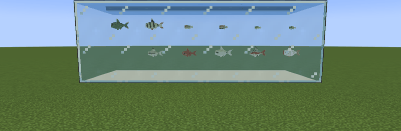

---
navigation:
  title: Puffers
  icon: bettacraft:dwarf_puffer_bucket
  parent: tankmates.md
  position: 97
feature: tankmates.puffers
---

# Puffers

Puffers (Tetraodontidae) are clever, curious hunters with beak-like teeth: the tiny **dwarf puffer** and **red-eye puffer** of
fresh water and the big **green spotted puffer** of brackish water. They crack snails, need snails or hard food for their
teeth, and nip the fins of long-finned fish.

## Species

| Species | °C | Shoal | Betta tank | Breeding |
|---|---|---|---|---|
| <ItemImage id="bettacraft:dwarf_puffer_bucket" /> [Dwarf Puffer](dwarf_puffer.md) | 22–29 | – | no (nips fins) | Scatters its eggs (fine plants, spawning mop) |
| <ItemImage id="bettacraft:red_eye_puffer_bucket" /> [Red-Eye Puffer](red_eye_puffer.md) | 23–29 | – | no (nips fins) | Scatters its eggs (fine plants, spawning mop) |
| <ItemImage id="bettacraft:green_spotted_puffer_bucket" /> [Green Spotted Puffer](green_spotted_puffer.md) | 24–29 | – | too big | Does not breed in a tank |

## Snails and teeth

* Puffers eat the snails in the tank, the bladder and ramshorn snails first (`tankmates.behaviour.pufferSnailsPerDay`): the
  natural cure for a snail plague. A small snail tank next to the puffer tank keeps them fed.
* Their teeth grow all the time. Without snails or **[shell food](../food/food_variety.md)** for 8 days
  (`tankmates.behaviour.pufferTeethDays`) they have overgrown: the menu says so, the puffer is stressed and refuses all soft
  food - it starves unless it gets a snail or shell food. Either wears the teeth down at once.
* Shell food is hard food from the [food maker](../food/food_maker.md); puffers like it, frozen and live food, and take flakes
  and pellets badly.

## Getting along

* **Fin nippers:** they nip the long fins of bettas, angelfish, gouramis and male guppies (`tankmates.behaviour.finNipping`).
  Keep them alone or as a species group, **without bettas**.
* They hunt fry and shrimplets; the green spotted puffer eats shrimp and small fish too.
* The **green spotted puffer** needs brackish water (5–30 ppt, see [salt water](../saltwater.md)).
