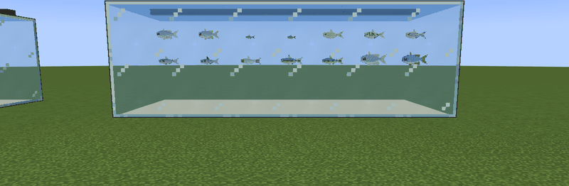

---
navigation:
  title: Rainbowfish
  icon: bettacraft:forktail_rainbow_bucket
  parent: tankmates.md
  position: 48
---

# Rainbowfish

Rainbowfish (Melanotaeniidae and the blue-eyes, Pseudomugilidae) from New Guinea and Australia: peaceful, colourful shoaling fish with two dorsal fins that swim in the open water and spawn a few eggs every day into moss or a spawning mop.

## Species

| Species | °C | Shoal | Betta tank | Breeding |
|---|---|---|---|---|
| <ItemImage id="bettacraft:forktail_rainbow_bucket" /> [Forktail Rainbowfish](forktail_rainbow.md) | 23–28 | 6 | yes | Scatters its eggs (fine plants, spawning mop) |
| <ItemImage id="bettacraft:neon_dwarf_rainbow_bucket" /> [Neon Dwarf Rainbowfish](neon_dwarf_rainbow.md) | 23–28 | 6 | yes | Scatters its eggs (fine plants, spawning mop) |

## Getting along

* The **forktail rainbowfish** fits a betta tank; the **neon dwarf rainbowfish** needs more room.
* The males show their best colours at dawn and when they court the females.
