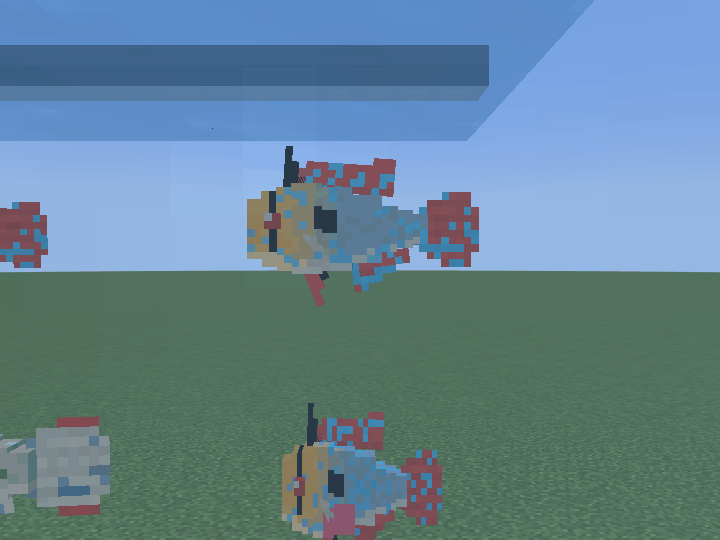
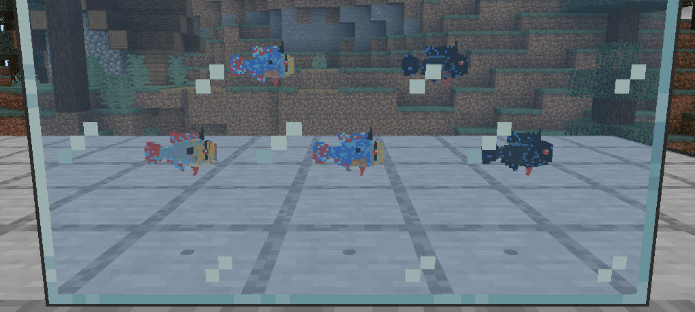

---
navigation:
  title: Ram Cichlid
  icon: bettacraft:ram_cichlid_bucket
  parent: tankmates/cichlids.md
  position: 10
item_ids:
  - bettacraft:ram_cichlid_bucket
  - bettacraft:ram_cichlid_spawn_egg
---

# Ram Cichlid

A small, colourful dwarf cichlid: golden head with a black bar through the eye, a black spot in the middle and blue spangles; the female has a pink belly.

**Origin:** the llanos rivers of the Orinoco basin in Venezuela and Colombia.

## Profile

| | |
|---|---|
| Group | Cichlids |
| Scientific name | *Mikrogeophagus ramirezi* |
| Size in the game | about 5.5 cm (0.45 blocks) |
| Temperature | 25–31 °C |
| Breeding temperature | 27–30 °C |
| Water | fresh water, sensitive |
| Water chemistry | pH 5.0–7.5, TDS 0–300 ppm |
| Shoal | alone or as a pair |
| Swims | in the lower water |
| Stocking | counts as 0.8 fish |
| Breeding | Open brooder: the pair spawns on a stone, leaf or the glass and guards the brood, 20–60 young |
| Betta tank | with care (big tank) |
| Special | guards its brood, territorial, 6 colour varieties |

## Varieties

Varieties: Wild type, Gold, Electric Blue, Black, German Blue, Balloon. **Black** has a velvet-black body with blue
spangles, **German Blue** a stronger blue than the wild form, a red belly and a red eye. The wild type is dominant, the bred varieties are recessive: only two equal alleles show the colour (carriers look wild). Of two different bred varieties the one listed first shows. Wild fish now and then carry a bred variety hidden; the menu shows the genes in a tooltip.

## Breeding

At 27–30 °C a pair forms: the male and the nearest free female clean a **flat stone** (the level top of a stone or slate in the lower half of the water; else a pit in the substrate) and spawn 20–60 eggs there. Both parents stay at the brood, fan the eggs and **drive every other fish away** (bettas too: the intruder flees and takes a bite, config `tankmates.behaviour.broodDefence`). Guarded eggs are safe from the other fish; when both parents are gone, the brood dies.

## Keeping

* Warm and soft: 25–31 °C suits a betta tank; with a betta it is okay if the tank is big enough and has a flat stone of its own (the betta may get bitten near the brood).
* The Balloon is a bred body form (short and round); in the game it sits on the colour locus like the other varieties.
* Of two bred forms the one listed first shows: Gold before Electric Blue, Black, German Blue and Balloon. A Black × German
  Blue pair gives only black young that carry German Blue; their young are a quarter German Blue. Wild-caught rams and the
  wild-type rams of the trader sometimes carry a form hidden; rams of older worlds keep their genes.
* Males are territorial: each needs about 3 water blocks; in a smaller tank the extra males are chased and bitten.

## Obtaining

* **[Aquarium net](../equipment/tank_net.md)** in rivers: 0.49–0.58 % per swing (about 1 in 173–205 swings).
* **[Aquarium net](../equipment/tank_net.md)** in jungle water: 0.13–0.15 % per swing (about 1 in 646–765 swings).
* **Wild** in rivers, alone (spawn weight 3) (config `features.tankmates.cichlids`).
* **Wild** in jungle water, alone (spawn weight 2) (config `features.tankmates.cichlids`).
* **Wandering trader** (usual offers): 2 for 3 emeralds; one of 37 in this offer.
* **[Aquarist villager](../getting_started/aquarist.md)** (Master): 2 for 14 emeralds; one of about 20 in this offer (config `features.tankmates.cichlids`).
* **[Breeding](breeding.md)**: Open brooder: the pair spawns on a stone, leaf or the glass and guards the brood.

The biomes of biome mods count too ([biome tags](../settings.md)).
