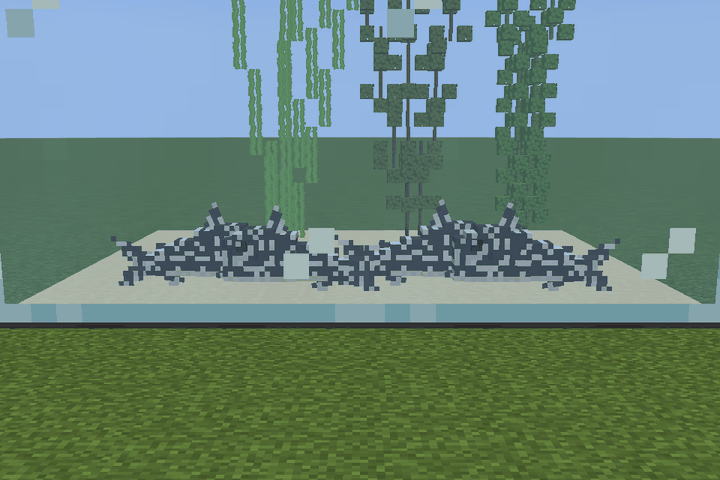

---
navigation:
  title: Sterbai Cory
  icon: bettacraft:sterbai_cory_bucket
  parent: tankmates/corydoras.md
  position: 30
item_ids:
  - bettacraft:sterbai_cory_bucket
  - bettacraft:sterbai_cory_spawn_egg
---

# Sterbai Cory

Dark with white dots and orange pectoral fins; one of the few corys for warm betta tanks.

**Origin:** the Rio Guaporé (Brazil, Bolivia), warm water.

## Profile

| | |
|---|---|
| Group | Corydoras |
| Scientific name | *Corydoras sterbai* |
| Size in the game | about 6 cm (0.5 blocks) |
| Temperature | 24–30 °C |
| Breeding temperature | 24–28 °C |
| Water | fresh water, normal |
| Water chemistry | pH 5.8–8.0, TDS 0–500 ppm |
| Shoal | from 6 fish |
| Swims | on the bottom |
| Stocking | counts as 0.6 fish |
| Breeding | Glues its eggs to the glass (after a cool water change), 12–30 young |
| Betta tank | yes |
| Special | gulps air at the surface, 2 colour varieties |

## Varieties

Varieties: Wild type, Albino. The **Albino** sterbai is cream-white with faint white dots, keeps its orange pectoral fins and has red eyes. The wild type is dominant, the bred forms are recessive: only two equal alleles show the form (carriers look wild). Of two different bred forms the one listed first shows. Wild fish and the wild-type fish of the trader now and then carry a form hidden; the menu shows the genes in a tooltip. Switch: `features.tankmates.tetraCoryForms`.

## Breeding

A cool water change sets them off: at least a quarter of the water fresh, cooling the tank by 1.5 °C. The female glues 12–30 eggs to the glass, the decoration and leaves. The other fish like to eat them: take them out with the net into a fish bag and raise them in a tank without adults.

## Keeping

* Bottom fish: gets only part of the sinking food while faster fish are around - algae wafers go straight to it.
* Darts up to the surface for a gulp of air now and then.

## Obtaining

* **[Aquarium net](../equipment/tank_net.md)** in jungle water: 0.61–0.72 % per swing (about 1 in 138–164 swings), 1–4 at a time.
* **Wild** in jungle water, in groups of 3–6 (spawn weight 7) (config `features.tankmates.wildSpawns`).
* **Wandering trader** (usual offers): 6 for 5 emeralds; one of 37 in this offer.
* **[Aquarist villager](../getting_started/aquarist.md)** (Master): 2 for 14 emeralds; one of about 20 in this offer (config `features.tankmates.wildSpawns`).
* **[Breeding](breeding.md)**: Glues its eggs to the glass (after a cool water change).

The biomes of biome mods count too ([biome tags](../settings.md)).
