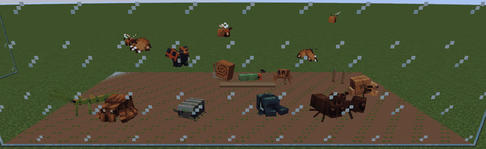
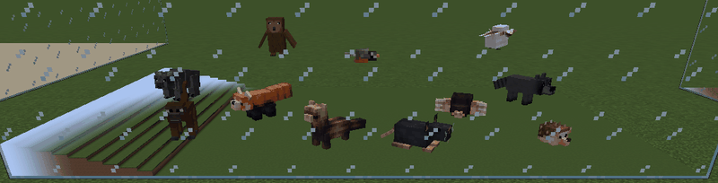

---
navigation:
  title: Land animals of other mods
  icon: bettacraft:terrarium_box
  parent: terrarium.md
  position: 75
feature: foreignAnimals.terrarium
---

# Land animals of other mods

Land and marsh animals of other mods can live in our terraria and paludaria when they have a **terrarium profile**
([profiles for animals of other mods](../settings/foreign_profiles.md)). Bettacraft brings profiles for:

| Animal | Mod | Tank | Size rule |
|---|---|---|---|
| [Tortoise](naturalist_tortoise.md) | Naturalist | dry terrarium | 1 m: 12 × 6 × 3 blocks, 100 blocks of land |
| [Alligator](naturalist_alligator.md) | Naturalist | big paludarium | 2 m: 24 × 12 × 6 blocks, 800 blocks of tank |
| Lizard (bearded dragon, leopard gecko, green, brown) | Naturalist | dry terrarium, basking spot, UV | its hitbox |
| Snake (green snake, coral snake, rattlesnake) | Naturalist | dry terrarium, basking spot | its hitbox |
| Desert scorpion | Naturalist | dry terrarium, dry air (10 to 40 %) | its hitbox |
| Jungle scorpion | Naturalist | dry terrarium, humid air (60 to 90 %) | 0.2 m: 3 × 2 × 1 blocks |
| Snail | Naturalist | dry terrarium, humid air (70 to 100 %), cool | its hitbox |
| Crab | Naturalist | paludarium, fresh or sea water | its hitbox |
| Dragonfly | Naturalist, Critters and Companions | paludarium, flies (**lid**) | 0.1 m (for its wide wings) |
| Duck | Naturalist | big paludarium | 0.6 m: 8 × 4 × 2 blocks, 22 blocks of tank |
| Capybara | Naturalist | big paludarium | 1.2 m: 15 × 8 × 4 blocks, 173 blocks of tank |
| Leaf insect | Critters and Companions | dry terrarium, humid air (60 to 90 %) | its hitbox |
| Otter | Critters and Companions | big paludarium, cool water | 1 m: 12 × 6 × 3 blocks, 100 blocks of tank |

With a profile an animal gets:

* **Its tank:** a dry terrarium, a paludarium or either, with its air, humidity, UV and basking spot like our
  [terrarium animals](../terrarium.md). A big one has a length and goes by the [size rule of the big animals](../big_tanks.md),
  measured over the **land** (a tortoise), the **water** or the **whole tank** (an alligator, at home in both).
* **Our care:** it gets hungry, eats its food by hand on the tank and from the [feeder](../equipment/feeder.md) (greens and
  raw meat too), minds its climate, falls sick and dies without care.
* **Our walker:** in its tank it walks on the land of the interior, swims in the water and goes to the basking spot, instead
  of the AI of its mod (which cannot see the land of the miniature).
* **Our breeding:** a fed pair breeds now and then; an egg layer lays its eggs into sand or soil on the land, and the nest
  temperature hatches them (warmer faster). Its own breeding is suppressed in the tank.
* **The terrarium box:** an empty <ItemLink id="bettacraft:terrarium_box" /> catches it (right-click the animal), a full one
  puts it into a tank or lets it go. Animals too big for a box (the alligator) go with the [large net](../big_tanks/large_net.md)
  into a [transport tub](../big_tanks/transport_tub.md). Animals without a profile are refused, unless the server lists them
  in `terrarium.boxAllow` (they then live in terraria and paludaria without our care). A tame animal goes into the box
  only for its owner.

## The other animals

| Animal | Food (by hand and from the feeder) | Breeding | In the tank |
|---|---|---|---|
| Lizard | crickets, greens, daily | eggs into sand or soil (29 °C) | walks, basks |
| Snake | prey (raw rabbit, chicken), every 5 days | eggs into sand or soil (29 °C) | slithers, basks |
| Scorpions | crickets, every 3 days | live young | walks slowly, hides buried in the ground |
| Snail | greens, carrots, beetroot | eggs into sand or soil (22 °C) | creeps, climbs the glass |
| Crab | pellets, raw fish | none (its larvae need the sea) | walks on the land and the bottom of the water |
| Dragonfly | fruit flies, daily | none (its larvae live for years in the water) | flies over the water and the land, rests on the land |
| Duck | pellets, seeds, greens, raw fish | eggs into sand or soil (26 °C) | swims on the surface, walks on the land |
| Capybara | greens, melon, sugar cane | live young | grazes, swims |
| Leaf insect | leaves | eggs into sand or soil (25 °C) | sits still, climbs the glass |
| Otter | raw fish, clams | live young | swims fast, **hunts small fish** (up to 0.4 blocks) |

* The **scorpions** are hostile at night in the world; in a tank our walker moves them and they attack nobody (like the
  [mobs in glass](mobs_in_glass.md)). Catch one by day.
* The **dragonfly** flies (our walker has a flying style for it): straight through the air of the tank, never into the land,
  the water or the decoration, now and then just over the water, and it rests on the land.
* The **capybara** goes with the [large net](../big_tanks/large_net.md) into a [transport tub](../big_tanks/transport_tub.md);
  the others go into the terrarium box.
* The **sea bunny** of Critters and Companions has an aquarium profile: a sea water aquarium (18 to 28 °C, pellets), no breeding.

## Insects, small animals, mammals and birds

Bettacraft also brings profiles for the insects and crawlers, the mammals and the birds of Naturalist, Critters and Companions
and Living Things: every one that fits a tank by its size. The [list of the animals of other mods](../settings/foreign_animal_list.md)
names each with its tank, length and food.

| Group | Animals | Tank | Breeding |
|---|---|---|---|
| Insects | caterpillar, butterfly, firefly, ant (Naturalist); stag beetle, stick bug, ladybug, acorn weevil (Critters and Companions) | dry terrarium (the firefly a paludarium too) | none (their own life is left to their mod) |
| Spiders | jumping spider (Critters and Companions) | dry terrarium | none |
| Clean-up crew | roly-poly, snail (Critters and Companions), snail (Living Things) | humid dry terrarium | woodlice live young, snails eggs into sand or soil |
| Small mammals | hedgehog, mole, rat (Naturalist); ferret, red panda (Critters and Companions); koala, monkey, raccoon (Living Things) | dry terrarium (the raccoon a paludarium too) | live young, a female and a male |
| Birds | bird (Naturalist), shima enaga (Critters and Companions), owl (Living Things) | dry terrarium with a **lid** | eggs, a female and a male |
| Ground birds | turkey (Naturalist), peacock (Living Things) | big dry terrarium with a **lid** (they flutter up) | eggs into sand or soil |
| Penguin and flamingo | Living Things | big paludarium: the penguin cold (−10 to 12 °C) and hunting small fish, the flamingo warm, eating live food | eggs into sand or soil |
| Komodo dragon | Naturalist | big dry terrarium, basking spot, UV (2.5 m: 30 × 15 × 8 blocks) | none in a tank |
| Big mammals | bear, black bear, boar, deer, zebra, lion, tiger, ostrich, vulture (Naturalist); lion, ostrich (Living Things) | big dry terrarium by their length (1.4 to 2.4 m) | none in a tank |

* **A lid for the fliers.** Butterflies, fireflies, ladybugs, dragonflies and the birds need a closed top: every top block of
  the tank covered with a <ItemLink id="bettacraft:tank_lid" />, a light or a feeder. With an open top our tanks refuse them,
  and one whose lid is taken off flies out of the tank within an hour or so (it is let go alive into the world above the tank).
* **The clean-up crew.** Woodlice and snails eat the leftovers of the food (the portions nobody needed do not rot) and live
  from the waste of the other animals: as long as another animal of the tank eats, they need no food of their own.
* **Fireflies** glow at night in their tank, flashing every few seconds, and the daylight through the glass does not drive them
  away (in the world they hide from the sun).
* **The caterpillar** turns into a butterfly only by its own way in Naturalist: it needs a real log beside it in the world.
  The land of a tank is its interior in miniature, so in our tanks it stays a caterpillar (Bettacraft does not suppress it).
* **Big ones** (1.2 m and more) go with the [large net](../big_tanks/large_net.md) into a [transport tub](../big_tanks/transport_tub.md),
  the others into the terrarium box. A full tub lets a land animal go on the ground, a water animal into water. The big ones
  do not breed in a tank (the young would outgrow it), like the big fish.
* **Too big** are the elephant, the mammoth, the giraffe, the hippo and the rhino (Naturalist, Living Things); the nether knight
  and the ancient blaze of Living Things are hostile and the baby ender dragon no animal for a tank: all of them are refused
  with the reason.

## Fish in the water part of a paludarium

Our fish, the fish of other mods with a profile and the water animals the inhabitant rules admit also live in the
**water part** of a paludarium. There the water part decides, not the fill of the whole tank (a paludarium has its water in a
third or a half of its height): the water must be deep enough for the fish (half a block, a tall fish its height and a little
more), and the stocking and the size rule of the big fish measure the water part. A fish comes in over the open water, and it
stays there: our fish keep out of the land by themselves, a fish of another mod that swims into the land is put back into the
water.

## Eggs and the mother

A mother that leaves her tank (box, tub, menu) takes her laid clutch along: the eggs vanish from the nest and she lays them
again, as far as they were, in her next tank (it needs sand or soil). A mother that dies in her tank loses her eggs.

Switch: `features.foreignAnimals.terrarium` (off: none of them go into tanks and the box takes none; those in tanks stay).
