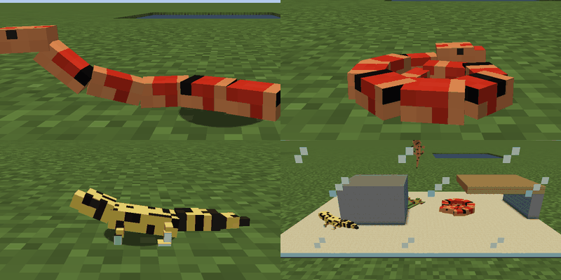
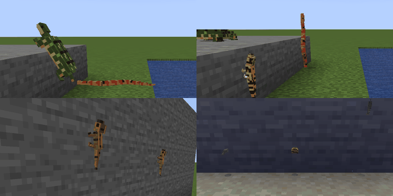

---
navigation:
  title: Amphibians and reptiles
  icon: bettacraft:dart_frog_spawn_egg
  parent: terrarium.md
  position: 60
item_ids:
  - bettacraft:frog_eggs
---

# Amphibians and reptiles

Besides the turtles, five more terrarium animals live in the tanks: two frogs, two geckos and a snake. They need the
same climate values as the turtles (air, humidity, UV, basking spot, land) but move in their own ways: the frogs
**hop**, the horned frog **sits buried** in the ground, the crested gecko **climbs the glass** and the corn snake
**slithers**. All of them travel in a [terrarium box](../terrarium.md) (right-click the animal with an empty
<ItemLink id="bettacraft:terrarium_box" />).

| Animal | Tank | Air, humidity | Food | Breeding |
|---|---|---|---|---|
| [Poison dart frogs](dart_frog.md) (three species) | paludarium, mostly land | 21-28 °C, 75-100 % | fruit flies | eggs on moss, leaves or soil; tadpoles in the water |
| [Cranwell's horned frog](horned_frog.md) | moist terrarium | 23-30 °C, 60-95 % | crickets | none in the tank |
| [Leopard gecko](leopard_gecko.md) | dry terrarium, basking spot | 24-33 °C, 20-55 % | crickets | two eggs, sex by temperature |
| [Crested gecko](crested_gecko.md) | terrarium with height | 19-27 °C, 55-95 % | fruit, crickets, fruit flies | two eggs |
| [Corn snake](corn_snake.md) | dry terrarium, basking spot, 8 blocks | 21-31 °C, 35-70 % | a prey animal a week | eggs; brumates in the cold |

Their food: [feeder insects](feeder_insects.md) (crickets and fruit flies from cultures), soft fruit for the crested gecko
and raw rabbit or chicken for the snake.

## How they move

They live like the real animals, in the world as in the tank (switch `features.visuals.livelyMovement`):

* **Their own hours.** Outside them they rest more and longer, and the ones that hide go **under cover**: into a cave or
  under an overhang of the decoration in a tank, under leaves or a roof in the world.
* **A calm pace with short fast phases:** the snake shoots forward, the lizards sprint off, the frogs hop in quick series.
* **The furnishing:** the snake and the geckos **climb** onto rocks, roots and branches of the decoration (faces up to
  almost a block high), the dart frogs sit up on **leaves** and plants, and the turtles and lizards bask under the
  [basking lamp](basking_lamp.md).
* **While they sit still** they do something: the corn snake **raises its head** and **flicks its tongue** (now and then
  also while it crawls) and lies **coiled** while it rests; lizards look around, stretch up and wave the tip of the tail;
  frogs look around and **call** (the throat pumps); turtles look around and stretch their necks.

| Animal | Active | Pace | Climbs, hides |
|---|---|---|---|
| Corn snake | dusk, dawn, night | calm, shoots forward | climbs rocks and branches, hides by day |
| Leopard gecko | night | deliberate, sprints | low rocks, hides by day |
| Crested gecko | night | slow, jumpy | the glass, branches and leaves |
| Dart frogs | day | quick hops | sit on leaves, under the leaves at night |
| Horned frog | night | sits buried, lunges | buried in the ground |
| Turtles | day (the musk turtle at night) | slow, faster in the water | hide in caves, bask |

In the world they also bask in the sun on bright days and the small and shy ones run from a player who comes close.
With the switch off they move as before (1.43). The same switch makes **fish** dart off now and then and rest more at night,
and lets **crayfish** stay in their hides by day.

**Climbing in the world** (switch `features.visuals.worldClimbing`): the turtles, the leopard gecko and the corn snake climb
up a one-block step instead of jumping (a turtle scrambles up with its front raised, the lizards and the snake lie flat on the
face), the **crested gecko** climbs whole walls (trunks, cliffs, house walls) to the top and over, now and then only part of
the way to hold on there for a while and come down again, and the **mudskipper** climbs roots and trunks (logs, mangrove
roots) the same way. The frogs still hop up.

## Breeding

A grown, fed female (two days), without a harmful problem and with little stress, and a grown male of the same species
lay eggs on the land like the turtles ([turtle breeding](turtle_breeding.md)): the female walks to a nest spot and lays
there.

* **Dart frogs** lay a small clutch of jelly with dark embryos (3-6 eggs) onto **moss, leaves or soil**
  (`#bettacraft:frog_nest_ground`). Only frogs of the **same species** mate (the three species do not cross). The young
  hatch as **tadpoles** and go straight into the water (a paludarium without water: they die). A tadpole swims, eats
  pellets or fry food and turns into a froglet at 40 % of its growth; then it climbs out onto the land.
* **Geckos** lay two eggs into sand or soil. The **leopard gecko** has temperature-dependent sex determination with
  females at both ends: cool nests (26-29 °C) give **females**, about 32-33 °C mostly **males**, very hot nests (from
  35 °C) females again. The crested gecko's sex is genetic (half and half).
* The **corn snake** lays 4-8 eggs into sand or soil; its sex is genetic.
* The **horned frog** does not breed in a tank: in captivity it only spawns after a simulated rainy season and with
  hormones.

The eggs develop by the warmth of the ground ([heat mats](heat_mat.md)); the climate tab shows them. Morphs: now and
then a hatchling of the leopard gecko, the crested gecko or the corn snake shows a captive morph of its own (4 %; the log
names it). Stocking limits count every young like the turtles' hatchlings.

## Wild

| Animal | Where |
|---|---|
| Dart frogs, crested gecko | on the floor of jungles |
| Horned frog | savannas and dry shrublands, rarely swamps |
| Leopard gecko | deserts and badlands (`#bettacraft:arid_lands`) |
| Corn snake | forests and plains (`#bettacraft:snake_lands`) |

They spawn on soil, sand or terracotta in daylight (also under the jungle's leaves, not in caves), at most two of a kind
nearby; the wild ones are the wild type (the morphs are bred). Switch: `features.terrariums.wildHerps`.

## Settings

Common config: `features.terrariums.herps` (off: none go into tanks), `features.terrariums.herpBreeding`, `features.terrariums.wildHerps`. The
incubation speed, the days between clutches and the brumation are the turtles' (`terrarium.*`).
