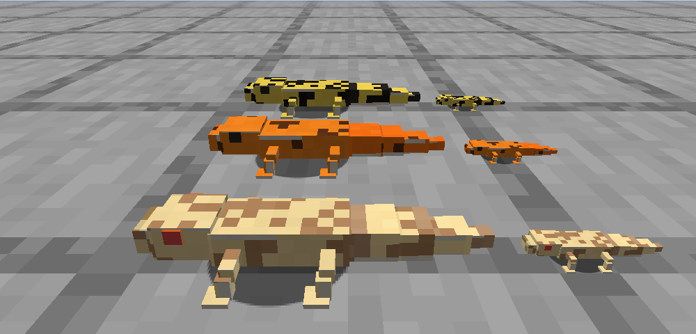

---
navigation:
  title: Leopard gecko
  icon: bettacraft:leopard_gecko_box
  parent: terrarium/herps.md
  position: 63
item_ids:
  - bettacraft:leopard_gecko_box
  - bettacraft:leopard_gecko_spawn_egg
---

# Leopard gecko

The leopard gecko (*Eublepharis macularius*, about 22 cm) lives in the rocky semi-desert of Pakistan and Afghanistan: a
yellow, black-spotted ground gecko with a fat tail (its fat store) and eyelids. It cannot climb glass.

## Care

| | |
|---|---|
| Tank | a dry [terrarium](../terrarium.md) (90 % land or more) with sand or soil |
| Air | 24 to 33 °C; humidity 20 to 55 % |
| Basking spot | needs a warm spot: a [basking lamp](basking_lamp.md) (UV is not needed); [heat mats](heat_mat.md) warm the ground |
| Food | [crickets](feeder_insects.md) |
| Stocking | 2 bettas |

* By day it hides under the decoration and among grown [terrarium plants](plants.md) (`features.terrariumPlants.hiding`).

## Breeding

A pair lays **two eggs** into sand or soil. The **nest temperature decides the sex** (pattern FMF): 26-29 °C gives
females, about 32-33 °C mostly males, from 35 °C females again. Set the target temperature of the heat mats under the
tank. Morphs: **tangerine** (orange, few spots) and **albino** (pale, red eyes) appear now and then in a clutch and pass
on to the young; wild geckos are always the normal yellow ones.

## Obtaining

* <ItemLink id="bettacraft:leopard_gecko_box" />: **Wild** in deserts and badlands, alone (spawn weight 4) (config `features.terrariums.wildHerps`).
