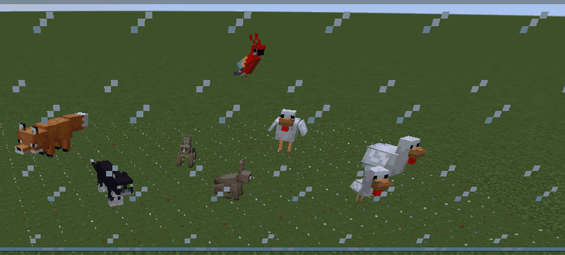
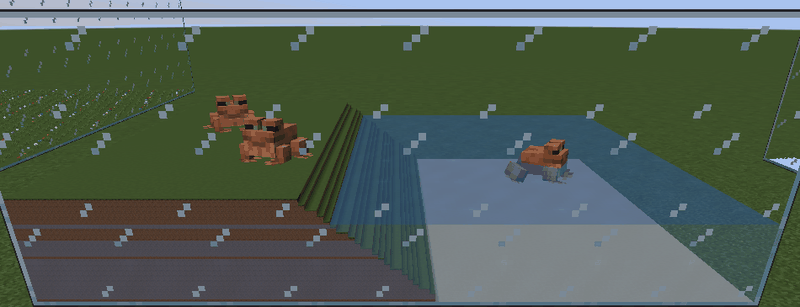

---
navigation:
  title: Minecraft animals as pets
  icon: minecraft:carrot
  parent: terrarium.md
  position: 72
feature: foreignAnimals.vanillaPets
---

# Minecraft animals as pets

The peaceful animals of Minecraft live in our terraria and paludaria too, **at their real size**: a chicken in a small
dry terrarium, a frog in a paludarium, a cow in a big terrarium by the size rule of the big animals. In the tank our walker
moves them (their own AI would walk into the glass), our care feeds them and our breeding breeds them, as the land animals
of other mods ([Land animals of other mods](foreign_land_animals.md)).

## Which animals

| Animal | Tank | Needs | Breeding |
|---|---|---|---|
| Chicken | dry terrarium with a lid (it flutters) | seeds, wheat, insects | the hen lays eggs into sand or soil, chicks hatch |
| Rabbit | dry terrarium | **grass** on the land (it grazes there); carrots, dandelions | young (2-6) |
| Bee | dry terrarium with a lid | **flowers** (its nectar) and a **beehive** in the interior | young bees from the hive |
| Frog | paludarium (it needs water) | feeder insects, slime balls | young frogs |
| Cat, ocelot | dry terrarium | raw fish | kittens |
| Fox | dry terrarium | sweet berries, raw chicken and rabbit | cubs |
| Parrot | dry terrarium with a lid | seeds, fruit | eggs |
| Armadillo | dry, warm terrarium | spider eyes, insects; digs in | four young at a time |
| Bat | humid terrarium with a lid | insects, fruit | one young |
| Wolf (1 m) | dry terrarium of 12 × 6 × 3 or more | meat | pups |

**Big ones** by the size rule (their length in metres; catch them with the large net and the transport tub, the box is too
small from 1.2 m): pig (1.2 m), goat (1.2 m), sheep (1.3 m) still breed; cow and mooshroom (2 m), horse (2.2 m), donkey and
mule (1.9 m), llama (2 m), panda (1.6 m) and polar bear (2.2 m, cold) are too big to breed in a tank. Sheep, goats, cows,
horses, donkeys, mules and llamas graze: they need grass on the land.

**Refused** with a reason: the camel and the sniffer (far too big), the strider (it lives on lava) and the skeleton and
zombie horses (undead). Fish, squids, axolotls, dolphins, turtles and tadpoles have had their own care for a long time.

## Their needs

* **Grass**: a grass block as the ground, or grass and ferns on it, in at least a tenth of the land of the interior.
* **Flowers**: at least three flowers on the land.
* **A beehive**: a beehive or a bee nest in the interior: there it is a mini hive, a sixteenth of the tank block.

A missing need is a problem in the menu and the tank log, and the animal does not breed. A grazer (rabbit, sheep, bee ...)
is fed by its grass or flowers while they are there; otherwise feed it by hand or from the feeder.

## Catching

* The **terrarium box** catches the small ones (right-click; a tame one only for its owner), the **large net** and the
  **transport tub** the big ones.
* **Bait**: right-click a tank with an **open top** with their food when no animal in it eats it: for a day, a pet of that
  kind within 12 blocks walks to the tank and goes in when the top is within a jump. Not for the fliers (they need a lid) and
  not for the big ones.

## No farm

Like the [mobs in glass](mobs_in_glass.md), a Minecraft animal that lived in one of our tanks (or was born there) drops
nothing and gives no experience when it dies, whatever kills it. Shears, buckets, bowls and brushes do nothing on it, and a
chicken lays no eggs in its tank. Only our breeding brings young.

## Settings

The switch `features.foreignAnimals.vanillaPets` (in the common config) turns it off: then no Minecraft animal goes into a
tank, the box takes none, and the refusals above are off too; animals already in tanks stay. The profiles are the files
`data/bettacraft/bettacraft/foreign_animals/minecraft_*.json`; a datapack can change them like every
[profile](../settings/foreign_profiles.md), with the keys `needs` and `grazes`.
