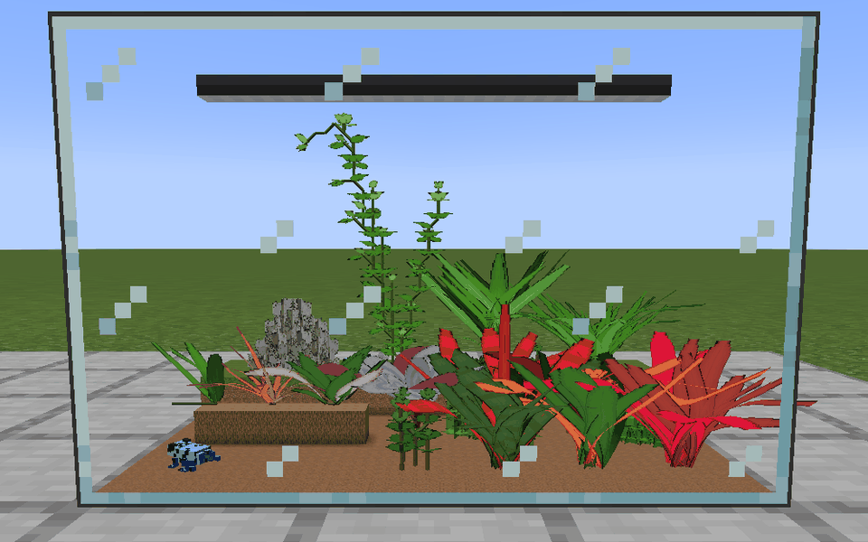

---
navigation:
  title: Terrarium plants
  icon: bettacraft:neoregelia
  parent: terrarium.md
  position: 45
feature: terrariumPlants.enabled
---

# Terrarium plants

Terrarium plants grow on the **land** of a [terrarium or paludarium](../terrarium.md): plant a cutting in the
[interior](../interior.md) on soil, sand or gravel (the air plant and the orchid also on stone or wood, the mosses on any
solid block), above the water line. Like the [aquarium plants](../plants.md) they grow from a cutting into a plant of many
blocks, also while nobody is inside.

* [Tropical and humid](plants_tropical.md): bromeliads, ferns, mosses, orchids, begonias.
* [Swamp and shore](plants_swamp.md): carnivorous plants, sedges, rushes, papyrus.
* [Dry and hot](plants_dry.md): cacti and succulents, the grasses of the savanna.

## Climate

Every species wants its **light**, **humidity** and **air temperature** (its tooltip and its page say which; the
[thermo-hygrometer](thermo_hygrometer.md) and the tank menu show what the tank has). The light comes from the tank light,
the sky through an open top and the [basking lamp](basking_lamp.md).

* In a good climate it grows, spreads and keeps the air **humid** (the land it covers raises the humidity of the tank;
  cacti and succulents hardly, they keep their water).
* In a bad one it **languishes**: it loses a stage every few days down to its first. Under water a terrarium plant
  languishes too. The plants tab of the tank menu counts the languishing ones.
* **Aquarium plants** above the water of a humid paludarium (from about 55 % humidity, fully from 75 %) grow in their
  **emersed form**, at half speed.

## Propagation

* **Cuttings**: shears on a grown plant (inside, or from outside on the tank where you look).
* **Offsets**: the cacti, succulents, bromeliads and the air plant: the shears take a small rooted plant off; grown, they
  put out offsets around themselves.
* **Division**: the mosses and the spikemoss: the shears divide the clump (half of it as a plant); breaking a piece of a
  moss divides it too.
* Breaking the root takes the whole plant out (an item that keeps its stage).

## In the world

* Terrarium plants grow **wild**: in jungles, the lush caves, swamps and mangroves, deserts and badlands, savannas
  (biome tags `#bettacraft:*_plant_lands`, so the biomes of biome mods count too; config
  `features.terrariumPlants.wildPlants`). Shears cut a cutting off (an offset, a piece of moss) and the plant grows back;
  silk touch takes the whole plant.
* Any terrarium plant can be **planted in the world** as decoration (use it outside a tank on soil or sand). It does not
  grow there; broken, it gives its plant back.
* A few come from vanilla plants (crafting: cactus, fern, large fern, moss block, dead bush, short grass), others from the
  [wandering trader](../getting_started/sources.md) and the [aquarist](../getting_started/aquarist.md).

## The animals

* **Tortoises** graze the edible plants (prickly pear, stonecrop, the grasses) when they are hungry: a plant loses a stage
  and the tortoise is fed (`features.terrariumPlants.tortoiseGrazing`).
* **Dart frogs** carry their tadpoles into the cups of half-grown bromeliads, one per bromeliad: there they need no open
  water and no food and leave as froglets (`features.terrariumPlants.bromeliadTadpoles`).
* **Snakes and geckos** hide among the grown plants (`features.terrariumPlants.hiding`).

## All terrarium plants

| | Plant | Light | Humidity | °C | Shears |
|---|---|---|---|---|---|
| <ItemImage id="bettacraft:neoregelia" /> | [Neoregelia (Blushing Bromeliad)](plants/neoregelia.md) | medium | 65–100 % | 20–30 | offsets |
| <ItemImage id="bettacraft:guzmania" /> | [Guzmania](plants/guzmania.md) | medium | 65–100 % | 20–30 | offsets |
| <ItemImage id="bettacraft:vriesea" /> | [Vriesea (Flaming Sword)](plants/vriesea.md) | medium | 65–100 % | 20–30 | offsets |
| <ItemImage id="bettacraft:tillandsia" /> | [Tillandsia (Air Plant)](plants/tillandsia.md) | strong | 45–100 % | 20–30 | offsets |
| <ItemImage id="bettacraft:fittonia" /> | [Fittonia (Nerve Plant)](plants/fittonia.md) | low | 65–100 % | 20–30 | cuttings |
| <ItemImage id="bettacraft:pothos" /> | [Pothos](plants/pothos.md) | low | 65–100 % | 20–30 | cuttings |
| <ItemImage id="bettacraft:marcgravia" /> | [Marcgravia (Shingle Plant)](plants/marcgravia.md) | low | 65–100 % | 20–30 | cuttings |
| <ItemImage id="bettacraft:boston_fern" /> | [Boston Fern](plants/boston_fern.md) | low | 65–100 % | 20–30 | cuttings |
| <ItemImage id="bettacraft:birds_nest_fern" /> | [Bird's Nest Fern](plants/birds_nest_fern.md) | low | 65–100 % | 20–30 | cuttings |
| <ItemImage id="bettacraft:cushion_moss" /> | [Cushion Moss](plants/cushion_moss.md) | low | 65–100 % | 20–30 | division |
| <ItemImage id="bettacraft:reindeer_lichen" /> | [Reindeer Lichen](plants/reindeer_lichen.md) | medium | 40–100 % | 10–26 | division |
| <ItemImage id="bettacraft:selaginella" /> | [Selaginella (Spikemoss)](plants/selaginella.md) | low | 65–100 % | 20–30 | division |
| <ItemImage id="bettacraft:mini_orchid" /> | [Miniature Orchid](plants/mini_orchid.md) | medium | 65–100 % | 20–30 | cuttings |
| <ItemImage id="bettacraft:begonia_rex" /> | [Rex Begonia](plants/begonia_rex.md) | low | 65–100 % | 20–30 | cuttings |
| <ItemImage id="bettacraft:peperomia" /> | [Peperomia](plants/peperomia.md) | low | 65–100 % | 20–30 | cuttings |
| <ItemImage id="bettacraft:sundew" /> | [Sundew](plants/sundew.md) | strong | 55–100 % | 15–30 | cuttings |
| <ItemImage id="bettacraft:sarracenia" /> | [Trumpet Pitcher (Sarracenia)](plants/sarracenia.md) | strong | 55–100 % | 10–30 | cuttings |
| <ItemImage id="bettacraft:nepenthes" /> | [Tropical Pitcher Plant (Nepenthes)](plants/nepenthes.md) | medium | 55–100 % | 16–28 | cuttings |
| <ItemImage id="bettacraft:venus_flytrap" /> | [Venus Flytrap](plants/venus_flytrap.md) | strong | 55–100 % | 10–30 | cuttings |
| <ItemImage id="bettacraft:butterwort" /> | [Butterwort](plants/butterwort.md) | medium | 50–100 % | 15–30 | cuttings |
| <ItemImage id="bettacraft:swamp_sedge" /> | [Swamp Sedge](plants/swamp_sedge.md) | medium | 50–100 % | 15–30 | cuttings |
| <ItemImage id="bettacraft:soft_rush" /> | [Soft Rush](plants/soft_rush.md) | medium | 50–100 % | 15–30 | cuttings |
| <ItemImage id="bettacraft:papyrus" /> | [Papyrus](plants/papyrus.md) | strong | 55–100 % | 15–30 | cuttings |
| <ItemImage id="bettacraft:umbrella_sedge" /> | [Umbrella Sedge](plants/umbrella_sedge.md) | medium | 55–100 % | 15–30 | cuttings |
| <ItemImage id="bettacraft:golden_barrel_cactus" /> | [Golden Barrel Cactus](plants/golden_barrel_cactus.md) | strong | 10–55 % | 20–38 | offsets |
| <ItemImage id="bettacraft:column_cactus" /> | [Column Cactus](plants/column_cactus.md) | strong | 10–55 % | 20–38 | offsets |
| <ItemImage id="bettacraft:prickly_pear" /> | [Prickly Pear](plants/prickly_pear.md) | strong | 10–55 % | 20–38 | offsets |
| <ItemImage id="bettacraft:mammillaria" /> | [Mammillaria](plants/mammillaria.md) | strong | 10–55 % | 20–38 | offsets |
| <ItemImage id="bettacraft:echeveria" /> | [Echeveria](plants/echeveria.md) | strong | 10–55 % | 20–38 | offsets |
| <ItemImage id="bettacraft:haworthia" /> | [Zebra Haworthia](plants/haworthia.md) | medium | 10–55 % | 20–38 | offsets |
| <ItemImage id="bettacraft:aloe_vera" /> | [Aloe Vera](plants/aloe_vera.md) | strong | 10–55 % | 20–38 | offsets |
| <ItemImage id="bettacraft:agave" /> | [American Agave](plants/agave.md) | very strong | 10–55 % | 20–38 | offsets |
| <ItemImage id="bettacraft:lithops" /> | [Living Stones (Lithops)](plants/lithops.md) | strong | 10–45 % | 20–38 | offsets |
| <ItemImage id="bettacraft:sedum" /> | [Stonecrop](plants/sedum.md) | strong | 10–55 % | 20–38 | cuttings |
| <ItemImage id="bettacraft:blue_grama" /> | [Blue Grama](plants/blue_grama.md) | strong | 10–70 % | 20–38 | cuttings |
| <ItemImage id="bettacraft:needlegrass" /> | [Needlegrass](plants/needlegrass.md) | strong | 10–70 % | 20–38 | cuttings |
