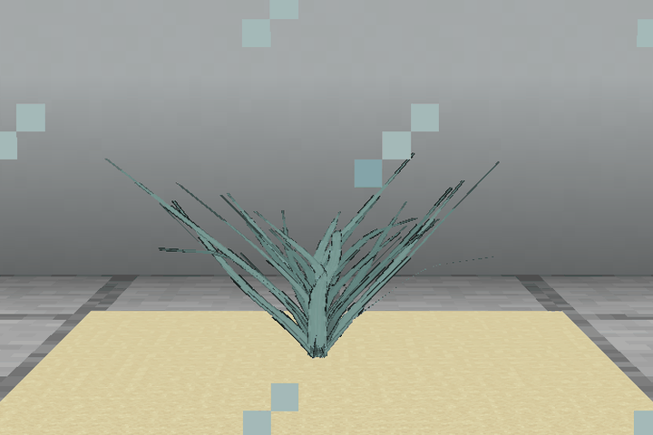

---
navigation:
  title: American Agave
  icon: bettacraft:agave
  parent: terrarium/plants_dry.md
  position: 16
item_ids:
  - bettacraft:agave
feature: terrariumPlants.enabled
---

# American Agave

A large rosette of stiff, blue-grey leaves with a spine at the tip; wants very strong light.

## Profile

| | |
|---|---|
| Habitat | dry and hot (desert terrarium) |
| Growth form | rosette |
| Grows on | soil, sand or gravel on the land (above the water) |
| Light | very strong (an LED panel, a high-power LED or a basking lamp and the sun) |
| Humidity | 10–55 % |
| Air temperature | 20–38 °C |
| Full size | after about 30 days |
| Spreads | offsets around it |
| Shears | an offset (a small rooted plant) |
| Humidity it gives | little (it keeps its water) |
| Hiding place | snakes and geckos hide in it when half grown (config `features.terrariumPlants.hiding`) |

## Obtaining

* **Shears** on a wild plant in deserts and badlands: 100 % per cut (config `features.terrariumPlants.wildPlants`).
* **Shears** on a wild plant in savannas and dry shrublands: 100 % per cut (config `features.terrariumPlants.wildPlants`).
* **Offsets**: shears on a grown plant take an offset (a small rooted plant); it also spreads by itself (offsets around it).

The biomes of biome mods count too ([biome tags](../../settings.md)).
