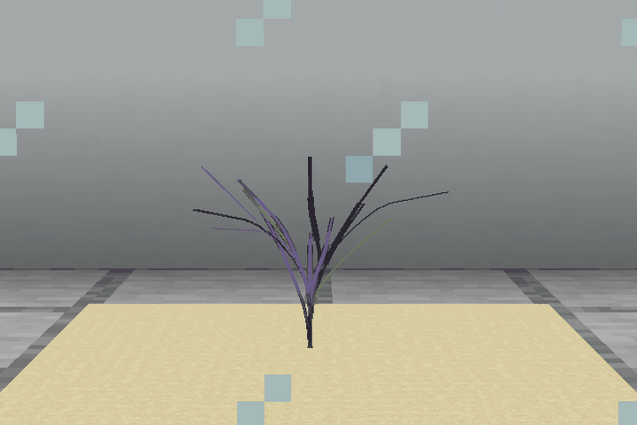

---
navigation:
  title: Blue Grama
  icon: bettacraft:blue_grama
  parent: terrarium/plants_dry.md
  position: 22
item_ids:
  - bettacraft:blue_grama
feature: terrariumPlants.enabled
---

# Blue Grama

A grass of the prairies with curly blades and its seed heads like little flags; spreads by runners. Tortoises graze it.

## Profile

| | |
|---|---|
| Habitat | dry and hot (desert terrarium) |
| Growth form | rosette |
| Grows on | soil, sand or gravel on the land (above the water) |
| Light | strong |
| Humidity | 10–70 % |
| Air temperature | 20–38 °C |
| Full size | after about 5 days |
| Spreads | runners |
| Shears | 1 cutting(s) per trim |
| Humidity it gives | little (it keeps its water) |
| Tortoises | graze it (config `features.terrariumPlants.tortoiseGrazing`) |
| Hiding place | snakes and geckos hide in it when half grown (config `features.terrariumPlants.hiding`) |

## Obtaining

* **Shears** on a wild plant in savannas and dry shrublands: 100 % per cut (config `features.terrariumPlants.wildPlants`).
* **Cuttings**: shears on a grown plant give 1 cutting(s) per trim; it also spreads by itself (runners).

The biomes of biome mods count too ([biome tags](../../settings.md)).
