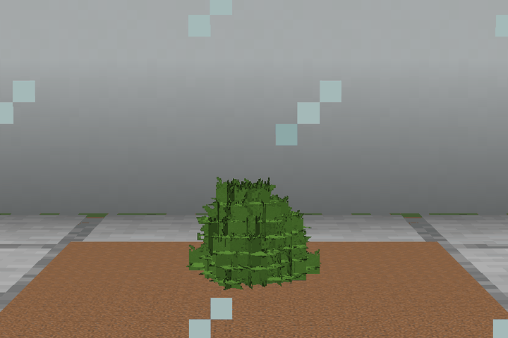

---
navigation:
  title: Cushion Moss
  icon: bettacraft:cushion_moss
  parent: terrarium/plants_tropical.md
  position: 20
item_ids:
  - bettacraft:cushion_moss
feature: terrariumPlants.enabled
---

# Cushion Moss

A pale green moss that grows into round, soft cushions on any surface.

## Profile

| | |
|---|---|
| Habitat | tropical and humid (rainforest terrarium, the land of a paludarium) |
| Growth form | moss |
| Grows on | any solid block |
| Light | low |
| Humidity | 65–100 % |
| Air temperature | 20–30 °C |
| Full size | after about 12 days |
| Spreads | it creeps on |
| Shears | divides the clump (half of it as a plant) |
| Humidity it gives | yes |

## Obtaining

* **Shears** on a wild plant in lush caves: 100 % per cut (config `features.terrariumPlants.wildPlants`).
* **Shears** on a wild plant on the land of swamps and mangroves: 100 % per cut (config `features.terrariumPlants.wildPlants`).
* **Wandering trader** (usual offers): 2 for 2 emeralds; one of 9 in this offer.
* **[Aquarist villager](../../getting_started/aquarist.md)** (Apprentice): 2 for 2 emeralds; one of about 8 in this offer (config `features.sources.aquaristVillager`).
* **Division**: shears divide the clump (half of it as a plant); breaking a piece of it divides it too; it also spreads by itself (it creeps on).

The biomes of biome mods count too ([biome tags](../../settings.md)).

Crafting:

<RecipesFor id="bettacraft:cushion_moss" />
