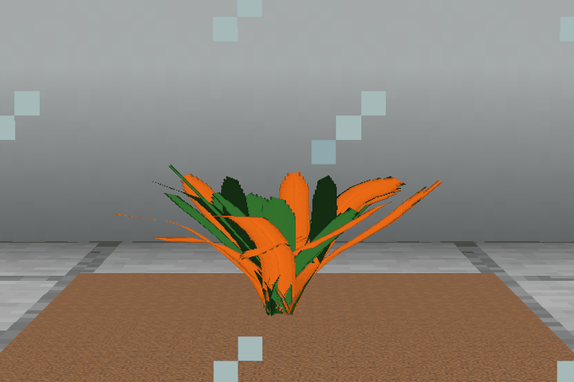

---
navigation:
  title: Guzmania
  icon: bettacraft:guzmania
  parent: terrarium/plants_tropical.md
  position: 4
item_ids:
  - bettacraft:guzmania
feature: terrariumPlants.enabled
---

# Guzmania

A bromeliad with glossy green leaves and a star of orange bracts on a short stalk in its middle. Its cup holds water for the tadpoles of the dart frogs.

## Profile

| | |
|---|---|
| Habitat | tropical and humid (rainforest terrarium, the land of a paludarium) |
| Growth form | rosette |
| Grows on | soil, sand or gravel on the land (above the water) |
| Light | medium |
| Humidity | 65–100 % |
| Air temperature | 20–30 °C |
| Full size | after about 14 days |
| Spreads | offsets around it |
| Shears | an offset (a small rooted plant) |
| Humidity it gives | yes |
| Water cup | takes a dart frog tadpole when half grown (config `features.terrariumPlants.bromeliadTadpoles`) |
| Hiding place | snakes and geckos hide in it when half grown (config `features.terrariumPlants.hiding`) |

## Obtaining

* **Shears** on a wild plant on the floor of jungles: 100 % per cut (config `features.terrariumPlants.wildPlants`).
* **Wandering trader** (usual offers): 2 for 2 emeralds; one of 9 in this offer.
* **Offsets**: shears on a grown plant take an offset (a small rooted plant); it also spreads by itself (offsets around it).

The biomes of biome mods count too ([biome tags](../../settings.md)).
