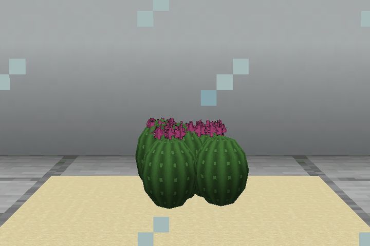

---
navigation:
  title: Mammillaria
  icon: bettacraft:mammillaria
  parent: terrarium/plants_dry.md
  position: 8
item_ids:
  - bettacraft:mammillaria
feature: terrariumPlants.enabled
---

# Mammillaria

A small cactus that grows into a cluster of round heads, each with a ring of pink flowers.

## Profile

| | |
|---|---|
| Habitat | dry and hot (desert terrarium) |
| Growth form | cactus |
| Grows on | soil, sand or gravel on the land (above the water) |
| Light | strong |
| Humidity | 10–55 % |
| Air temperature | 20–38 °C |
| Full size | after about 30 days |
| Spreads | offsets around it |
| Shears | an offset (a small rooted plant) |
| Humidity it gives | little (it keeps its water) |

## Obtaining

* **Shears** on a wild plant in deserts and badlands: 100 % per cut (config `features.terrariumPlants.wildPlants`).
* **Offsets**: shears on a grown plant take an offset (a small rooted plant); it also spreads by itself (offsets around it).

The biomes of biome mods count too ([biome tags](../../settings.md)).
