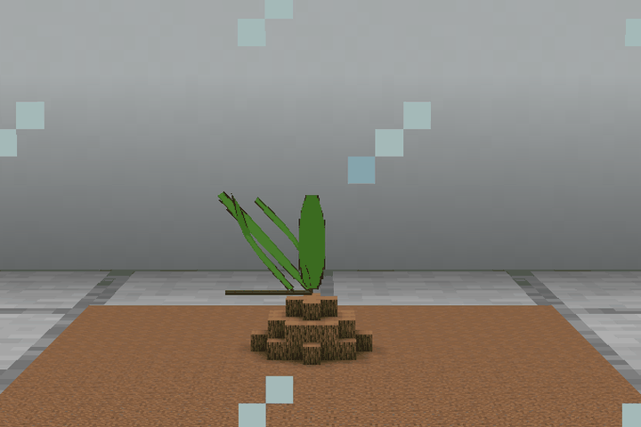

---
navigation:
  title: Marcgravia (Shingle Plant)
  icon: bettacraft:marcgravia
  parent: terrarium/plants_tropical.md
  position: 14
item_ids:
  - bettacraft:marcgravia
feature: terrariumPlants.enabled
---

# Marcgravia (Shingle Plant)

A creeper whose small round leaves lie on stone and wood like shingles.

## Profile

| | |
|---|---|
| Habitat | tropical and humid (rainforest terrarium, the land of a paludarium) |
| Growth form | epiphyte (rhizome) |
| Grows on | stone and wood (also decoration), soil |
| Light | low |
| Humidity | 65–100 % |
| Air temperature | 20–30 °C |
| Full size | after about 18 days |
| Spreads | no |
| Shears | 1 cutting(s) per trim |
| Humidity it gives | yes |

## Obtaining

* **Shears** on a wild plant on the floor of jungles: 100 % per cut (config `features.terrariumPlants.wildPlants`).
* **Cuttings**: shears on a grown plant give 1 cutting(s) per trim.

The biomes of biome mods count too ([biome tags](../../settings.md)).
