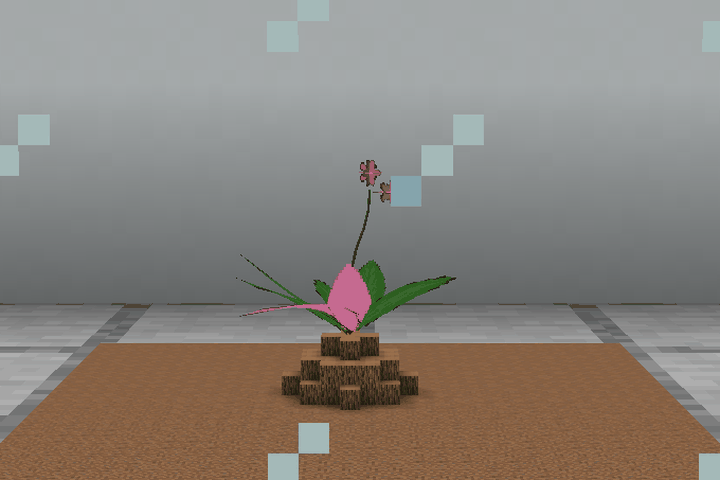

---
navigation:
  title: Miniature Orchid
  icon: bettacraft:mini_orchid
  parent: terrarium/plants_tropical.md
  position: 26
item_ids:
  - bettacraft:mini_orchid
feature: terrariumPlants.enabled
---

# Miniature Orchid

A small orchid that sits on wood or stone, with a few broad leaves and an arching spike of pink flowers.

## Profile

| | |
|---|---|
| Habitat | tropical and humid (rainforest terrarium, the land of a paludarium) |
| Growth form | epiphyte (rhizome) |
| Grows on | stone and wood (also decoration), soil |
| Light | medium |
| Humidity | 65–100 % |
| Air temperature | 20–30 °C |
| Full size | after about 24 days |
| Spreads | no |
| Shears | 1 cutting(s) per trim |
| Humidity it gives | yes |

## Obtaining

* **Shears** on a wild plant on the floor of jungles: 100 % per cut (config `features.terrariumPlants.wildPlants`).
* **Wandering trader** (rare offers): 1 for 4 emeralds; one of 6 in this offer.
* **Cuttings**: shears on a grown plant give 1 cutting(s) per trim.

The biomes of biome mods count too ([biome tags](../../settings.md)).
