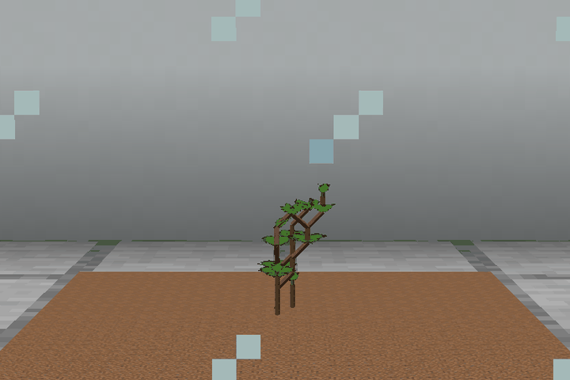

---
navigation:
  title: Peperomia
  icon: bettacraft:peperomia
  parent: terrarium/plants_tropical.md
  position: 30
item_ids:
  - bettacraft:peperomia
feature: terrariumPlants.enabled
---

# Peperomia

A small, bushy plant with round, glossy, fleshy leaves on reddish stems.

## Profile

| | |
|---|---|
| Habitat | tropical and humid (rainforest terrarium, the land of a paludarium) |
| Growth form | stem plant |
| Grows on | soil, sand or gravel on the land (above the water) |
| Light | low |
| Humidity | 65–100 % |
| Air temperature | 20–30 °C |
| Full size | after about 8 days |
| Spreads | side shoots |
| Shears | 3 cutting(s) per trim |
| Humidity it gives | yes |
| Hiding place | snakes and geckos hide in it when half grown (config `features.terrariumPlants.hiding`) |

## Obtaining

* **Shears** on a wild plant on the floor of jungles: 100 % per cut (config `features.terrariumPlants.wildPlants`).
* **Cuttings**: shears on a grown plant give 3 cutting(s) per trim; it also spreads by itself (side shoots).

The biomes of biome mods count too ([biome tags](../../settings.md)).
