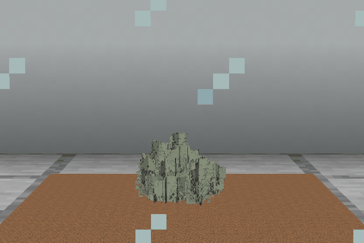

---
navigation:
  title: Reindeer Lichen
  icon: bettacraft:reindeer_lichen
  parent: terrarium/plants_tropical.md
  position: 22
item_ids:
  - bettacraft:reindeer_lichen
feature: terrariumPlants.enabled
---

# Reindeer Lichen

A lichen of pale, finely branched tufts (often sold as "lichen moss"); it dries out without harm and waits for moister days.

## Profile

| | |
|---|---|
| Habitat | tropical and humid (rainforest terrarium, the land of a paludarium) |
| Growth form | moss |
| Grows on | any solid block |
| Light | medium |
| Humidity | 40–100 % |
| Air temperature | 10–26 °C |
| Full size | after about 20 days |
| Spreads | it creeps on |
| Shears | divides the clump (half of it as a plant) |
| Humidity it gives | yes |

## Obtaining

* **Shears** on a wild plant in lush caves: 100 % per cut (config `features.terrariumPlants.wildPlants`).
* **Division**: shears divide the clump (half of it as a plant); breaking a piece of it divides it too; it also spreads by itself (it creeps on).

The biomes of biome mods count too ([biome tags](../../settings.md)).
