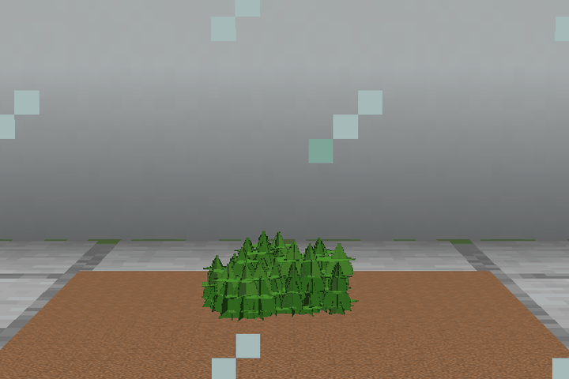

---
navigation:
  title: Selaginella (Spikemoss)
  icon: bettacraft:selaginella
  parent: terrarium/plants_tropical.md
  position: 24
item_ids:
  - bettacraft:selaginella
feature: terrariumPlants.enabled
---

# Selaginella (Spikemoss)

A spikemoss: a low carpet of feathery, fern-like shoots for the floor of a humid terrarium.

## Profile

| | |
|---|---|
| Habitat | tropical and humid (rainforest terrarium, the land of a paludarium) |
| Growth form | carpet |
| Grows on | soil, sand or gravel on the land (above the water) |
| Light | low |
| Humidity | 65–100 % |
| Air temperature | 20–30 °C |
| Full size | after about 6 days |
| Spreads | runners |
| Shears | divides the clump (half of it as a plant) |
| Humidity it gives | yes |

## Obtaining

* **Shears** on a wild plant in lush caves: 100 % per cut (config `features.terrariumPlants.wildPlants`).
* **Division**: shears divide the clump (half of it as a plant); breaking a piece of it divides it too; it also spreads by itself (runners).

The biomes of biome mods count too ([biome tags](../../settings.md)).
