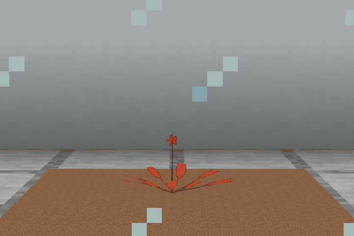

---
navigation:
  title: Sundew
  icon: bettacraft:sundew
  parent: terrarium/plants_swamp.md
  position: 2
item_ids:
  - bettacraft:sundew
feature: terrariumPlants.enabled
---

# Sundew

A small carnivorous plant: round leaves covered in red, glistening tentacles that catch insects; a flower stalk in the middle. Redder in strong light.

## Profile

| | |
|---|---|
| Habitat | swamp and shore (paludarium) |
| Growth form | rosette |
| Grows on | soil, sand or gravel on the land (above the water) |
| Light | strong |
| Humidity | 55–100 % |
| Air temperature | 15–30 °C |
| Full size | after about 8 days |
| Spreads | no |
| Shears | 1 cutting(s) per trim |
| Colour | redder in strong light |
| Humidity it gives | yes |

## Obtaining

* **Shears** on a wild plant on the land of swamps and mangroves: 100 % per cut (config `features.terrariumPlants.wildPlants`).
* **Wandering trader** (usual offers): 2 for 2 emeralds; one of 9 in this offer.
* **Cuttings**: shears on a grown plant give 1 cutting(s) per trim.

The biomes of biome mods count too ([biome tags](../../settings.md)).
