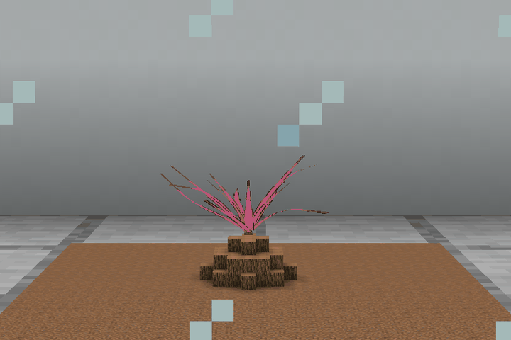

---
navigation:
  title: Tillandsia (Air Plant)
  icon: bettacraft:tillandsia
  parent: terrarium/plants_tropical.md
  position: 8
item_ids:
  - bettacraft:tillandsia
feature: terrariumPlants.enabled
---

# Tillandsia (Air Plant)

A small, silvery air plant that sits on wood or stone without soil and takes its water from the air; it blushes red in strong light.

## Profile

| | |
|---|---|
| Habitat | tropical and humid (rainforest terrarium, the land of a paludarium) |
| Growth form | epiphyte (rhizome) |
| Grows on | stone and wood (also decoration), soil |
| Light | strong |
| Humidity | 45–100 % |
| Air temperature | 20–30 °C |
| Full size | after about 10 days |
| Spreads | offsets around it |
| Shears | an offset (a small rooted plant) |
| Colour | redder in strong light |
| Humidity it gives | yes |

## Obtaining

* **Shears** on a wild plant on the floor of jungles: 100 % per cut (config `features.terrariumPlants.wildPlants`).
* **Wandering trader** (usual offers): 2 for 2 emeralds; one of 9 in this offer.
* **Offsets**: shears on a grown plant take an offset (a small rooted plant); it also spreads by itself (offsets around it).

The biomes of biome mods count too ([biome tags](../../settings.md)).
