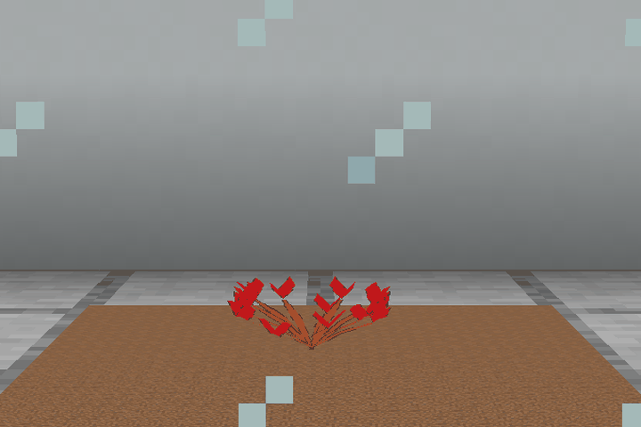

---
navigation:
  title: Venus Flytrap
  icon: bettacraft:venus_flytrap
  parent: terrarium/plants_swamp.md
  position: 8
item_ids:
  - bettacraft:venus_flytrap
feature: terrariumPlants.enabled
---

# Venus Flytrap

The famous trap: at the end of every leaf two lobes with teeth, red inside, that snap shut. Wants strong light and tolerates cool air.

## Profile

| | |
|---|---|
| Habitat | swamp and shore (paludarium) |
| Growth form | rosette |
| Grows on | soil, sand or gravel on the land (above the water) |
| Light | strong |
| Humidity | 55–100 % |
| Air temperature | 10–30 °C |
| Full size | after about 10 days |
| Spreads | no |
| Shears | 1 cutting(s) per trim |
| Colour | redder in strong light |
| Humidity it gives | yes |

## Obtaining

* **Shears** on a wild plant on the land of swamps and mangroves: 100 % per cut (config `features.terrariumPlants.wildPlants`).
* **Wandering trader** (rare offers): 1 for 4 emeralds; one of 6 in this offer.
* **Cuttings**: shears on a grown plant give 1 cutting(s) per trim.

The biomes of biome mods count too ([biome tags](../../settings.md)).
