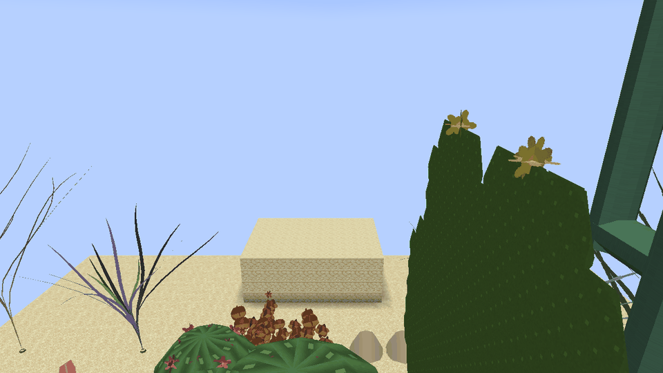

---
navigation:
  title: Dry and hot
  icon: bettacraft:golden_barrel_cactus
  parent: terrarium/plants.md
  position: 30
feature: terrariumPlants.enabled
---

# Dry and hot

The plants of the desert terrarium: the golden barrel, the column cactus, the prickly pear, the Mammillaria, Echeveria, Haworthia,
aloe, agave, the living stones, stonecrop and the grasses of the savanna. They want **dry air** (up to about 55 %; above that they
rot), **heat** (20-38 °C) and **strong light**: a basking lamp counts as strong light for them, an LED panel or the sun even more.

* Cacti and succulents grow **offsets**: take them off with the shears, and they put out new ones around themselves.
* They keep their water: a desert terrarium full of cacti stays dry.
* [Hermann's tortoise](hermann_tortoise.md) grazes the prickly pear, stonecrop and the grasses.

## Species

| | Plant | Light | Humidity | °C | Shears |
|---|---|---|---|---|---|
| <ItemImage id="bettacraft:golden_barrel_cactus" /> | [Golden Barrel Cactus](plants/golden_barrel_cactus.md) | strong | 10–55 % | 20–38 | offsets |
| <ItemImage id="bettacraft:column_cactus" /> | [Column Cactus](plants/column_cactus.md) | strong | 10–55 % | 20–38 | offsets |
| <ItemImage id="bettacraft:prickly_pear" /> | [Prickly Pear](plants/prickly_pear.md) | strong | 10–55 % | 20–38 | offsets |
| <ItemImage id="bettacraft:mammillaria" /> | [Mammillaria](plants/mammillaria.md) | strong | 10–55 % | 20–38 | offsets |
| <ItemImage id="bettacraft:echeveria" /> | [Echeveria](plants/echeveria.md) | strong | 10–55 % | 20–38 | offsets |
| <ItemImage id="bettacraft:haworthia" /> | [Zebra Haworthia](plants/haworthia.md) | medium | 10–55 % | 20–38 | offsets |
| <ItemImage id="bettacraft:aloe_vera" /> | [Aloe Vera](plants/aloe_vera.md) | strong | 10–55 % | 20–38 | offsets |
| <ItemImage id="bettacraft:agave" /> | [American Agave](plants/agave.md) | very strong | 10–55 % | 20–38 | offsets |
| <ItemImage id="bettacraft:lithops" /> | [Living Stones (Lithops)](plants/lithops.md) | strong | 10–45 % | 20–38 | offsets |
| <ItemImage id="bettacraft:sedum" /> | [Stonecrop](plants/sedum.md) | strong | 10–55 % | 20–38 | cuttings |
| <ItemImage id="bettacraft:blue_grama" /> | [Blue Grama](plants/blue_grama.md) | strong | 10–70 % | 20–38 | cuttings |
| <ItemImage id="bettacraft:needlegrass" /> | [Needlegrass](plants/needlegrass.md) | strong | 10–70 % | 20–38 | cuttings |
