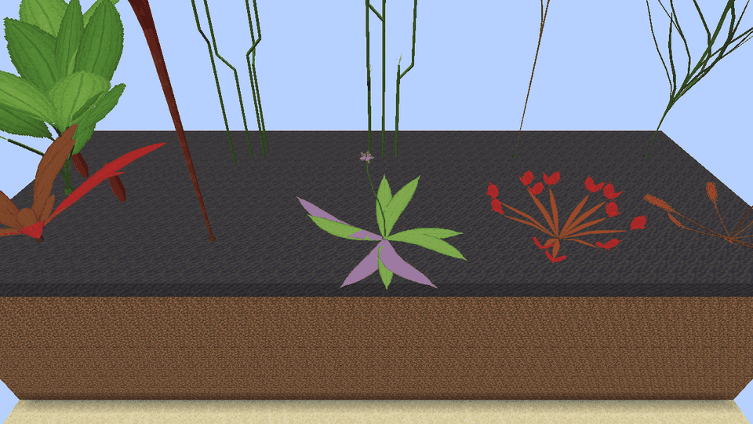

---
navigation:
  title: Swamp and shore
  icon: bettacraft:sundew
  parent: terrarium/plants.md
  position: 20
feature: terrariumPlants.enabled
---

# Swamp and shore

The plants of the swamp and of the shore of a paludarium: the carnivorous plants (sundew, trumpet pitcher, the tropical pitcher
plant, the Venus flytrap, butterwort), sedges, the soft rush, papyrus and the umbrella sedge. They want **wet air** (from about
55 %), most of them **strong light**; the bog plants (trumpet pitcher, flytrap) also bear cool air.

* Plant them on the land just above the water line: under water they languish.
* The sedges and the rush spread by **runners**, papyrus and the umbrella sedge by side shoots.

## Species

| | Plant | Light | Humidity | °C | Shears |
|---|---|---|---|---|---|
| <ItemImage id="bettacraft:sundew" /> | [Sundew](plants/sundew.md) | strong | 55–100 % | 15–30 | cuttings |
| <ItemImage id="bettacraft:sarracenia" /> | [Trumpet Pitcher (Sarracenia)](plants/sarracenia.md) | strong | 55–100 % | 10–30 | cuttings |
| <ItemImage id="bettacraft:nepenthes" /> | [Tropical Pitcher Plant (Nepenthes)](plants/nepenthes.md) | medium | 55–100 % | 16–28 | cuttings |
| <ItemImage id="bettacraft:venus_flytrap" /> | [Venus Flytrap](plants/venus_flytrap.md) | strong | 55–100 % | 10–30 | cuttings |
| <ItemImage id="bettacraft:butterwort" /> | [Butterwort](plants/butterwort.md) | medium | 50–100 % | 15–30 | cuttings |
| <ItemImage id="bettacraft:swamp_sedge" /> | [Swamp Sedge](plants/swamp_sedge.md) | medium | 50–100 % | 15–30 | cuttings |
| <ItemImage id="bettacraft:soft_rush" /> | [Soft Rush](plants/soft_rush.md) | medium | 50–100 % | 15–30 | cuttings |
| <ItemImage id="bettacraft:papyrus" /> | [Papyrus](plants/papyrus.md) | strong | 55–100 % | 15–30 | cuttings |
| <ItemImage id="bettacraft:umbrella_sedge" /> | [Umbrella Sedge](plants/umbrella_sedge.md) | medium | 55–100 % | 15–30 | cuttings |
