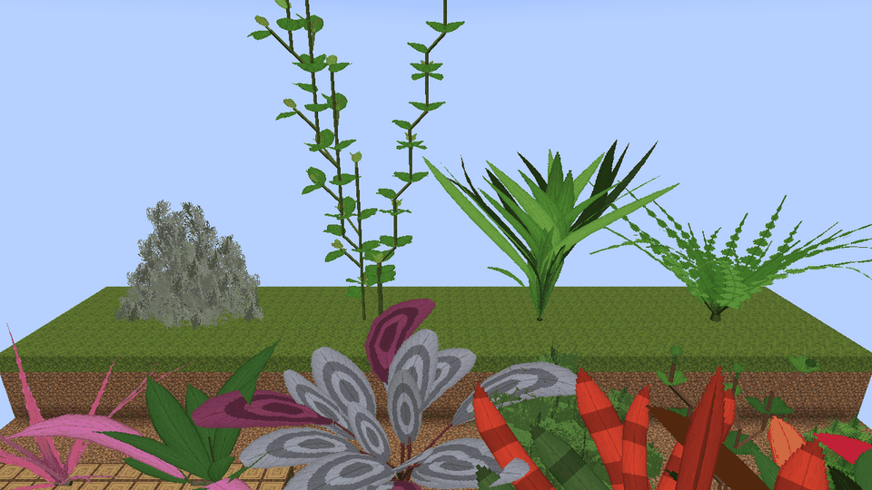

---
navigation:
  title: Tropical and humid
  icon: bettacraft:neoregelia
  parent: terrarium/plants.md
  position: 10
feature: terrariumPlants.enabled
---

# Tropical and humid

The plants of the rainforest terrarium and of the land of a paludarium: bromeliads, the air plant, ferns, mosses and the lichen,
the miniature orchid, begonias, Fittonia, Peperomia and the climbing Pothos. They want **humid air** (from about 65 %) and
**20-30 °C**; most are content with little light. A closed lid, a mister and water in the tank keep the air humid.

* The **bromeliads** (Neoregelia, Guzmania, Vriesea) hold water in their cup: [dart frogs](herps.md) raise their tadpoles in it.
* The **mosses** and the spikemoss are divided with the shears; the bromeliads and the air plant grow **offsets**.

## Species

| | Plant | Light | Humidity | °C | Shears |
|---|---|---|---|---|---|
| <ItemImage id="bettacraft:neoregelia" /> | [Neoregelia (Blushing Bromeliad)](plants/neoregelia.md) | medium | 65–100 % | 20–30 | offsets |
| <ItemImage id="bettacraft:guzmania" /> | [Guzmania](plants/guzmania.md) | medium | 65–100 % | 20–30 | offsets |
| <ItemImage id="bettacraft:vriesea" /> | [Vriesea (Flaming Sword)](plants/vriesea.md) | medium | 65–100 % | 20–30 | offsets |
| <ItemImage id="bettacraft:tillandsia" /> | [Tillandsia (Air Plant)](plants/tillandsia.md) | strong | 45–100 % | 20–30 | offsets |
| <ItemImage id="bettacraft:fittonia" /> | [Fittonia (Nerve Plant)](plants/fittonia.md) | low | 65–100 % | 20–30 | cuttings |
| <ItemImage id="bettacraft:pothos" /> | [Pothos](plants/pothos.md) | low | 65–100 % | 20–30 | cuttings |
| <ItemImage id="bettacraft:marcgravia" /> | [Marcgravia (Shingle Plant)](plants/marcgravia.md) | low | 65–100 % | 20–30 | cuttings |
| <ItemImage id="bettacraft:boston_fern" /> | [Boston Fern](plants/boston_fern.md) | low | 65–100 % | 20–30 | cuttings |
| <ItemImage id="bettacraft:birds_nest_fern" /> | [Bird's Nest Fern](plants/birds_nest_fern.md) | low | 65–100 % | 20–30 | cuttings |
| <ItemImage id="bettacraft:cushion_moss" /> | [Cushion Moss](plants/cushion_moss.md) | low | 65–100 % | 20–30 | division |
| <ItemImage id="bettacraft:reindeer_lichen" /> | [Reindeer Lichen](plants/reindeer_lichen.md) | medium | 40–100 % | 10–26 | division |
| <ItemImage id="bettacraft:selaginella" /> | [Selaginella (Spikemoss)](plants/selaginella.md) | low | 65–100 % | 20–30 | division |
| <ItemImage id="bettacraft:mini_orchid" /> | [Miniature Orchid](plants/mini_orchid.md) | medium | 65–100 % | 20–30 | cuttings |
| <ItemImage id="bettacraft:begonia_rex" /> | [Rex Begonia](plants/begonia_rex.md) | low | 65–100 % | 20–30 | cuttings |
| <ItemImage id="bettacraft:peperomia" /> | [Peperomia](plants/peperomia.md) | low | 65–100 % | 20–30 | cuttings |
