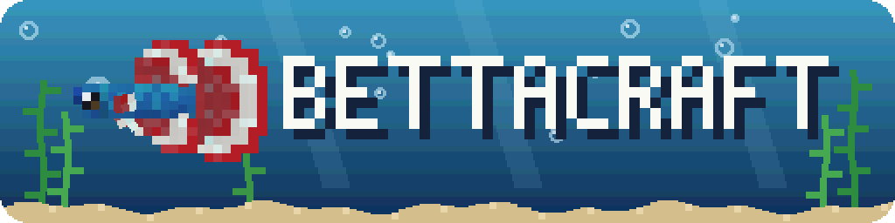
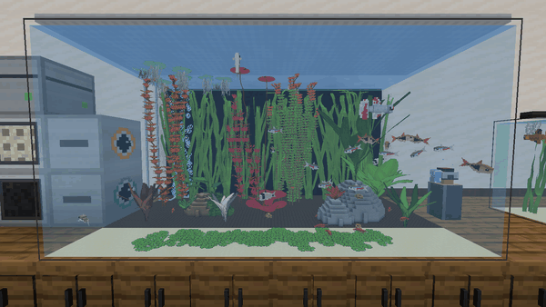
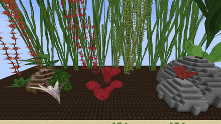
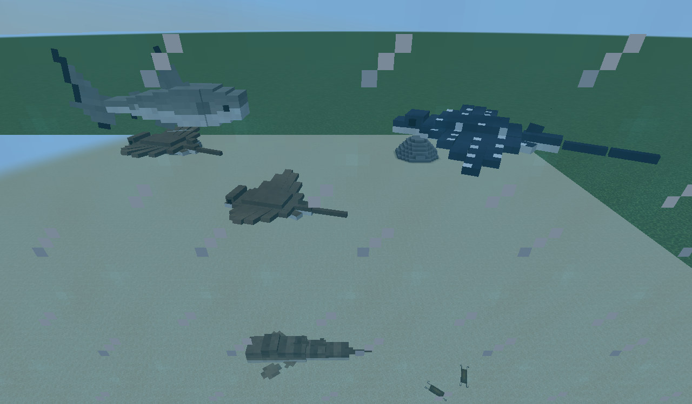
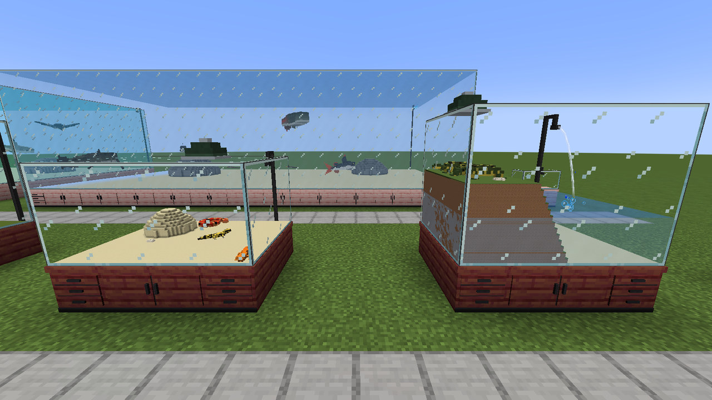
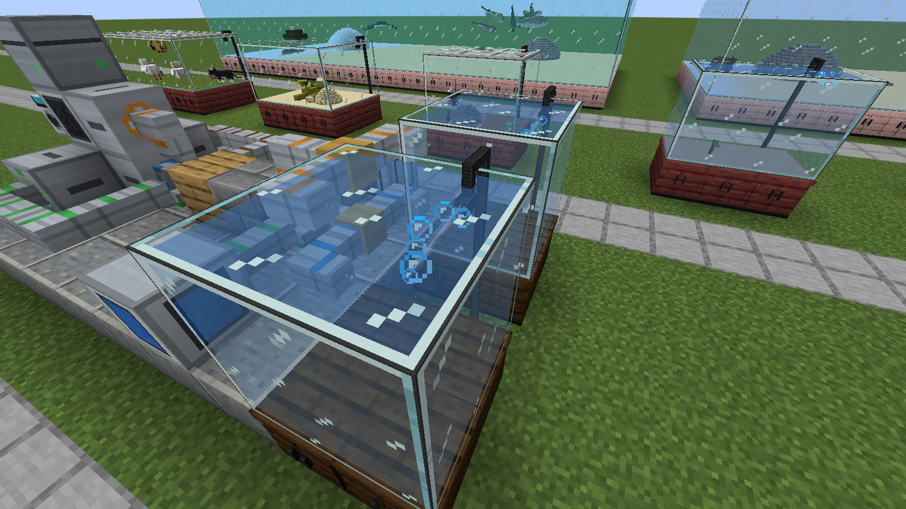
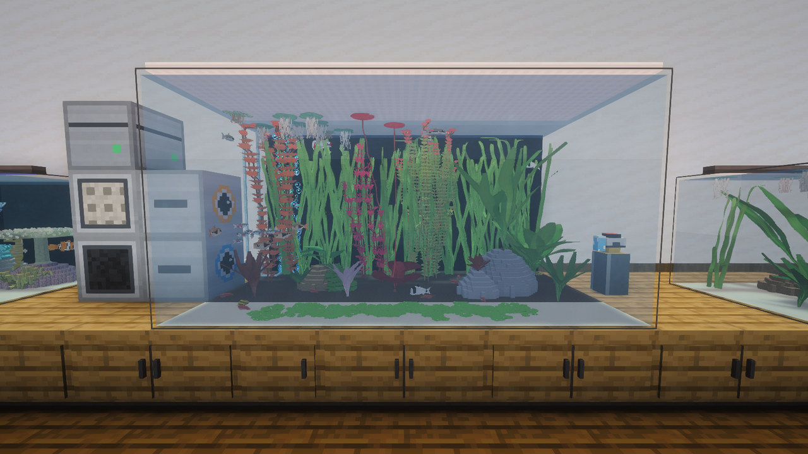

# Bettacraft

**Realistic fishkeeping in Minecraft 1.21.1 (NeoForge).** Catch wild bettas and tankmates, keep them in multiblock
aquariums of any glass and shape, aquascape the inside block by block with plants and corals that sway in the water, run
filters, lights, CO2, pipes and reef dosing, culture live food, and breed new colours with real Mendel genetics. Water
chemistry, temperature, stocking and food all matter, the way they do in a real tank. Made for big modpacks such as All
the Mods 10, and fine on its own.

## Bettas and genetics

- **Wild bettas** live in swamps (also those of biome mods). Catch them with a water bucket or a fish bag; the fish keeps
  all its genes. A magnifier, or the aquarium, reveals the hidden genes of a new animal. Some are the wild species
  *Betta imbellis* and *Betta smaragdina*, which cross with *B. splendens* into fertile hybrids.
- **Mendel genetics:** nine loci with dominance, carriers and mutations: 8 tail shapes, short and long fins, dumbo ears,
  43 colours, 12 patterns and 16 named varieties (Koi Galaxy, Nemo, Black Orchid, Mustard Gas, Samurai, Hellboy ...).
  Colours, genes and varieties are data-driven and can be changed with datapacks.
- **Breeding:** condition the pair with live food, give them floating plants for the bubble nest, and raise eggs,
  larvae and fry through six life stages on infusoria and artemia that you culture yourself. Two adult males flare and
  fight, also at a mirror stick. The breeding tab shows Punnett squares.
- **Two sizes:** Normal (the default, close to a real betta next to a block) or Large, one server setting for everyone;
  only the look and the hitbox change.

## Tanks and the interior

- **Multiblock tanks** of any glass and any connected shape (box, L, T, steps ...), up to 16x16x16 (configurable up to
  64; big tanks up to 32x16x32), with the connected texture of the glass or perfectly clear. Real vanilla water, filled
  bucket by bucket, and the animals are real entities.
- **The interior:** sneak and right-click with an empty hand to step inside the tank, a pocket dimension at 16 blocks
  per tank block. Build with any block: substrates, equipment and 28 decorations: castles, shipwrecks and a ship's bow,
  aquascaping stones (Seiryu, dragon stone, holey rock, lava rock, slate caves), roots and spiderwood, clay tubes that
  plecos breed in, a diving helmet and a treasure chest that bubbles from the air pump. Outside, the aquarium shows the
  result as a live miniature, and several players can build at once.
- **Care:** temperature from biome and time of day, heaters and coolers, hunger, stocking, water quality, oxygen,
  sickness and recovery. A tank menu with tabs (overview, inhabitants and their genes, breeding, water, devices, plants,
  interior, log), name sign, owner lock and break protection.

## Plants and corals

- **49 aquarium plants** (Java fern, Anubias, Bucephalandras that turn white or pink in strong light, mosses, Riccia,
  Cryptocorynes, sword plants, Rotala, Ludwigia and other stem plants, carpets such as Monte Carlo, HC 'Cuba' and
  hairgrass, Vallisneria, Aponogeton, tiger lotus ...) grow from a cutting into plants of many blocks, turn red in strong
  light, some need CO2 or soft water, are trimmed with shears and clean the water. The **Marimo** ball rolls with the
  current. **Floating plants** (duckweed, salvinia, water lettuce, hornwort ...) drift on the surface and spread.
- **Liquid fertilizer** from the fertilizer maker makes them grow faster; too much feeds the algae.
- **Plants of Minecraft and other mods work too:** kelp, seagrass, corals and the water plants of other mods lower the
  nitrate and count for breeding, without growing or needs.
- **Every plant grows wild** in the waters it comes from (jungle, swamp, river, mangrove, cold lakes, lush caves):
  shears cut a cutting, floating plants lie on calm water like lily pads.
- Every plant and coral has real leaves, polyps and tentacles that **sway in the water**, inside and in the miniature;
  zoanthids and star polyps close when a fish swims by.

## Shrimp, snails and other small animals

- **Neocaridina in eleven colours** with selection grades that you breed up, bee shrimp from Crystal Red S to SSS,
  Sulawesi shrimp and snails, dwarf crayfish, nerites, apple snails, ramshorns and dwarf clawed frogs. Algae grow, and the
  cleaning crew eats them.
- **Big crayfish** (blue and orange Florida crayfish, the all-female marbled crayfish) eat plants and catch slow fish.
- **Axolotls** get real care in a cool tank: eggs on the plants, larvae, and the five colours inherited by Mendel.

## Tankmates

- **50 freshwater tankmates** with their own models and behaviour: tetras (also gold, albino and diamond neons),
  rasboras and danios, rainbowfish, corydoras (albino and longfin pandas, the bronze cory), plecos, loaches and garras, barbs, guppies and endlers (with their own genetics and 28 strains), platys, mollies, swordtails,
  gouramis, **cichlids** (rams, Apistogramma, angelfish, discus) and **puffers** that eat snails.
- Shoals, water ranges, predators and prey, fin nippers, and a breeding style for every species: open and cave brooders
  guard their young.
- **Water animals of other mods** live in the aquariums too; whales, bosses and hostile mobs are refused with a reason.

## Salt water, reef tanks and seahorses

- Sea water and salinity, protein skimmer, flow pump, live rock and actinic light. Eight corals and the bubble tip
  anemone grow with light, flow, calcium, alkalinity and magnesium from a four-channel dosing pump, and they bleach,
  glow and give frags. Clownfish spawn at their anemone and their larvae need rotifers (cultured on phytoplankton); the
  Banggai cardinalfish broods in the male's mouth, the mandarinfish lives on the copepods of the live rock; tangs, gobies,
  chromis, damsels, anthias, cleaner and fire shrimp, hermit crabs.
- A **sump** in the cabinet adds its water to the tank and holds heaters, a skimmer, filter media and a **refugium** with
  Chaetomorpha; a **calcium reactor** dissolves coral rubble with CO2 for the stony corals.
- **Brackish water:** the archerfish shoots insects off the leaves above the tank, the mudskipper lives on the mud of a
  paludarium, Amano larvae grow up in brackish water, and a mangrove propagule grows into a small mangrove over the water.
- **Seahorses** swim upright, hold on to plants and corals, and the male gives birth from his brood pouch.
- **Big tanks** up to 32 x 16 x 32 blocks with a size rule for big animals by their real length: the bamboo shark that
  lays egg cases, the blacktip reef shark, eagle and cownose rays, the honeycomb moray, and in fresh water pangasius,
  redtail and wels catfish, the arapaima and the motoro stingray. Vanilla **dolphins** live in very big sea water tanks.
  Catch the giants with the large net or a steel leader on your fishing rod into a transport tub.

## Terraria and paludaria

- A tank without water is a **terrarium**, one with water and land a **paludarium**, with air temperature, humidity and
  UV from heat mats, basking lamps and misters. Fix the tank type in the menu and a terrarium is never flooded by mistake.
- **Turtles** (musk turtle, sliders, Hermann's tortoise, Reeves' turtle) lay eggs in the sand, and the nest temperature
  decides whether males or females hatch. **Poison dart frogs** with tadpoles, a horned frog that sits buried, **geckos**
  that climb the glass and a **corn snake**.
- **Land animals of other mods** (insects, small mammals, birds and reptiles of Naturalist, Critters and Companions and
  Living Things) live in terraria with our care and breeding; catch them with the terrarium box.
- **Minecraft animals as pets:** chickens with chicks from eggs in the sand, rabbits on grass, bees with flowers and a
  mini beehive, frogs, cats, foxes and more at their real size. No drops, no farm.
- **Mobs in glass:** drowned, zombies, skeletons, spiders and small slimes live shrunk and harmless in a tank. Catch one
  in a **mob jar** or lure it in with bait: decoration, not a farm.

## Technology

- **Equipment:** internal, external, sponge and corner filters, cabinets of any wood or stone, automatic and clip-on
  feeders, air pumps with air stones, light bars and LED panels in 16 colours with dimmer and daylight timer.
- **Pipes and the multiblock filter:** glass and stainless steel pipes and pumps carry water with all its values. A
  multiblock filter of any size with media that clog serves several aquariums: filter pipes with T-pieces dock on any side
  of a tank, up to four lines run in one pipe bundle, fresh and waste water ports change the water of every tank of the
  filter, and a pipe cover hides the pipes behind any block.
- **Water chemistry:** TDS, pH and hardness from the water, the substrate, driftwood, leaves and CO2, with a range for
  every animal. CO2 cylinders and bio CO2, a reverse osmosis unit, nitrate that makes water changes matter, and a water
  change controller that does them for you.
- **Food:** live food cultures (tubifex, daphnia, mosquito larvae, artemia) that a live food pump sends through the pipes;
  a food maker for pellets, flakes, wafers and frozen food; a varied diet makes the colours stronger.
- **Power, your choice:** by default nothing needs energy. With the power options on, the devices take Forge Energy, or
  you wind them with a **crank**, or with Create a **drive adapter** runs every device of a tank on rotation with real
  stress.

## Handbook and menus

An in-game handbook (with GuideME) in English and German with a page for every animal, plant, coral and device and
where to get it, 31 advancements, JEI pages and tooltips. Without GuideME every item explains itself in its tooltip.

## Compatibility

- **Required:** Minecraft 1.21.1, NeoForge 21.1.200 or newer, Java 21. Install on client and server. No other mod is
  required.
- **Handbook and info:** GuideME (handbook), JEI (information pages), Jade, The One Probe and WTHIT (aquarium, betta,
  filter and cabinet lines).
- **Aquarium and animal mods:** Better Fish Tanks, Fintastic, Fish of Thieves, Aquaculture 2, Naturalist, Critters and
  Companions and Living Things: their animals get our care and breeding (their young inherit their colours), the giants go
  into big tanks by their real length, their land animals into terraria; deep-sea, giant and hostile animals are refused
  with a reason; modpacks add profiles for any animal.
- **Tech mods:** Mekanism, EnderIO, Create and Thermal make stainless steel; their tanks and pipes connect to Bettacraft
  pipes, aquariums and reservoirs (also AE2 and Refined Storage interfaces); CO2 gas of other mods fills CO2 cylinders.
  The facades of AE2, EnderIO, Mekanism Covers and Cable Facades hide the filter pipes.
- **Create and Create Aeronautics:** aquariums travel on contraptions, trains and airships with their animals; rotation
  drives pumps, the reverse osmosis unit, the food maker and the fertilizer maker, and the drive adapter powers a whole
  tank; Display Links show tank values. AE2 and Refined Storage autocrafting feeds the food maker and the crucible.
- **For modpacks:** an FTB Quests chapter "Bettacraft" (33 quests, English and German), KubeJS events (animal born,
  animal died, monitor alarm), JourneyMap waypoints at tanks with a monitor alarm, and `/bettacraft foreign list` to see
  which animals of other mods still need a profile.
- **Biome mods:** the swamps, rivers, mangroves and warm oceans of Regions Unexplored, Oh The Biomes We've Gone, Biomes
  O' Plenty and others get the wild animals, plants and corals (biome tags).
- **Sodium and Iris:** supported, water and miniatures render correctly with shaders.

## FAQ

**Does it work with shaders?** Yes. Sodium and Iris are supported, the water and the miniatures render correctly. The
last three pictures under Compatibility were taken with Complementary Reimagined; every other picture on this page is
without shaders.

**Can I use it in my modpack?** Yes. The mod is MIT licensed (code and all assets), so you may include it in any pack.
Tags and datapacks control spawns, food, inhabitants and genetics, and the pack files (quest chapter, KubeJS example)
come with every release.

**Can I turn features off?** Yes. Every feature has its own switch (`features.*` in `config/bettacraft-common.toml`, 105
in all): off, it loses its recipes, trades, loot and spawns, hides from the creative tab, JEI and the handbook, and its
logic rests. Presets (`preset = SIMPLE | REALISTIC | DECOR`) set other defaults in one line, `care.mode = NO_DEATH` keeps
every animal alive, and datapacks can use the `bettacraft:feature` recipe and loot condition.

**Where is the config?** `serverconfig/bettacraft-server.toml` in the world (tank size, animals, breeding, water, power
...), `config/bettacraft-common.toml` (spawns, feature switches) and `config/bettacraft-client.toml` (render distances,
connected glass, effects). Every option can also be changed in game: Mods > Bettacraft > Config.

**Do I need power?** No. By default no device needs energy; with the power options on they take Forge Energy, a crank or
Create rotation.

**Will my fish die while I am away?** By default time stands still for aquariums in unloaded chunks, and water quality and
evaporation are on but gentle.

**Is it a beta?** Yes. Worlds are migrated between versions and nothing should get lost, but keep backups. Bugs and
ideas go to the [issue tracker](https://github.com/0verEngineer/BettaCraft/issues).

## Acknowledgements

- Code, procedural textures, models, sounds and the logo: 0verEngineer. Every asset comes from the mod's own generator
  (`tools/assetgen`), no third-party assets are used. Licence: MIT.
- Developed with the help of AI coding tools. The pictures and animations on this page are real in-game captures of the
  mod, taken automatically in its showcase world.
- Inspired by real betta and aquarium keeping. Thanks to the authors of NeoForge, GuideME, JEI, Jade, Sodium, Iris,
  Complementary Reimagined and the mods Bettacraft works with.
- Source code, changelog and issues: [github.com/0verEngineer/BettaCraft](https://github.com/0verEngineer/BettaCraft).
