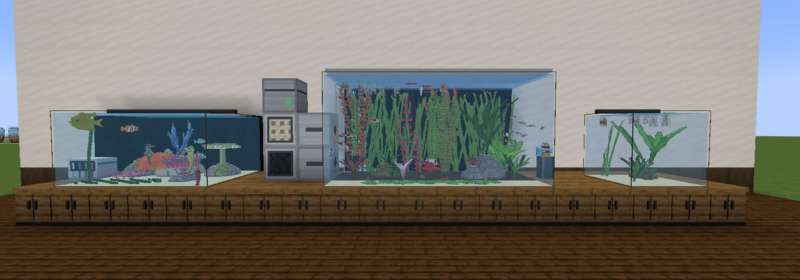
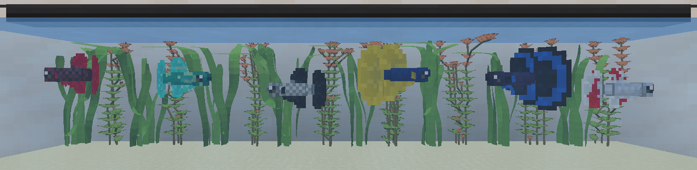
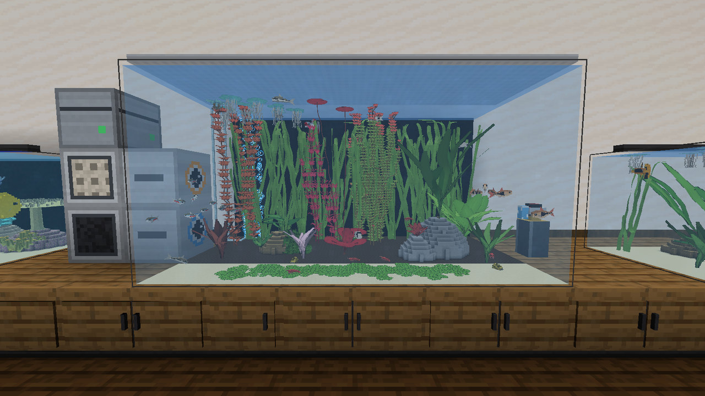
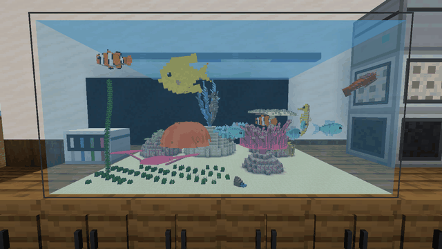
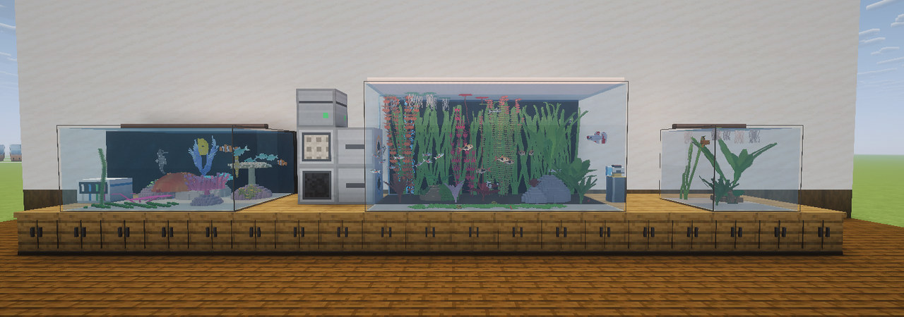

# Bettacraft

**Betta fish and real aquariums for Minecraft 1.21.1 (NeoForge).** Catch wild bettas and tankmates, keep them in
multiblock aquariums of any glass and shape, aquascape the inside block by block with plants and corals that sway in the
water, run filters, lights, CO2, pipes and reef dosing, culture live food, and breed new colours with real Mendel
genetics. Made for big modpacks such as All the Mods 10, and fine on its own.

## Bettas and genetics

- **Wild bettas** live in swamps (also those of biome mods). Catch them with a water bucket or a fish bag; the fish keeps
  all its genes. A magnifier, or the aquarium, reveals the hidden genes of a new animal. Some are the wild species
  *Betta imbellis* and *Betta smaragdina*, which cross with *B. splendens* into fertile hybrids.
- **Mendel genetics:** nine loci with dominance, carriers and mutations: 8 tail shapes, short and long fins, dumbo ears,
  43 colours, 12 patterns and 16 named varieties (Koi Galaxy, Nemo, Black Orchid, Mustard Gas, Samurai, Hellboy ...).
  Colours, genes and varieties are data-driven and can be changed with datapacks.
- **Breeding:** condition the pair with live food, give them floating plants for the bubble nest, and raise eggs,
  larvae and fry through six life stages on infusoria and artemia that you culture yourself. Two adult males flare and
  fight, also at a mirror stick. The breeding tab shows Punnett squares.

## Aquariums you build yourself

- **Multiblock tanks** of any glass and any connected shape (box, L, T, steps ...), up to 16x16x16 (configurable up to
  64; big tanks up to 32x16x32), with the connected texture of the glass or perfectly clear. Real vanilla water, filled bucket by bucket, and the
  animals are real entities.
- **The interior:** sneak and right-click with an empty hand to step inside the tank, a pocket dimension at 16 blocks
  per tank block. Build with any block: substrates, equipment and 28 decorations: castles, shipwrecks and a ship's bow,
  aquascaping stones (Seiryu, dragon stone, holey rock, lava rock, slate caves), roots and spiderwood, clay tubes that
  plecos breed in, a diving helmet and a treasure chest that bubbles from the air pump. Almond leaves and alder cones on
  the floor lower the pH and feed the shrimp. Outside, the aquarium shows the result as a live miniature, and several
  players can build at once.
- **Care:** temperature from biome and time of day, heaters and coolers, hunger, stocking, water quality, oxygen,
  sickness and recovery. A tank menu with tabs (overview, inhabitants and their genes, breeding, water, devices,
  plants, interior, log), name sign, owner lock and break protection.

## Plants and corals

- **49 aquarium plants** (Java fern, Anubias, Bucephalandras that turn white or pink in strong light, mosses, Riccia,
  Cryptocorynes, sword plants, Rotala, Ludwigia and other stem plants, carpets such as Monte Carlo, HC 'Cuba' and
  hairgrass, Vallisneria, Aponogeton, tiger lotus ...) grow from a cutting into plants of many blocks, turn red in strong
  light, some need CO2 or soft water, are trimmed with shears and clean the water. The **Marimo** ball rolls with the
  current. **Floating plants** (duckweed, salvinia, water lettuce, hornwort ...) drift on the surface and spread.
- **Every plant grows wild** in the waters it comes from (jungle, swamp, river, mangrove, cold lakes, lush caves):
  shears cut a cutting, floating plants lie on calm water like lily pads.
- Every plant and coral has real leaves, polyps and tentacles that **sway in the water**, inside and in the miniature;
  zoanthids and star polyps close when a fish swims by.

## Tankmates and small animals

- **48 freshwater tankmates** with their own models and behaviour: tetras, rasboras and danios, rainbowfish, corydoras,
  plecos, loaches, barbs, guppies and endlers (with their own genetics and 28 strains), platys, mollies, swordtails,
  gouramis, **cichlids** (rams, Apistogramma, angelfish, discus) and **puffers** that eat snails. Shoals, water ranges,
  predators and prey, fin nippers, and a breeding style for every species: open and cave brooders guard their young.
- **Shrimp, snails and more:** Neocaridina in eleven colours with selection grades, bee shrimp from Crystal Red S to
  SSS, Sulawesi shrimp and snails, dwarf crayfish, nerites, apple snails, ramshorns and dwarf clawed frogs. Algae grow,
  and the cleaning crew eats them. **Big crayfish** (blue and orange Florida crayfish, the all-female marbled crayfish)
  eat plants and catch slow fish.
- **Axolotls** get real care in a cool tank: eggs on the plants, larvae, and the five colours inherited by Mendel.
- **Water animals of other mods** live in the aquariums too; whales, bosses and hostile mobs are refused with a reason.

## Reef tanks and seahorses

- Sea water and salinity, protein skimmer, flow pump, live rock and actinic light. Eight corals and the bubble tip
  anemone grow with light, flow, calcium, alkalinity and magnesium from a four-channel dosing pump, and they bleach,
  glow and give frags. Clownfish spawn at their anemone; tangs, gobies, chromis, damsels, cleaner shrimp, hermit crabs.
- **Seahorses** swim upright, hold on to plants and corals, and the male gives birth from his brood pouch.

## Big tanks and big animals

- **Big tanks** up to 32 x 16 x 32 blocks with a coarser interior, and a **size rule** for big animals by their real
  length: a 1 m bamboo shark needs 12 x 6 x 3 blocks, a dolphin 32 x 16 x 8.
- **Ten giants:** pangasius, redtail and wels catfish, arapaima and the motoro stingray in fresh water; the bamboo shark
  that lays egg cases (mermaid's purses), the blacktip reef shark, the spotted eagle ray, schooling cownose rays and the
  honeycomb moray that lives in a lair under your rocks in sea water. Vanilla **dolphins** live in very big sea water
  tanks and take raw fish from the feeder.
- Catch them with the **large net** or a **steel leader** on your fishing rod into a **transport tub**; they swim wide
  curves, turn slowly and eat the small fish of their tank.

## Terraria, turtles, frogs and mobs in glass

- A tank without water is a **terrarium**, one with water and land a **paludarium**, with air temperature, humidity and
  UV from heat mats, basking lamps and misters. Fix the tank type in the menu and a terrarium is never flooded by mistake.
- **Turtles** (musk turtle, sliders, Hermann's tortoise, Reeves' turtle) lay eggs in the sand, and the nest temperature
  decides whether males or females hatch. **Poison dart frogs** with tadpoles, a horned frog that sits buried, **geckos**
  that climb the glass and a **corn snake**.
- **Mobs in glass:** drowned, zombies, skeletons, spiders and small slimes live shrunk and harmless in a tank. Weaken one
  and catch it in a **mob jar**, lure it into an open tank with bait, or bring it in an EnderIO soul vial. A zombie under
  water becomes a drowned, fed pairs breed, and mobs in glass never drop anything: decoration, not a farm.

## Equipment, water and chemistry

- Internal, external, sponge and corner filters, cabinets of any wood or stone, automatic and clip-on feeders, air
  pumps with air stones, light bars and LED panels in 16 colours with dimmer and daylight timer.
- **Pipes and water changes:** glass and stainless steel pipes and pumps carry water with all its values, a multiblock
  filter of any size with media that clog, nitrate that makes water changes matter, and a water change controller that
  does them for you.
- **Water chemistry:** TDS, pH and hardness from the water, the substrate, driftwood, leaves and CO2, with a range for
  every animal. CO2 cylinders and bio CO2, a reverse osmosis unit, and RO and sea water as fluids for other mods.
- Optional Forge Energy for the equipment. All sounds are generated by the mod's own tools.

## Food and live food

- **Live food cultures:** tubifex worms, daphnia, mosquito larvae and artemia grow, go stale and crash when crowded or
  hot. A **live food pump** sends them through the pipes into the tanks on a schedule.
- **Food maker:** pellets, flakes, granules, algae wafers, fry powder, shrimp food and frozen food from vanilla
  ingredients and live food, on a hand-wound spring or on FE. Hoppers, AE2 and Refined Storage fill and empty it.
- **Food variety:** every kind of eater has favourite and poorly suited food; a varied diet helps the fish recover and
  makes the bettas' colours stronger.

## Handbook and menus

An in-game handbook (with GuideME) in English and German with a page for every animal, plant, coral and device and
where to get it, 31 advancements, JEI pages and tooltips. Without GuideME every item explains itself in its tooltip.

## Compatibility

- **Required:** Minecraft 1.21.1, NeoForge 21.1.200 or newer, Java 21. Install on client and server. No other mod is
  required.
- **Handbook and info:** GuideME (handbook), JEI (information pages), Jade, The One Probe and WTHIT (aquarium, betta,
  filter and cabinet lines).
- **Aquarium and fish mods:** Better Fish Tanks, Fintastic, Fish of Thieves, Aquaculture 2, Naturalist, and the small
  water animals of any mod.
- **Tech mods:** Mekanism, EnderIO, Create and Thermal make stainless steel; their tanks and pipes connect to Bettacraft
  pipes, aquariums and reservoirs (also AE2 and Refined Storage interfaces); CO2 gas of other mods fills CO2 cylinders.
- **Animals of other mods:** Fintastic, Aquaculture 2, Critters and Companions and Naturalist fish get our care and
  breeding in Bettacraft aquariums (their young inherit their colours); modpacks add profiles for any animal.
- **Create and Create Aeronautics:** aquariums travel on contraptions, trains and airships with their animals; rotation
  drives pumps, the reverse osmosis unit and the food maker; Display Links show tank values. **AE2 and Refined
  Storage** autocrafting feeds the food maker and the crucible; **Mekanism** tanks take the Bettacraft fluids.
- **For modpacks:** an FTB Quests chapter "Bettacraft" (33 quests, English and German), KubeJS events (animal born,
  animal died, monitor alarm), **JourneyMap** waypoints at tanks with a monitor alarm, a switch for every feature,
  presets (simple, realistic, decoration only) and `/bettacraft foreign list` to see which animals of other mods still
  need a profile.
- **Biome mods:** the swamps, rivers, mangroves and warm oceans of Regions Unexplored, Oh The Biomes We've Gone, Biomes
  O' Plenty and others get the wild animals, plants and corals (biome tags).
- **Sodium and Iris:** supported, water and miniatures render correctly with shaders.

## FAQ

**Does it work with shaders?** Yes. Sodium and Iris are supported, the water and the miniatures render correctly. The
pictures above were taken with Complementary Reimagined.

**Can I use it in my modpack?** Yes. The mod is MIT licensed (code and all assets), so you may include it in any pack.
Every feature has its own switch (`features.*` in `config/bettacraft-common.toml`, 105 in all): off, it loses its
recipes, trades, loot and spawns, hides from the creative tab, JEI and the handbook, and its logic rests. Presets
(`preset = SIMPLE | REALISTIC | DECOR`) set other defaults in one line, `care.mode = NO_DEATH` keeps every animal alive,
and datapacks can use the `bettacraft:feature` recipe and loot condition. Tags and datapacks control spawns, food,
inhabitants and genetics.

**Where is the config?** `serverconfig/bettacraft-server.toml` in the world (tank size, animals, breeding, water, power
...), `config/bettacraft-common.toml` (spawns, feature switches) and `config/bettacraft-client.toml` (render
distances, connected glass, effects). Every option can also be changed in game: Mods > Bettacraft > Config.

**Do I need power?** No. By default no device needs energy; with the power options on they take Forge Energy.

**Will my fish die while I am away?** By default time stands still for aquariums in unloaded chunks, and water
quality and evaporation are on but gentle.

**Is it a beta?** Yes. Worlds are migrated between versions and nothing should get lost, but keep backups. Bugs and
ideas go to the [issue tracker](https://github.com/0verEngineer/BettaCraft/issues).

## Credits

- Code, procedural textures, models, sounds and the logo: 0verEngineer. Every asset comes from the mod's own generator
  (`tools/assetgen`), no third-party assets are used. Licence: MIT.
- Developed with the help of AI coding tools; the screenshots and animations are real in-game captures.
- Inspired by real betta and aquarium keeping. Thanks to the authors of NeoForge, GuideME, JEI, Jade and the mods
  Bettacraft works with.
- Source code, changelog and issues: [github.com/0verEngineer/BettaCraft](https://github.com/0verEngineer/BettaCraft).

## Kurz auf Deutsch

Bettacraft bringt Kampffische (Bettas) und echte Aquarien nach Minecraft 1.21.1 (NeoForge): Wildfänge aus dem Sumpf,
Zucht nach Mendel mit Hunderten Farbformen, Multiblock-Aquarien aus beliebigem Glas, eine begehbare Innenwelt zum
Einrichten mit Wracks, Aquascaping-Steinen und Wurzeln, fast 50 wachsende Pflanzen und Korallen, fast 50 Beifische (Buntbarsche, Kugelfische, Guramis …), Garnelen, Schnecken, große Krebse, Axolotl-Zucht, Meerwasser mit Seepferdchen, Großbecken mit Haien, Rochen, Riesenwelsen und Delfinen, Terrarien und Paludarien mit Schildkröten, Pfeilgiftfröschen,
Geckos und Kornnattern, verkleinerte Mobs im Glas, Filter,
Licht, CO2, Rohre, Wasserchemie, Lebendfutter und eine Futtermaschine. Fische anderer Mods (Fintastic, Aquaculture …)
bekommen unsere Pflege und Zucht, Becken fahren auf Create-Contraptions und Luftschiffen mit, und für Modpacks gibt es
ein FTB-Quests-Kapitel, KubeJS-Events, JourneyMap-Wegpunkte bei Alarmen, einen Schalter für jedes Feature und
Voreinstellungen (einfach, realistisch, nur Deko). Die Mod und das Handbuch im Spiel sind
komplett auf Deutsch übersetzt; die Spielsprache Deutsch genügt.
