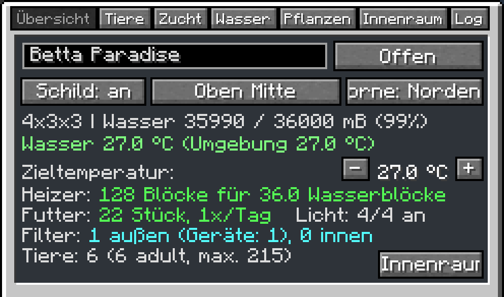
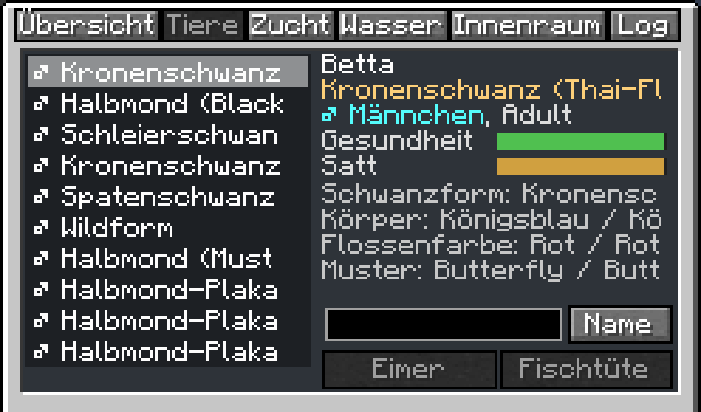
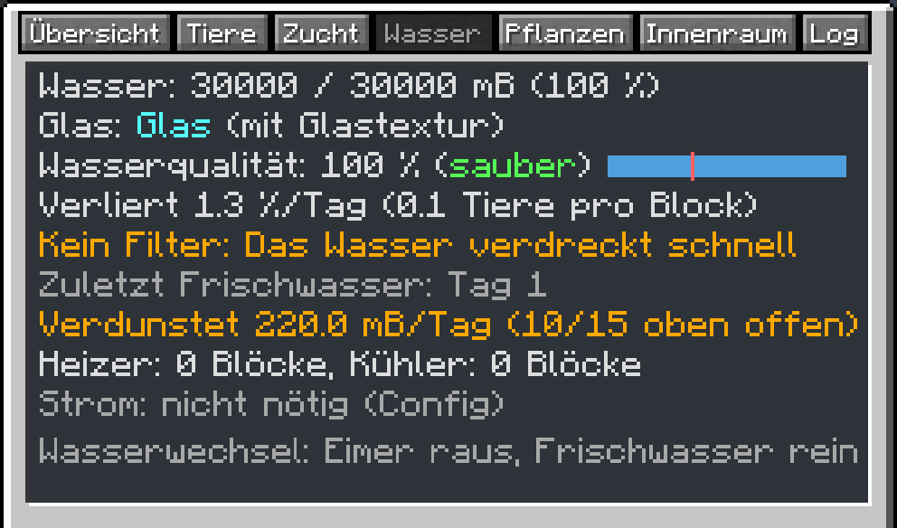

---
navigation:
  title: Aquarium-Menü
  icon: minecraft:name_tag
  parent: aquarium.md
  position: 40
---

# Aquarium-Menü, Namensschild und Sperre

**Rechtsklicke** ein Aquarium mit leerer Hand, um sein Menü zu öffnen. (**Schleichen + Rechtsklick** betritt stattdessen
den [Innenraum](../interior.md).)

## Übersicht

* **Name** (bis 32 Zeichen) und **Namensschild**: an oder aus, seine Position (oben oder unten, links, Mitte oder
  rechts) und die **Vorderseite** des Aquariums, auf der es sitzt. Das Schild ist schwarz mit weißer Schrift; lange
  Namen bekommen eine kleinere Schrift. Der Name steht auch bei ausgeschaltetem Schild im Menü und in Jade.
* **Sperre**: Wer das Aquarium gesetzt hat, ist sein Besitzer. Ist es gesperrt, dürfen nur Besitzer und Operatoren es
  ändern (Wasser, Tiere, Einstellungen, Innenraum); ansehen dürfen es alle.
* Größe, Wassermenge, Wasser- und Umgebungstemperatur, die **Zieltemperatur** (– / +).
* Heizstäbe (oder Kühler, wenn das Ziel unter der Umgebung liegt), Futterautomat, Licht und Filter, die Zahl der Tiere
  und der Knopf zum Betreten des Innenraums. Die letzte Zeile warnt vor mäßigem Wasser oder fehlendem Strom.

## Tiere

Die Liste aller Tiere mit Name, Typ, Geschlecht und Stufe. Zum ausgewählten Fisch: Gesundheits- und Satt-Balken,
Fortschritt der Stufe, der Genotyp (Schwanzform, Körper, Flossen, Muster; alle neun Loci im Tooltip), die Generation,
ein Namensfeld und die Knöpfe zum Entnehmen mit Eimer oder Fischtüte.

## Zucht

Warnungen, das Schaumnest, die Zuchtbedingungen mit ✔ und ✘, die Jungtiere, die Eltern und die erwarteten Nachkommen.
Siehe [Zucht](../breeding.md).

## Wasser

Wasservolumen, die [Wasserqualität](water_quality.md) mit einem Balken (die rote Marke zeigt, ab wann die Bettas
leiden), wie schnell sie sinkt und warum (Tiere pro Wasserblock, wie viel die Filter entfernen), das letzte Frischwasser,
Verdunstung und offene obere Blöcke, Heizer und Kühler und der gespeicherte [Strom](../equipment/power.md), wenn der
Server ihn verlangt.

Der kleine Knopf mit dem Blatt oben rechts öffnet die Seite der [Schwimmpflanzen](floating_plants.md): Anzahl je Art,
Bedeckung, Licht, Wachstum, Abfallaufnahme, die Warnung bei dichter Decke und der Knopf **Ausdünnen**.

## Innenraum

Maßstab und Größe des Innenraums, wie viele Blöcke die Miniatur zeigt, Bodengrund, Heizstäbe und Filter im Innenraum,
Schwimmpflanzen, der Deko-Katalog und der Knopf zum Betreten.

## Log

Was im Aquarium passiert ist: Fütterungen, Eier, Kämpfe, Krankheiten, Todesfälle und ihre Ursachen, mit dem Ingame-Tag.
Es hält 100 Einträge und lässt sich filtern (alles, Zucht, Gesundheit, Futter).
