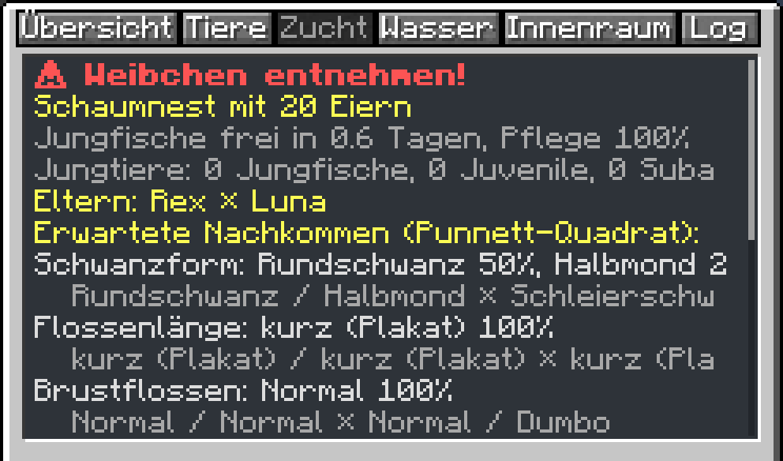

---
navigation:
  title: Zucht
  icon: minecraft:lily_pad
  parent: bettas.md
  position: 30
---

# Zucht

Bettas vermehren sich nur in einem Bettacraft-Aquarium, und zwar nah an der echten Betta-Zucht: Das **Männchen baut ein
Schaumnest**, das Paar laicht, und danach **müssen beide Eltern zur richtigen Zeit raus**.

## 1. Voraussetzungen

* ein **adultes Männchen und ein adultes Weibchen** im Aquarium,
* beide **gesund**, **satt** (innerhalb des letzten Tages gefressen) und mit mindestens der Hälfte ihrer Lebenspunkte,
* Wasser mit **26 bis 28 °C**,
* das Weibchen hat sich vom letzten Laichen erholt (3 Tage).

Passt alles, kommt das Paar innerhalb eines Vierteltages in Zuchtstimmung; beim Weibchen siehst du es an den senkrechten
Querstreifen. **Mückenlarven** konditionieren das Paar für zwei Tage: Das geht dann doppelt so schnell, und das Gelege
hat zwei Eier mehr. Die Filterströmung spielt keine Rolle.

## 2. Schaumnest

Das Männchen baut an der Wasseroberfläche ein **Schaumnest**, das dauert noch einmal einen Vierteltag. Am liebsten baut
es unter Schwimmpflanzen: Setze [Schwimmpflanzen](../plants/floating_plants.md) auf die Oberfläche (Amazonas-Froschbiss
mag es am liebsten), dann entsteht das Nest unter der dichtesten Gruppe; ohne sie unter der **Seerose** im
[Innenraum](../interior.md), die ihm am nächsten ist. Schwimmpflanzen machen es außerdem etwas schneller bereit. Ein fertiges Nest ohne Weibchen zerfällt nach 3 Tagen. Das Nest ist ein gewölbter
Schaumhaufen, der etwas unter die Oberfläche reicht, so siehst du es auch durch die Seitenscheibe; die Eier sitzen an
seiner Unterseite, die Larven hängen daran.

## 3. Laichen

Das Weibchen laicht **8 bis 20 Eier** ins Nest. Jetzt **nimm das Weibchen heraus**: Das Männchen bewacht das Nest und
jagt es, es verliert 2 Lebenspunkte pro Tag. Das Menü zeigt „Weibchen entnehmen!“.

## 4. Eier und Larven

Aus den Eiern schlüpfen nach einem halben Tag Larven, die nach einem weiteren halben Tag als Jungfische frei schwimmen.
Sie entwickeln sich nur bei 24 bis 30 °C. Solange das Nest Eier oder Larven enthält, lässt sich das Aquarium nicht
abbauen.

**60 bis 90 %** der Larven überleben, je nach Pflege in dieser Zeit: Die Hälfte macht die Temperatur aus (ideal 26 bis
28 °C), ein Viertel kein Überbesatz und ein Viertel ein sattes Männchen.

## 5. Jungfische

Sobald die Jungfische frei schwimmen, **nimm das Männchen heraus**: Es frisst pro Tag etwa jeden dritten Jungfisch. Das
Menü zeigt „Männchen entnehmen! (es frisst die Jungfische)“. Jetzt [Jungfischfutter](../food/fry_food.md) füttern und das
Wasser warm halten; nach etwa 8 weiteren Tagen sind die jungen Bettas erwachsen.

## Der Zucht-Tab

Der Zucht-Tab des [Aquarium-Menüs](../aquarium/menu.md) zeigt die Warnungen, das Nest mit seinen Eiern oder Larven, alle
Bedingungen mit ✔ und ✘, die Jungtiere, die Eltern und die **erwarteten Nachkommen** des Paares für jedes Merkmal, mit
den Genotypen beider Eltern. Siehe [Genetik](genetics.md).
