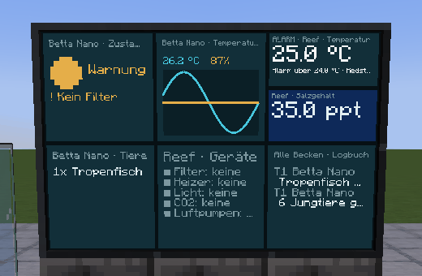

---
navigation:
  title: Monitor
  icon: bettacraft:monitor
  parent: equipment.md
  position: 110
item_ids:
  - bettacraft:monitor
---

# Monitor

<ItemImage id="bettacraft:monitor" scale="2" />

Ein Monitor ist ein Bildschirm für deine Becken. Stelle Monitor-Blöcke **nebeneinander**, mit dem Bildschirm in
dieselbe Richtung: Sie verbinden sich zu einem Bildschirm von bis zu **8 x 5 Blöcken** mit einem gemeinsamen Rahmen.
Ein Monitor, der an die Seite, Oberseite oder Unterseite eines anderen gesetzt wird, übernimmt dessen Richtung. Eine
Wand größer als 8 x 5 wird in mehrere Bildschirme geteilt.

Der Bildschirm findet von selbst **jedes Becken im Umkreis von 32 Blöcken** (`monitor.range`, gemessen bis zum
nächsten Punkt des Beckens) und zeigt seine Werte auf Kacheln. Jedes Becken heißt wie sein
[Namensschild](../aquarium/menu.md). Ab Werk richtet sich der Bildschirm selbst ein: zwei Kacheln pro Becken, die
**Temperatur** mit einem kleinen Verlauf des letzten Tages und die **Wasserqualität**. Ein Rechtsklick auf einen
Monitor öffnet den Editor (siehe unten), mit dem du die Kacheln selbst anordnest; Schleichen und Rechtsklick zeigt
seine Größe und wie viele Becken er gefunden hat.

* Ein Becken außer Reichweite oder in einem nicht geladenen Chunk zeigt **„nicht geladen“** mit den letzten Werten,
  die der Bildschirm gesehen hat.
* Die Werte gehen nur an Spieler, die den Monitor sehen können (innerhalb ihrer Sichtweite); sie kommen jede Sekunde.
* Jedes Becken zeichnet seine Werte der letzten 7 Spieltage auf (ein Punkt pro Spielstunde), auch wenn kein Monitor
  hinschaut; ein neuer Monitor zeigt also sofort die Vergangenheit.
* Mit einer Strom-Option (siehe [Strom](power.md)) braucht ein Monitor **1 FE pro Tick und Block**
  (`monitor.fePerBlock`); ohne FE zeigt er „Kein Strom“. Jeder Block des Bildschirms nimmt FE an.

## Kacheln

| Kachel | Zeigt |
|---|---|
| **Wert** | einen Wert eines Beckens, groß: Temperatur, Wasserqualität, pH, TDS, Salzgehalt, Kalzium, KH, Magnesium, Sauerstoff, CO2, Nitrat, Füllstand, Tiere, Algen oder das Futter im Automaten; wahlweise mit kleinem Verlauf des letzten Tages |
| **Ampel** | den Zustand eines Beckens in Grün, Gelb oder Rot mit den Warnungen aus seinem Menü: wenig oder schlechtes Wasser, kein Filter, Nitrat, Geräte ohne Strom, Überbesatz, kranke Tiere, leerer Futterautomat und die Zucht-Warnungen |
| **Verlauf** | ein bis drei Werte eines Beckens über 1 bis 7 Spieltage, jede Linie in eigener Farbe und auf ihren eigenen Bereich skaliert, darüber die letzten Werte; eine schwache Linie markiert jeden Tag |
| **Tiere** | wie viele Tiere jeder Art im Becken leben (Jungtiere in Klammern), danach Schaumnest, Eier, Jungtiere und Kleintiere mit Eiern |
| **Geräte** | Filter, Heizer, Kühler, Licht (mit Dimmer), CO2 und Luftpumpen: wie viele laufen, rot ohne Strom; der Energiespeicher des Beckens, solange eine Strom-Option an ist |
| **Alarm** | ein Wert mit Grenzwert: Die Kachel blinkt rot, solange der Wert darüber (oder darunter) liegt. Sie kann ein Redstone-Signal geben (siehe unten) |
| **Logbuch** | die letzten Logbuch-Einträge eines Beckens oder **aller Becken** des Bildschirms, die neuesten oben, mit dem Tag |

## Der Editor

Ein Rechtsklick auf einen Monitor öffnet den Editor. Links ist das Raster des Bildschirms (4 x 4 Zellen pro Block):

* **Klicke** eine Kachel an, um sie auszuwählen, **ziehe** sie zum Verschieben und **ziehe ihre untere rechte Ecke**
  für die Größe. Kacheln überlappen sich nie. *Kachel dazu* setzt eine neue Kachel auf den ersten freien Platz.
* Rechts stehen die Einstellungen der gewählten Kachel: die **Art**, das **Becken** (eines der gefundenen Becken, mit
  dem Namen seines Schilds; das Logbuch kann auch alle Becken zeigen), der **Wert** (Verläufe: bis zu drei Linien und
  die Tage), **Grenzwert** und **Redstone** des Alarms, die **Größe** (W-/W+/H-/H+) sowie **Hintergrund** und
  **Textfarbe**. Mit Umschalt gehen die Knöpfe rückwärts.
* **Speichern** bringt das Dashboard für alle auf den Bildschirm; **Automatisch** stellt das automatische Layout wieder
  her.

Nur Spieler, die am Monitor bauen dürfen, können sein Dashboard ändern (der Server prüft das wie beim Abbauen eines
Blocks dort), und nur aus der Nähe.

## Alarme und Redstone

Eine Alarm-Kachel überwacht einen Wert eines Beckens. Solange der Wert über dem Grenzwert liegt (oder darunter), blinkt
die Kachel; mit **Redstone** gibt zusätzlich jeder Block des Bildschirms ein **Redstone-Signal der Stärke 15** in alle
Richtungen, und ein Komparator liest die Zahl der ausgelösten Alarme (bis 15). Seit 1.25.0 prüft jeder Bildschirm mit
einer Alarm-Kachel seine Becken jede Sekunde, auch wenn niemand hinschaut. Ein nicht geladenes Becken löst nie einen
Alarm aus.

**Wegpunkt auf der Karte** (seit 1.25.0, mit JourneyMap): Löst ein Alarm aus, bekommen der Besitzer des Beckens und die
Spieler im Umkreis von 128 Blöcken einen roten Wegpunkt „Becken-Alarm“ am Becken; er verschwindet, wenn der letzte Alarm
des Beckens aus ist. Server-Schalter `features.alarmWaypoints`, für dich selbst `map.showAlarmWaypoints` in der
Client-Config. Modpack-Skripte bekommen den Alarm als Event, siehe [Modpacks: Quests und Skripte](../settings/modpacks.md).

## Bezug

Herstellung:

<RecipesFor id="bettacraft:monitor" />
