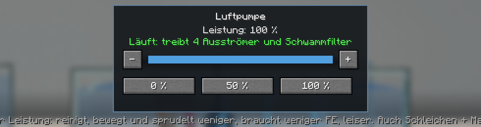

---
navigation:
  title: Leistungsregler
  icon: minecraft:comparator
  parent: equipment.md
  position: 37
---

# Leistungsregler

Filter, [Ausströmer](air_stone.md), [Luftpumpen](air_pump.md) und Strömungspumpen können mit **0 bis 100 %** laufen
(in Schritten von 10 %).

* **Schleichen + Mausrad**, während du das Gerät ansiehst, ändert um 10 %.
* **Rechtsklick** auf eine Luftpumpe, einen Ausströmer oder ein Gerät im Innenraum (Innen-, Eck- oder Schwammfilter,
  Strömungspumpe) öffnet ein kleines Regler-Fenster. Außenfilter und Schrankfilter haben einen Knopf in ihrem Menü
  (Klick +10 %, Schleichen + Klick -10 %).

Weniger Leistung heißt:

* **weniger Wirkung:** ein Filter mit 50 % reinigt halb so viel Wasser, eine Strömungspumpe bewegt halb so viel, ein
  Ausströmer bringt halb so viel Sauerstoff; der Wasserstrahl ist kürzer;
* **weniger Energie**, wenn der Server dafür Strom verlangt (siehe [Strom](power.md));
* **leiser:** der Sound folgt der Leistung. Jeder Spieler kann außerdem die Lautstärke je Geräteart in der Client-Config
  einstellen (`sound.filterVolume`, `airPumpVolume`, `airStoneVolume`, `flowPumpVolume`, `feederVolume`).

Bei 0 % steht das Gerät still. Ein Server kann den Regler abschalten (`features.powerRegulator`): dann läuft alles mit
100 %.
