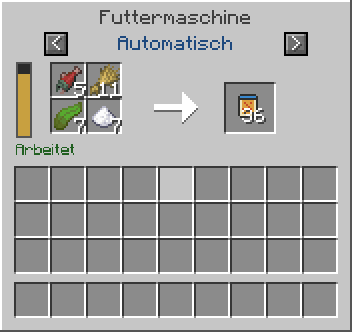

---
navigation:
  title: Futtermaschine
  icon: bettacraft:food_maker
  parent: food.md
  position: 30
item_ids:
  - bettacraft:food_maker
---

# Futtermaschine

<ItemImage id="bettacraft:food_maker" scale="2" />

Die Futtermaschine stellt Fischfutter in **Portionen** aus Vanilla-Zutaten und Lebendfutter her. Lege die Zutaten in
ihre vier Eingänge; nach einer Portion (10 Sekunden) liegt das Futter in der Ausgabe.

* **Produkt:** mit **\<** und **\>** wählen oder auf **Automatisch** lassen: dann macht sie das Rezept mit den meisten
  Zutaten, die in den Eingängen liegen (Fisch, Weizen, Seetang und Zucker geben Flocken, keine Pellets).
* **Feder:** Ohne Strom läuft sie mit einer Feder. **Schleichen + Rechtsklick mit leerer Hand** zieht sie auf: die Kurbel
  dreht sich um eine Vierteldrehung und die Ratsche klickt. Achtmal Aufziehen füllt sie, und eine volle Feder arbeitet
  **einen Spieltag** lang (`foodMaking.springTicks`). Der Balken links zeigt, wie viel noch übrig ist.
* **FE:** Solange eine Strom-Option an ist (`pipes.pumpsRequireEnergy` oder die `power.*`-Optionen des Aquariums), hat
  sie keine Feder und braucht beim Arbeiten `foodMaking.makerFePerTick` FE pro Tick; der Balken zeigt die gespeicherte FE.
* Ein Redstone-Signal pausiert sie. Ein Komparator liest, wie voll die Ausgabe ist.

| Futter | Portion | Zutaten |
|---|---|---|
| Betta-Pellets | 12 | roher Fisch, Weizen, getrockneter Seetang |
| [Flockenfutter](food_variety.md) | 12 | roher Fisch, Weizen, Seetang, Zucker |
| [Granulatfutter](food_variety.md) | 12 | Spinnenauge, 2 Weizen, getrockneter Seetang |
| Futtertabletten | 8 | 2 getrockneter Seetang, ein Gemüse (Karotte, Kürbis, Melone, Rote Bete), Weizen |
| [Garnelenfutter](food_variety.md) | 8 | Seetang, ein Gemüse, Knochenmehl |
| [Staubfutter](fry_food.md) | 8 | Ei, Weizen |
| [Frostfutter](food_variety.md) | 4 | 4 Mückenlarven, Artemia-Nauplien oder Daphnien und Eis (auch Packeis, Blaueis, Schnee) |

Die Rezepte sind Daten (`bettacraft:food_maker`), Modpacks können eigene hinzufügen; JEI zeigt sie.

## Automatisierung

Trichter, Rohre anderer Mods und die Lager-Mods nutzen die Maschine ohne besondere Einrichtung: Gegenstände gehen von
allen Seiten in die Eingänge und nur das Futter kommt aus der Ausgabe. Ein **Export-Bus** oder Interface von **AE2** und
ein **Import-Bus** oder der **Importer und Exporter von Refined Storage** befüllen und leeren sie; steht sie auf
Automatisch, muss ein Verarbeitungsmuster nur die Zutaten hineinlegen. Der [Futterautomat](../equipment/feeder.md) und der
[Vorratsbehälter](../equipment/top_off.md) funktionieren mit diesen Mods genauso.

## Bezug

Herstellung:

<RecipesFor id="bettacraft:food_maker" />
