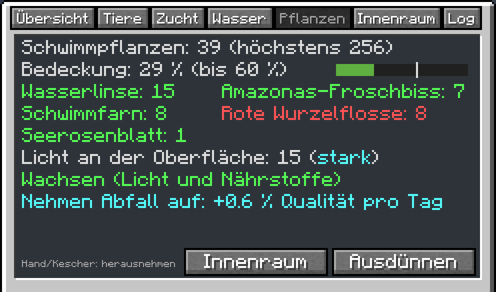

---
navigation:
  title: Schwimmpflanzen
  icon: bettacraft:amazon_frogbit
  parent: plants.md
  position: 60
---

# Schwimmpflanzen

Schwimmpflanzen treiben auf der **Wasseroberfläche** eines Aquariums. Sie sind keine Blöcke: Wende eine auf das
Aquarium an, dann schwimmt sie dort, wo du auf das Wasser schaust. Sie wachsen mit Licht und Nährstoffen, bilden
Ableger, nehmen Abfallstoffe aus dem Wasser auf und bieten dem Männchen einen guten Platz für sein Schaumnest. Hornkraut hat keine Wurzeln: seine Triebe hängen tief ins Wasser. [Riccia](riccia_fluitans.md) schwimmt auch (oder wird auf Stein und Holz gebunden).

## Arten

| | Pflanze | Wachstum | Nestplatz |
|---|---|---|---|
| <ItemImage id="bettacraft:duckweed" /> | [Wasserlinse](duckweed.md) | sehr schnell | mäßig |
| <ItemImage id="bettacraft:amazon_frogbit" /> | [Amazonas-Froschbiss](amazon_frogbit.md) | mittel | der liebste |
| <ItemImage id="bettacraft:salvinia" /> | [Schwimmfarn](salvinia.md) | schnell | gut |
| <ItemImage id="bettacraft:red_root_floater" /> | [Rote Wurzelflosse](red_root_floater.md) | mittel | gut |
| <ItemImage id="bettacraft:water_lettuce" /> | [Muschelblume](water_lettuce.md) | mittel | gut |
| <ItemImage id="bettacraft:hornwort" /> | [Hornkraut](hornwort.md) | sehr schnell | mäßig |
| <ItemImage id="bettacraft:riccia_fluitans" /> | [Teichlebermoos (Riccia)](riccia_fluitans.md) | schnell | der liebste |

## Wachstum

* Pflanzen brauchen **Licht**: eine eingeschaltete [Aquarienleuchte](../equipment/light.md) auf dem Aquarium (starkes
  Licht) oder Tageslicht von oben. Glas hält das Licht nicht ab, eine Abdeckung oder ein voller Block darüber schon. Im
  Dunkeln wachsen sie nicht.
* Sie brauchen **Nährstoffe**: den Abfall der Tiere im Wasser ([Wasserqualität](../aquarium/water_quality.md)). In sehr sauberem
  Wasser wachsen sie langsam, in einem Aquarium mit Tieren schneller.
* Eine ausgewachsene Pflanze bildet neben sich einen **Ableger**, bis die Blätter **60 %** der Oberfläche bedecken.
* Solange sie Licht haben, **nehmen die Pflanzen Abfall auf**: Das Wasser bleibt etwas länger sauber (kein Ersatz für
  Filter und Wasserwechsel).
* Die **Rote Wurzelflosse** färbt sich unter starkem Licht (Aquarienleuchte oder volles Tageslicht) in etwa einem
  Vierteltag rot, unter schwachem Licht wieder grün.
* Die Pflanzen treiben langsam über die Oberfläche, schieben sich gegenseitig zur Seite und weichen der Stelle aus, an
  der der Strahl eines [Außenfilters](../equipment/filters.md) ins Wasser trifft. In einer [freien Form](../aquarium/shapes.md)
  bleiben sie über dem Wasser und treiben nie in eine Aussparung oder über eine abgeschlossene Stufe.

## Herausnehmen

* **Rechtsklick** mit **leerer Hand** beim Blick von oben auf die Oberfläche: nimmt die Pflanzen heraus, auf die du
  schaust (du bekommst sie als Items). Wo keine Pflanze schwimmt, öffnet sich wie gewohnt das Aquarium-Menü.
* Der <ItemLink id="bettacraft:tank_net" /> nimmt die Pflanzen heraus, auf die du schaust – aus **jedem Winkel**,
  auch von der Seite durch das Glas; **Schleichen** mit dem Kescher dünnt das ganze Aquarium um die Hälfte aus
  (Seerosenblätter bleiben). Auf eine Garnele, einen Krebs, eine Schnecke, ein Gelege oder einen abgelegten Panzer
  gezielt, holt er diese heraus, und in offenem Wasser [fängt er Kleintiere](../getting_started/catching.md).
* Der Tab **Pflanzen** im [Aquarium-Menü](../aquarium/menu.md): Anzahl, Bedeckung, Licht, Wachstum, Abfallaufnahme und ein Knopf
  **Ausdünnen**.

* Wird der letzte Block eines Aquariums abgebaut, fallen seine Pflanzen als Items heraus.

## Nest und dichte Decke

* Das Männchen baut sein [Schaumnest](../bettas/breeding.md) unter der **dichtesten Gruppe** Schwimmpflanzen, am liebsten unter
  Froschbiss.
* Schwimmpflanzen (ab 10 % Bedeckung) machen das Männchen etwas schneller bereit für ein Nest (1,15-fach).
* **Dichte Decke** (ab 50 %): Menü und Info-Anzeigen warnen, die Pflanzen beschatten sich und wachsen langsamer, und
  etwas Futter aus dem [Futterautomaten](../equipment/feeder.md) bleibt auf den Blättern liegen und verrottet im
  Wasser. Dünne sie ab und zu aus.

Alle Werte lassen sich in der Server-Config ändern (`floatingPlants.*`): Wachstumsgeschwindigkeit (0 = kein
Wachstum), höchste Bedeckung, dichte Decke, Abfallaufnahme, Zuchtbonus, Futter auf den Blättern, die Chancen der
Flasche und beim Angeln.
