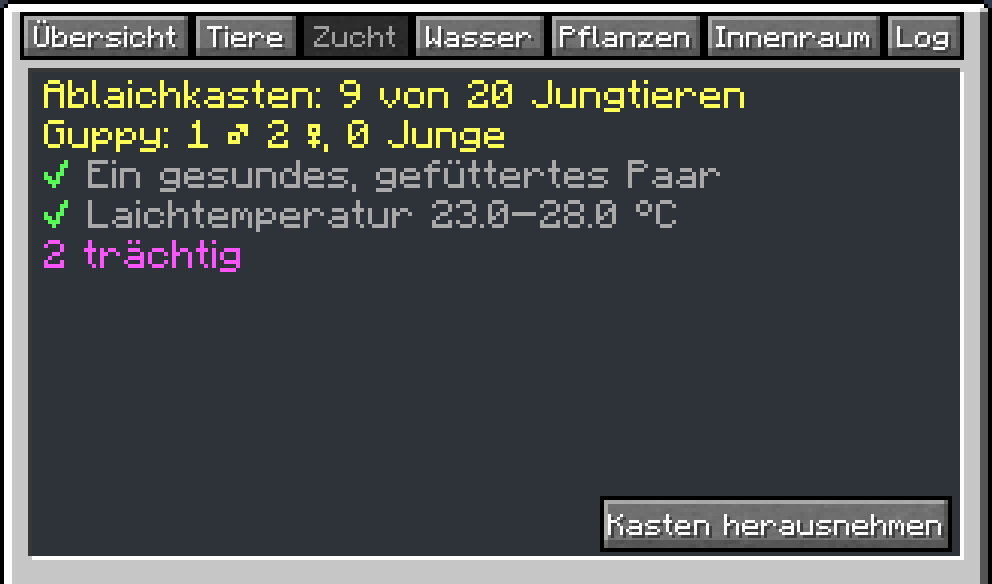

---
navigation:
  title: Zucht der Beifische
  icon: bettacraft:breeding_box
  parent: tankmates.md
  position: 2
item_ids:
  - bettacraft:breeding_box
  - bettacraft:fry_powder
  - bettacraft:algae_wafer
  - bettacraft:spawning_cave
  - bettacraft:spawning_mop
  - bettacraft:decor_spawning_cave
  - bettacraft:decor_spawning_mop
---

# Zucht der Beifische

Jede Art vermehrt sich auf ihre Weise. Was alle brauchen: ein **gesundes, gefüttertes Paar** Erwachsener, die
**Laichtemperatur** ihrer Art (der Tab Zucht nennt sie) und Platz im Becken (ein volles Becken bekommt keinen
Nachwuchs). Lebendfutter (Mückenlarven) macht sie schneller laichbereit. Der Tab Zucht im [Tank-Menü](../aquarium/menu.md)
zeigt die Bedingungen und die Gelege jeder Art im Becken.

## Eier am Glas: Panzerwelse, Otocinclus

* **Panzerwelse laichen nach einem kühlen Wasserwechsel**: Ersetze innerhalb eines Vierteltags mindestens ein Viertel
  des Wassers durch frisches, das das Becken um 1,5 °C abkühlt (frisches Wasser hat Umgebungstemperatur;
  `coolChangeShare`, `coolChangeDrop`). Das Logbuch vermerkt den kühlen Wasserwechsel; einen Tag lang sind die
  Panzerwelse in Stimmung.
* Das Weibchen klebt seine Eier in kleinen Gruppen ans **Glas**, an Deko und breite Blätter. Nach einem Tag schlüpfen
  sie, einen halben Tag später schwimmen die Jungen frei.
* Die anderen Fische fressen die Eier: Nimm ein Gelege mit dem **Kescher** heraus (darauf zielen; es kommt in eine leere
  Fischtüte) und setze es per Rechtsklick in ein Becken ohne Erwachsene, um die Jungen aufzuziehen.
* Otocinclus legen ab und zu ein paar Eier, auch ohne Wasserwechsel.

## Höhlen: Harnischwelse

* L134, L046 und der Antennenwels brauchen eine <ItemLink id="bettacraft:decor_spawning_cave" /> im
  [Innenraum](../interior.md) (oder eine eigene Höhle aus <ItemLink id="bettacraft:spawning_cave" />, ab 20
  zusammenhängenden Blöcken). Jedes erwachsene Männchen besetzt eine Höhle; Männchen ohne Höhle werden vertrieben.
* Ein Paar laicht in der Höhle, das **Männchen bewacht** Eier und Larven; dort sind sie sicher vor den anderen Fischen.
  Ohne das Männchen geht das Gelege ein.

## Freilaicher: Salmler, Bärblinge, Dornaugen

* Bei Laichtemperatur streut ein Paar seine Eier in **feinblättrige Pflanzen** (Rotala, Ludwigia, Alternanthera,
  Javamoos, Mini Needle) oder einen <ItemLink id="bettacraft:decor_spawning_mop" /> (drei
  <ItemLink id="bettacraft:spawning_mop" /> und ein Stein). Keilfleckbärblinge laichen stattdessen unter **breite
  Blätter**.
* **Die Eltern fressen die Eier**, alle anderen Fische auch: Im Laichmop sind 80 % außer Reichweite, in dichten Pflanzen
  viele. Ohne Pflanzen oder Mop fallen die Eier auf den kahlen Boden und werden gefressen.
* Die Eier schlüpfen nach einem Drittel Tag, die Jungen schwimmen einen halben Tag später frei.

## Lebendgebärende: Guppys, Endler, Platys

* Ein Weibchen mit einem Männchen wird **trächtig** (das Menü zeigt, wie weit) und bringt nach 3 Tagen lebende Junge zur
  Welt (`gestationDays`).
* Die Erwachsenen fressen die Jungfische. Ein <ItemLink id="bettacraft:breeding_box" /> fängt sie auf: Rechtsklick
  damit auf das Becken, er hängt innen an der Frontscheibe; die Jungen, die geboren werden, solange er dort hängt, sind
  sicher, bis sie Juvenile sind, dann schwimmen sie heraus (höchstens 20). Herausnehmen im Tab Zucht.

## Schaumnest: Zwergfadenfisch

* Wie beim [Betta](../breeding.md): Das Männchen baut ein Schaumnest an der Oberfläche (Schwimmpflanzen helfen), das
  Weibchen laicht hinein, danach bewacht das Männchen das Nest und vertreibt sie - nimm sie heraus.

## Prachtschmerlen

* Sie vermehren sich im Aquarium nicht (in der Natur wandern sie zum Laichen). Jede Prachtschmerle kommt aus dem Kescher
  oder vom Händler.

## Jungfischfutter

* <ItemLink id="bettacraft:fry_powder" /> ernährt die Jungfische aller Arten (auch Betta-Junge) im ganzen
  Jungfisch-Stadium; aus zwei Betta-Pellets und Knochenmehl. Infusorien und Artemia gehen wie bei den Bettas.
* <ItemLink id="bettacraft:algae_wafer" /> für die Bodenfische: getrockneter Seetang und Pellets.
