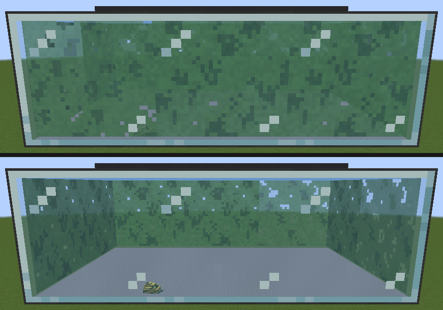

---
navigation:
  title: Algae
  icon: minecraft:green_dye
  parent: aquarium.md
  position: 50
---

# Algae and the algae scraper

A green film grows on the **inside of the glass**, one glass face at a time, in four stages. It dims the view into the
tank.

## What makes it grow

* **Light**: a lit tank light, or daylight on an open tank. In the dark nothing grows.
* **Waste** in the water: dirty water feeds the algae.
* **Time**: about four days from clean to green in a bright, dirty tank.
* Plants in the interior take the nutrients away, floating plants shade the glass: both slow the algae down.

## The cleaning crew

Snails and shrimp graze the algae, and the algae they eat feed them:

| Animal | Glass faces grazed per day |
|---|---|
| nerite | 1.6 - 2 |
| apple snail | 1.5 |
| ramshorn | 0.6 |
| bladder snail | 0.3 |
| shrimp | 0.08 |
| crayfish | 0.03 |

A 4 x 2 x 2 aquarium has 24 glass faces under water: **three nerites** keep it clean, even under a strong light. The menu
shows how much the crew grazes and how much grows.

## Algae scraper

<RecipeFor id="bettacraft:algae_scraper" />

* **Right-click** a glass face of the tank: that face is clean.
* **Sneak + right-click**: the whole side of the tank.
* It wears a little for every face it cleans.
