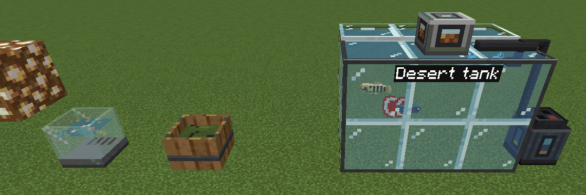
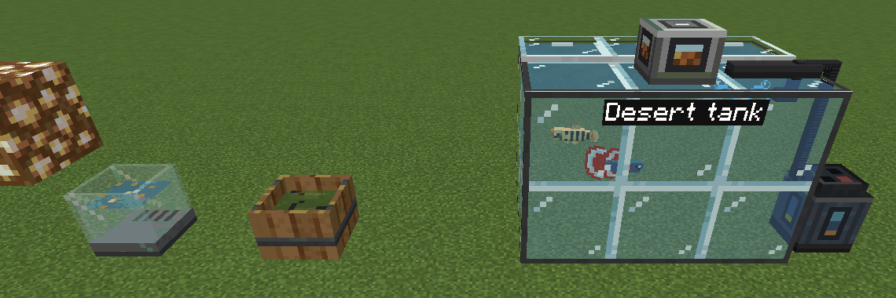
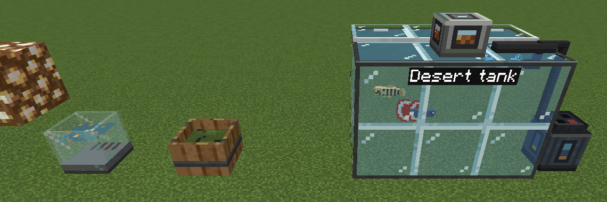

---
navigation:
  title: Floating plants
  icon: bettacraft:amazon_frogbit
  parent: aquarium.md
  position: 17
item_ids:
  - bettacraft:duckweed
  - bettacraft:amazon_frogbit
  - bettacraft:salvinia
  - bettacraft:red_root_floater
---

# Floating plants

Floating plants drift on the **water surface** of an aquarium. They are no blocks: use one on the aquarium and it floats
where you look at the water. They grow with light and nutrients, put out offshoots, take up waste from the water and
give the male a good place for his bubble nest.

## The four species

| | Plant | |
|---|---|---|
| <ItemImage id="bettacraft:duckweed" /> | <ItemLink id="bettacraft:duckweed" /> | tiny leaves in small patches, grows fastest: the starter plant |
| <ItemImage id="bettacraft:amazon_frogbit" /> | <ItemLink id="bettacraft:amazon_frogbit" /> | round leaves, long roots hanging into the water; males like it most for the nest |
| <ItemImage id="bettacraft:salvinia" /> | <ItemLink id="bettacraft:salvinia" /> | small paired, hairy leaves; robust, medium growth |
| <ItemImage id="bettacraft:red_root_floater" /> | <ItemLink id="bettacraft:red_root_floater" /> | small round leaves and red roots; **red under strong light**, green under weak light; rare and slow |

A vanilla **lily pad** used on an aquarium becomes a small lily pad on the surface. It stays where you put it and does
not multiply.

## Getting them

There is no crafting recipe. You find floating plants in the wild and then grow your own:

* **Swamp water:** filling a glass bottle from the water of a swamp sometimes brings up a bit of **duckweed** as well
  (15 % by default), see [Food](../food.md).
* **Fishing** in swamps and mangrove swamps sometimes brings up a floating plant instead of a fish (6 %): duckweed,
  salvinia or frogbit, in **mangrove swamps rarely the red root floater**.
* The **wandering trader** sells Amazon frogbit and salvinia, sometimes the red root floater.
* **Propagation:** once a tank has plants they multiply; take some out and put them into the next tank.

## Growing

* Plants need **light**: a lit [tank light](../equipment/light.md) on the aquarium (strong light) or daylight from above.
  Glass does not block the light, a lid or a full block above does. In the dark they do not grow.
* They need **nutrients**: the waste of the animals in the water ([water quality](water_quality.md)). In very clean
  water they grow slowly, in a tank with animals faster.
* A full-grown plant puts out an **offshoot** next to itself, until the leaves cover **60 %** of the surface.
* While they have light the plants **take up waste**: the water stays clean a little longer (no replacement for a
  filter or a water change).
* The **red root floater** turns red over about a quarter of a day under strong light (a tank light or full daylight),
  and green again under weak light.
* The plants drift slowly over the surface, push each other aside and keep away from where the jet of an
  [external filter](../equipment/filters.md) hits the water. In a [free shape](shapes.md) they stay over the water and
  never drift into a notch or over a closed-off step.

## Taking them out

* **Right-click** the surface with an **empty hand**: takes out the plants where you look (you get them as items).
  Where no plant floats the tank menu opens as usual.
* **Shears** take out the plants where you look; **shears while sneaking** thin the whole aquarium out by half.
* The **Water** tab of the [tank menu](menu.md) has a page for the floating plants (button at the top right): number,
  cover, light, growth, waste uptake and a **Thin out** button.
* When the last block of an aquarium is broken its plants drop as items.

## Nest and dense cover

* The male builds his [bubble nest](../breeding.md) under the **densest cluster** of floating plants, frogbit most of all.
* Floating plants (from 10 % cover) make the male ready for a nest a little faster (1.15x).
* **Dense cover** (from 50 %): the menu and the info overlays warn, the plants shade each other and grow slower, and some
  pellets of the [feeder](../equipment/feeder.md) stay on the leaves and rot in the water. Thin them out now and then.

All values can be changed in the server config (`floatingPlants.*`): growth speed (0 = no growth), most cover, dense
cover, waste uptake, breeding bonus, food on the leaves, the chances of the bottle and of fishing.
