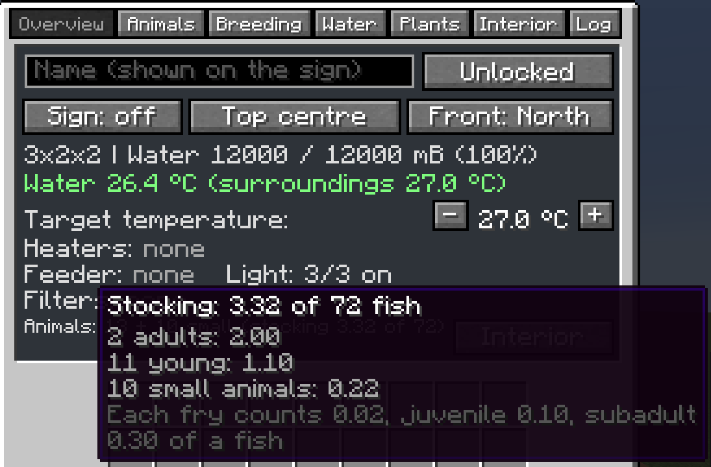

---
navigation:
  title: Inhabitants
  icon: bettacraft:fish_bag
  parent: aquarium.md
  position: 20
---

# Inhabitants

## Putting animals in

Right-click the aquarium with a **betta bucket**, any other **fish bucket** or a filled **fish bag**. The animal
appears in the water with all its data. The aquarium must be at least half full. A filled *Fish Bag* of Better Fish
Tanks (+100 mB) and a full *Fishnet* of Fintastic (no water) work as well.

Accepted is every **small water animal** (hitbox up to 0.8 x 0.8), also of other mods: fish, axolotls, tadpoles,
squids (with a fish bag, they have no bucket) and more. Refused are animals that are too big, bosses, hostile mobs, land
animals and the animals in `#bettacraft:tank_blacklist` (giant fish of other mods); the message says why. The animals in
`#bettacraft:tank_inhabitants` (e.g. the Fintastic pleco) are always welcome. Details and settings:
[Animals of other mods](other_animals.md).

Other animals keep their own behaviour and have **no needs** in the aquarium; only bettas get hungry, need warmth and
breed. Small water animals that get into the aquarium without a bucket (spawn egg, command) are adopted as well.

## Taking animals out

* **Menu:** open the tank menu, select the animal on the *Animals* tab and click *Bucket* or *Fish bag*. You need an
  empty bucket or fish bag in your inventory. A fish bag takes every animal, a bucket only those with a bucket. The button is greyed out if there is not enough water. The *Fish bag*
  button also fills an empty Better Fish Tanks fish bag (-100 mB) or a Fintastic fishnet (no water).
* **Directly:** right-click a fish in the aquarium with a water bucket, like anywhere else.

## Stocking

The stocking counts **fish**. Adults count fully, the young only a little (they are small and eat little):

| Stage | counts as | Config |
|---|---|---|
| egg, larva (in the nest) | 0 | `stocking.eggStocking`, `larvaStocking` |
| fry | 0.02 | `stocking.fryStocking` |
| juvenile | 0.1 | `stocking.juvenileStocking` |
| subadult | 0.3 | `stocking.subadultStocking` |
| adult | 1 | |

A clutch of 20 young bettas is therefore 0.4 fish as fry, 2 fish as juveniles and 6 as subadults: a big brood needs a
bigger aquarium as it grows. Young animals of other mods (a baby axolotl) count like a juvenile, small animals have
their own shares ([Stocking of the small animals](../invertebrates/stocking.md)). Hover over the animals line of the
[menu](menu.md) overview to see the parts; the *Animals* tab shows for each young betta how much it counts (hover over
its stage).

* One adult per water block is fine.
* From **2 adults per water block** the aquarium is overcrowded: the bettas get stressed and eventually sick
  (see [Health](../bettas/health.md)). The menu shows "Overcrowded!".
* At most **6 fish per water block** fit in at all (young in their fractions: no juvenile fits into a full aquarium).
  Only adults get stressed by overcrowding.
* An aquarium holds at most 64 animals in total, young ones included (`tank.maxEntities`).

## Predators

Pufferfish, axolotls and the predator fish of other mods eat small fish. See [Fights, flaring and predators](../bettas/fighting.md).

## Live prey

Small prey animals of other mods (`#bettacraft:betta_prey`: Fintastic fairy shrimp, daphnia and copepods) are live
food: a hungry betta eats one and counts as fed with live food, which also helps breeding.
