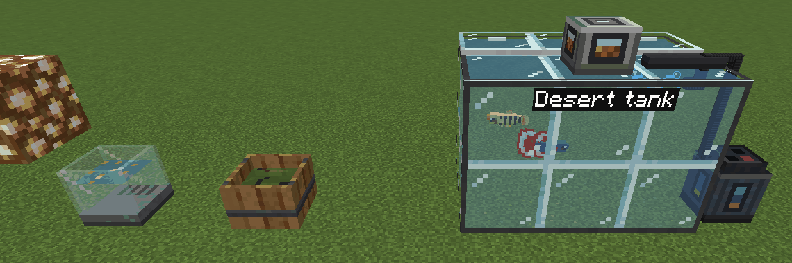

---
navigation:
  title: Water quality
  icon: bettacraft:tank_lid
  parent: aquarium.md
  position: 15
item_ids:
  - bettacraft:tank_lid
---

# Water quality and evaporation

## Water quality

Every aquarium has a **water quality** from 100 % (clean) down to 0 %. The **Water** tab of the tank menu shows it
with a bar, Jade, The One Probe and WTHIT show it when you look at the aquarium.

* The water slowly loses quality on its own (1 % per day) and faster with **more animals**: 2 bettas in 4 water
  blocks cost another 2 % per day.
* **Overfeeding:** a fish that gets food again within half a day was not hungry; its portion rots in the water.
  Feeding three times a day therefore fouls the water faster.
* **Filters** remove most of the waste (80 %) as long as they are large enough: an
  [external filter](../equipment/filters.md) keeps 32 water blocks clean, an internal filter under water 16. A smaller
  filter removes a matching part.
* **Water change:** take water out with empty buckets and pour fresh water in. Fresh water dilutes the waste; taking
  water out does not change the quality. Pipes of other mods can fill and drain the aquarium as well.

| Quality | State | |
|---|---|---|
| 85 % and more | clean | |
| 60 % to 85 % | good | |
| 35 % to 60 % | poor | the menu warns |
| below 35 % | bad | the bettas get stressed like by a wrong temperature, see [Health](../bettas/health.md) |

The tank log notes when the water becomes poor or bad. Existing aquariums start with clean water.

## Evaporation

Open aquariums slowly lose water: about **20 mB per day** for each top block at 25 °C (warmer water evaporates faster).
The waste stays in the water, so the quality drops a little, too. Top the water up with buckets now and then.

<ItemImage id="bettacraft:tank_lid" scale="2" />

A top block does not evaporate when something lies on it: an <ItemLink id="bettacraft:tank_lid" />, the
[feeder](../equipment/feeder.md), a [light](../equipment/light.md) or any full block. The Water tab shows how many top
blocks are still open.

<RecipeFor id="bettacraft:tank_lid" />

Water quality and evaporation can be switched off or made gentler in the server config (`waterQuality.*`,
`evaporation.*`).
