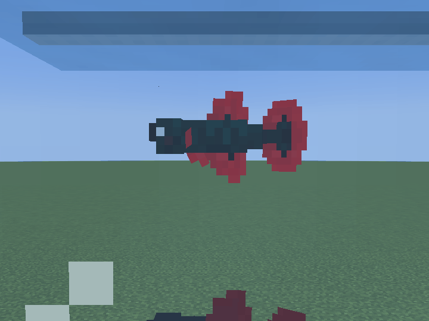

---
navigation:
  title: Betta imbellis
  icon: bettacraft:betta_bucket
  parent: bettas.md
  position: 70
---

# Betta imbellis

The "peaceful betta": a small wild betta (about 5 cm), dark with blue-green shining scales and a red crescent at the edge of the tail.

**Origin:** the peat swamps and slow waters of southern Thailand, the Malay peninsula and Sumatra.

## Keeping

* **Peaceful males:** two males flare at each other but fight only a quarter as hard as *B. splendens* males; in a large planted tank they hardly hurt each other.
* Care, food, water and breeding like every betta: a foam nest built by the male, who guards eggs and fry ([breeding](breeding.md)).
* Short fins and a round tail: the wild form. Long fins can come in from *splendens* crosses (recessive).

## Hybrids

All three species of the *Betta splendens* complex cross with each other, in the game as in nature, and the hybrids are
fertile. The colours follow the [genes](genetics.md) as always (the wild species only start with their own wild
alleles); on top every betta carries its **ancestry**, the shares of *B. splendens*, *B. imbellis* and *B. smaragdina*.
A young fish gets the mean of its parents: a cross of a pure *imbellis* and a *splendens* is 50 % each, back-crossed to
*splendens* 25 % and so on. From 7/8 on a fish counts as its species, below that it is a hybrid; the tooltip shows the
shares. The ancestry sets the size (*imbellis* 0.85, *smaragdina* 1.08 of a *splendens*) and how hard the males fight.

## Obtaining

* **Wild** in swamps: about 15 % of the wild bettas (config `features.wildBettas`).
* **[Breeding](breeding.md)**: bubble nest, eggs and fry in the aquarium.

The biomes of biome mods count too ([biome tags](../settings.md)).
