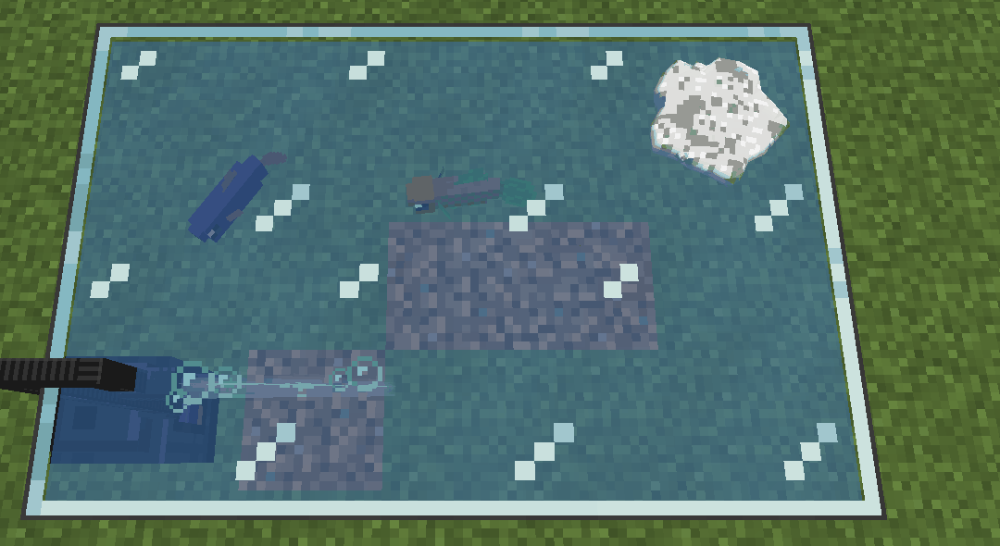
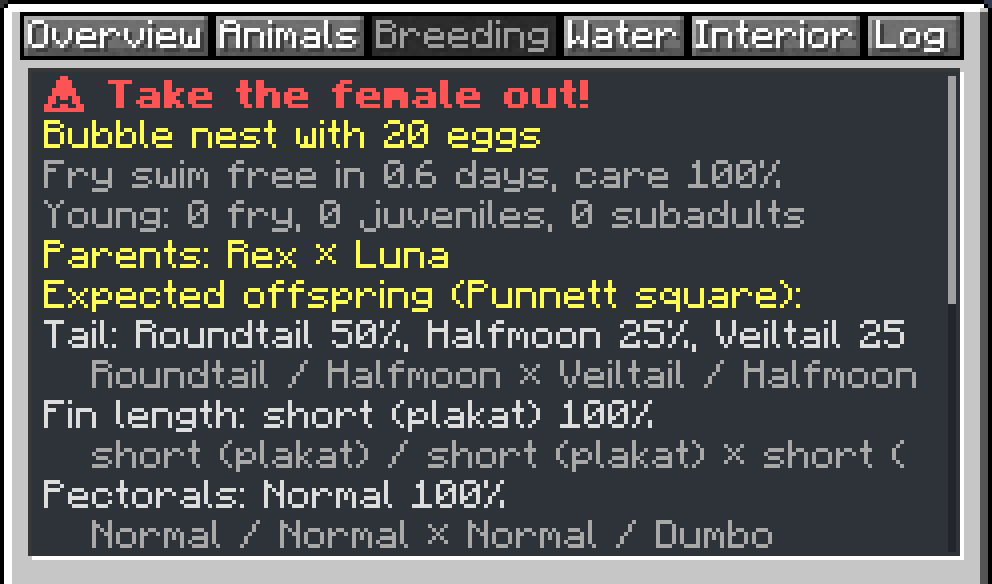

---
navigation:
  title: Breeding
  icon: minecraft:lily_pad
  parent: bettas.md
  position: 30
---

# Breeding

Bettas breed only in a Bettacraft aquarium, and the way they do it is close to real betta breeding: the **male builds
a bubble nest**, the pair spawns, and then **both parents have to leave** at the right time.

## 1. Conditions

* an **adult male and an adult female** in the aquarium,
* both **healthy**, **fed** (eaten within the last day) and with at least half of their health points,
* water at **26 to 28 °C**,
* the female has recovered from her last spawning (3 days).

When everything fits, the pair gets into breeding mood within a quarter of a day; you can see it on the female's
vertical bars. **Mosquito larvae** condition the pair for two days and make this twice as fast, and the clutch gets two
eggs more. The filter flow does not matter.

## 2. Bubble nest

The male builds a **bubble nest** at the water surface, which takes another quarter of a day. He likes to build it
under floating plants: put [floating plants](../plants/floating_plants.md) onto the surface (Amazon frogbit is his
favourite) and the nest appears under the densest cluster; without them under the **lily pad** in the
[interior](../interior.md) nearest to him. Floating plants also make him ready a little faster. A finished nest without a female falls apart after 3 days. The nest is a domed heap of foam that
reaches a little below the surface, so you can see it through the side glass too; the eggs sit in its underside, the
larvae hang from it.

## 3. Spawning

The female spawns **8 to 20 eggs** into the nest. Now **take the female out**: the male guards the nest and chases her,
she loses 2 health points per day. The menu shows "Take the female out!".

## 4. Eggs and larvae

The eggs hatch into larvae after half a day, the larvae swim free as fry after another half day. They only develop at
24 to 30 °C. While the nest holds eggs or larvae the aquarium cannot be broken.

**60 to 90 %** of the larvae survive, depending on the care during this time: half of it is the temperature (ideal
26 to 28 °C), a quarter no overcrowding and a quarter a fed male.

## 5. Fry

As soon as the fry swim free, **take the male out**: he eats about every third fry per day. The menu shows "Take the
male out! (he eats the fry)". Now feed [fry food](../food/fry_food.md) and keep the water warm; after about 8 more days
the young bettas are adult.

## The breeding tab

The breeding tab of the [tank menu](../aquarium/menu.md) shows the warnings, the nest with its eggs or larvae, all
conditions with ✔ and ✘, the young fish, the parents and the **expected offspring** of the pair for each trait, with
the genotypes of both parents. See [Genetics](genetics.md).
