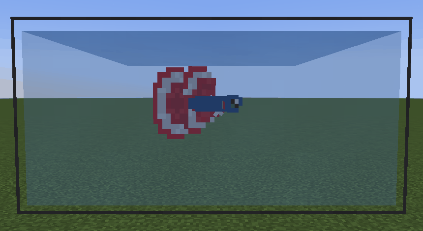

---
navigation:
  title: Fights, flaring and predators
  icon: minecraft:iron_sword
  parent: bettas.md
  position: 50
item_ids:
  - bettacraft:mirror_stick
---

# Fights, flaring and predators

## Fights

Bettas are called *Siamese fighting fish* for a reason: **two adult males in the same aquarium fight** until one of them
dies. A fight takes about one in-game day (`combat.fightDays`), so you have time to react. The tank menu, the tank log
and Jade warn you at once ("Males are fighting! Separate them."). Take one of them out with a bucket or a fish bag.

* Females do not fight each other; a male only chases females while he guards a [bubble nest](../breeding.md).
* Wild bettas do not fight in the wild. A wild male put into an aquarium does.
* Servers can turn fights off (`combat.malesFight = false`).

## Flaring

When an adult male sees another adult male within 6 blocks he **flares**: he spreads his fins and gill covers and his
colours get stronger. Glass and water do not block the view, so two males in neighbouring aquariums flare at each
other without fighting. Opaque blocks between the tanks stop it.

### Mirror stick

<RecipeFor id="bettacraft:mirror_stick" />

Hold the <ItemLink id="bettacraft:mirror_stick" /> in either hand and look at a male: every adult male within 6 blocks
in front of you that can see the mirror (also through the glass) flares at his reflection, holds still and shows
it his side: bettas see with the eyes on the sides of the head, so a displaying male stands broadside to his rival,
swaying slowly. It is mainly for show, and a little **mirror training**: a male that flared at the mirror during the last
in-game day gets ready for a bubble nest 1.25 times faster (`breeding.mirrorReadinessBonus`, 1 = purely cosmetic).
The breeding tab and the info overlays show "Trained at the mirror".

## Predators

Animals in the entity tag `#bettacraft:predators` hunt in the aquarium: the vanilla **pufferfish**, and if installed
piranha and anglerfish (Naturalist) and battlegill, wrecker and devilfish (Fish of Thieves). About four times a day
(`combat.predatorAttacksPerDay`) a predator attacks the smallest animal: young bettas and tiny animals are eaten, adults
take damage (the pufferfish poisons them). The breeding tab warns "A predator hunts the small fish!".
