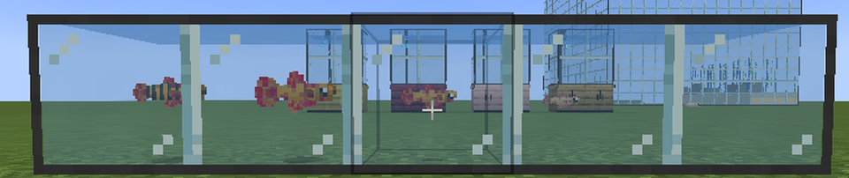

---
navigation:
  title: Life stages
  icon: minecraft:frogspawn
  parent: bettas.md
  position: 10
---

# Life stages

A betta goes through six stages. With the default settings it takes about **9 in-game days** (about 3 hours of play)
from the egg to the adult fish.

| Stage | Days | What you see |
|---|---|---|
| Egg | 0.5 | dots in the bubble nest |
| Larva | 0.5 | tiny lines hanging at the nest |
| Fry | 2 | free-swimming, a few pixels long, see-through |
| Juvenile | 2.5 | half size, faded colours |
| Subadult | 3.5 | three quarters of the full size |
| Adult | – | full size and colours |

* Eggs and larvae are not animals yet: they are part of the [bubble nest](../breeding.md) and only develop at 24 to
  30 °C.
* From the fry stage on the betta is a real animal in the tank.
* A young betta only grows while it is **fed**, the water temperature is **tolerable** (24 to 30 °C) and it is **not
  sick**. Otherwise it simply waits.
* Fry eat only [fry food](../food/fry_food.md); from the juvenile stage on they eat pellets and larvae.
* Young fish do not count for the [stocking limit](../aquarium/inhabitants.md); only adults do.

The tank menu shows the stage and its progress for every fish. The stage durations can be changed in the
[server config](../settings.md) (`stages.*Days`).
