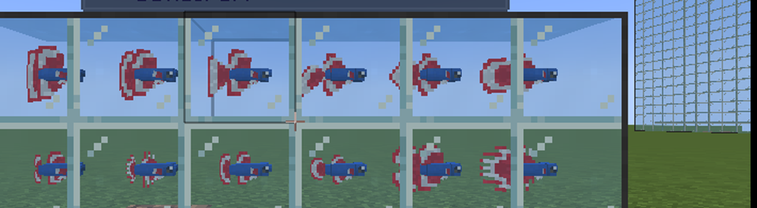
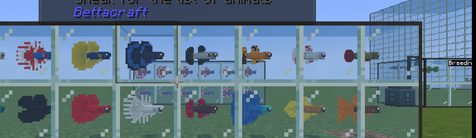

---
navigation:
  title: Types and colours
  icon: minecraft:tropical_fish
  parent: bettas.md
  position: 40
---

# Types and colours

The type name of a betta combines its fin form and its colour type, for example **Mustard Gas Halfmoon Plakat** or
**Red Butterfly Veiltail**. It is shown in the bucket tooltip, in Jade and in the tank menu.

## Fin forms

* **Tails:** Roundtail, Spadetail, Veiltail, Delta, Halfmoon, Rosetail, Crowntail and Doubletail.
* **Fin length:** short-finned fish are called **Plakat** ("Halfmoon Plakat", "Crowntail Plakat"); a short-finned
  roundtail is simply "Plakat", the form of the wild type.
* **Dumbo:** big pectoral fins, added to the name ("Halfmoon Dumbo").

## Colour types

These **named varieties** are recognised (the first matching one wins):

| Variety | Looks like |
|---|---|
| Wild Type | short round fins, olive, bronze, brown or smoky body |
| Koi Galaxy | koi pattern with strong iridescence |
| Nemo | orange, yellow or red with a koi or marble pattern |
| Samurai | black or dark blue body with silver or white dragon scales |
| Black Orchid | black body, dark fins, butterfly or tipped, blue sheen |
| Mustard Gas | dark blue or green body with yellow or orange fins |
| Thai Flag | blue body, red fins, white butterfly band |
| Cambodian | pale body with red fins |
| Chocolate | brown body with yellow or orange fins |
| Pineapple | yellow with brown dragon scales or grizzle |
| Full Mask | mask pattern with strong iridescence |
| Hellboy | red with black dragon scales |
| Super Red | completely red, no pattern |
| Platinum White | white or platinum, solid or galaxy |
| Melano Black | completely black |
| Avatar | dark blue or green galaxy with strong iridescence |

Other fish get a generic name: "Solid Red", "Red/Blue Bicolor", "Red Butterfly" or "Metallic ..." for fish with strong
iridescence.

## Patterns

Butterfly (band on the fins), marble (patches), dragon scale (shiny scales), koi (patches), mask (iridescent face),
fade, grizzle, tipped (pale fin edges), piebald (pale head), dalmatian (spots) and galaxy (glitter dots).
