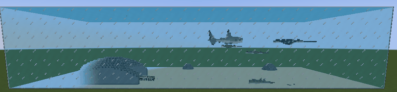

---
navigation:
  title: Big tanks
  icon: bettacraft:transport_tub
  position: 75
---

# Big tanks and big animals

Tanks can grow up to **32 × 16 × 32 blocks** (config `bigTankRules.bigMaxSize*`). Such a tank holds the **big animals**:
giant catfish, sharks, rays and even the vanilla **dolphin**. Small fish go into any tank as before; a big animal only goes
into a tank that is big enough for it.

## The size rule

An animal of known length needs, per metre of its length:

* **12 blocks** along the longer side of the tank, **6 blocks** along the shorter side and **3 blocks** of height;
* **100 water blocks** per cubic metre of its length, for each big animal (they add up).

So a 1 m pangasius or bamboo shark needs at least 12 × 6 blocks and 3 blocks of height (100 water blocks), a 2.6 m dolphin
32 × 16 blocks and 8 blocks of height (about 1760 water blocks; two dolphins fit into 32 × 16 × 8). When a tank is too
small, the message names the size the animal needs. The factors are in the config (`bigAnimalRules.*`).

Whales, bosses and hostile mobs never go into a tank; animals of other mods count as big when they are in the tag
`#bettacraft:big_tank_animals` (their length comes from their size).

## The interior of a big tank

A tank longer than **16 blocks** gets a smaller interior scale: **8** instead of 16 (and **4** from 33 blocks), so its
interior stays about 256 blocks long (`bigTankRules.interiorScale8Above`, `interiorScale4Above`). Tanks up to 16 blocks keep
scale 16.

When a tank with a decorated interior **grows past 16 blocks**, its interior is **shrunk** into the coarser one: every
cube of 2 × 2 × 2 blocks becomes one block (the most common one), so the layout stays at half the size. Nothing is lost:
the blocks that do not stay, devices with block entities, chests with their contents and the aquarium plants (whole, with
their stage) come out as items in front of the tank, packed into chests when there are many. Paid substrate beyond the new
floor comes back too.

## Dolphins

The vanilla dolphin lives only in a **very large sea water tank** (from 32 × 16 × 8 blocks, salt from 25 ‰). In the tank
it breathes at the surface and stays wet by itself. Feed it **raw fish** by right-clicking the tank with it, or put raw
fish into a [feeder](equipment/feeder.md) on the tank: at each feeding every dolphin that has not had fish for a while gets
one. A dolphin that has gone a day without fish **hunts the small fish** of its tank (tankmates, bettas, frogs; one a
day); after two days without fish (`bigAnimalRules.dolphinHungryDays`) it loses health, also in too fresh water. Catch one
with the [large net](big_tanks/large_net.md) into a [transport tub](big_tanks/transport_tub.md).

## Catching and carrying

Big animals do not go into buckets or fish bags. Catch them with the [large net](big_tanks/large_net.md) or, while
fishing, with a [steel leader](big_tanks/steel_leader.md), always into an empty [transport tub](big_tanks/transport_tub.md),
which carries one animal and slows you down while you carry it. Take a big animal out of a tank in the tank menu (an
empty transport tub in your inventory).

Big animals eat the small fish, young bettas and shrimp of their tank; keep them with fish of their own size. They swim
in wide curves and turn slowly.

## Freshwater giants

Besides the [pangasius](big_tanks/pangasius.md) four more giants live in fresh water: the predatory
[redtail catfish](big_tanks/redtail_catfish.md) and the [arapaima](big_tanks/arapaima.md), an air breather, from the
jungle waters, the [wels catfish](big_tanks/wels_catfish.md) of cool rivers (no heater needed) and the
[motoro stingray](big_tanks/motoro_stingray.md), which glides over the sand and lies on it. The catfish rest on the ground
by day. Only the stingray breeds in a tank: it bears live young, as many as the size rule leaves room for.

## Giants of the sea

Five big animals live in **sea water** tanks: the [bamboo shark](big_tanks/bamboo_shark.md), a small bottom shark that
lays **egg cases** ("mermaid's purses") under the decoration, the [blacktip reef shark](big_tanks/blacktip_reef_shark.md),
which has to keep swimming and eats every small fish, the [spotted eagle ray](big_tanks/spotted_eagle_ray.md) and the
schooling [cownose ray](big_tanks/cownose_ray.md), which fly through the open water with slow wing beats, and the
[honeycomb moray](big_tanks/honeycomb_moray.md), which lives in a lair under the decoration and comes out at night and for
food. They live wild in warm (the cownose ray also in lukewarm) oceans.

## In this chapter

<SubPages icons={true} />

## Big animals

| Species | °C | Shoal | Betta tank | Breeding |
|---|---|---|---|---|
| <ItemImage id="bettacraft:pangasius_spawn_egg" /> [Pangasius](big_tanks/pangasius.md) | 22–30 | – | no (eats them) | Does not breed in a tank |
| <ItemImage id="bettacraft:redtail_catfish_spawn_egg" /> [Redtail Catfish](big_tanks/redtail_catfish.md) | 20–28 | – | no (eats them) | Does not breed in a tank |
| <ItemImage id="bettacraft:wels_catfish_spawn_egg" /> [Wels Catfish](big_tanks/wels_catfish.md) | 4–26 | – | no (eats them) | Does not breed in a tank |
| <ItemImage id="bettacraft:arapaima_spawn_egg" /> [Arapaima](big_tanks/arapaima.md) | 24–31 | – | no (eats them) | Does not breed in a tank |
| <ItemImage id="bettacraft:motoro_stingray_spawn_egg" /> [Motoro Stingray](big_tanks/motoro_stingray.md) | 24–30 | – | no (too big) | Bears live young |
| <ItemImage id="bettacraft:bamboo_shark_spawn_egg" /> [Brownbanded Bamboo Shark](big_tanks/bamboo_shark.md) | 22–28 | – | no (too big) | Lays egg cases |
| <ItemImage id="bettacraft:blacktip_reef_shark_spawn_egg" /> [Blacktip Reef Shark](big_tanks/blacktip_reef_shark.md) | 24–30 | – | no (eats them) | Does not breed in a tank |
| <ItemImage id="bettacraft:spotted_eagle_ray_spawn_egg" /> [Spotted Eagle Ray](big_tanks/spotted_eagle_ray.md) | 24–29 | – | no (too big) | Does not breed in a tank |
| <ItemImage id="bettacraft:cownose_ray_spawn_egg" /> [Cownose Ray](big_tanks/cownose_ray.md) | 18–28 | 3 | no (too big) | Bears live young |
| <ItemImage id="bettacraft:honeycomb_moray_spawn_egg" /> [Honeycomb Moray](big_tanks/honeycomb_moray.md) | 24–28 | – | no (eats them) | Does not breed in a tank |
