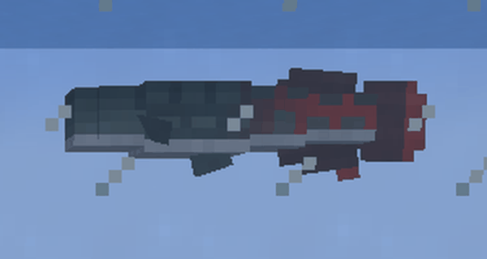

---
navigation:
  title: Arapaima
  icon: bettacraft:arapaima_spawn_egg
  parent: big_tanks.md
  position: 40
item_ids:
  - bettacraft:arapaima_spawn_egg
---

# Arapaima

One of the largest freshwater fish: a long, round body with a small, flat head, big scales that turn red towards the tail,
and the dorsal and anal fins far back next to the rounded tail. In the game it is 2 metres long; in the wild it can reach
3 m.

**Origin:** the floodplains and flooded forests of the Amazon.

## Profile

| | |
|---|---|
| Group | Bonytongues |
| Scientific name | *Arapaima gigas* |
| Size | about 2 m (4 blocks in the game) |
| Tank | at least 24 × 12 blocks, 6 high, 800 water blocks each |
| Temperature | 24–31 °C |
| Water | fresh water, hardy |
| Water chemistry | pH 5.5–7.8, TDS 0–450 ppm |
| Shoal | alone or as a pair |
| Swims | in the middle |
| Stocking | counts as 200 fish |
| Breeding | Does not breed in a tank |
| Betta tank | no (eats them) |
| Special | eats small fish, bettas and shrimp, swims wide curves, air breather: comes up to breathe at the surface |

## Keeping

* The biggest animal of the chapter: it needs a tank of at least 24 × 12 blocks and 6 blocks of height, and 800 water
  blocks of its own ([size rule](../big_tanks.md)).
* An **air breather**: every few minutes it rises to the surface for a breath. Low oxygen does not trouble it (like the
  labyrinth fish).
* Warm, soft to medium water (24–31 °C). It eats fish, bettas and shrimp.
* It breeds only in big ponds (the male guards the young in a nest pit), never in a tank.

## Obtaining

* **[Large net](large_net.md)** in jungle water: 0.57 % per swing (about 1 in 175 swings), into an empty transport tub (config `features.bigAnimals`).
* **[Steel leader](steel_leader.md)** (fishing) in jungle water: 0.71 % per catch (about 1 in 140 catches), into an empty transport tub (config `features.bigAnimals`).
* **Wild** in jungle water, in groups of 1–1 (spawn weight 1) (config `features.bigAnimals`).

The biomes of biome mods count too ([biome tags](../settings.md)).
