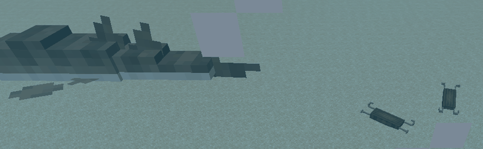
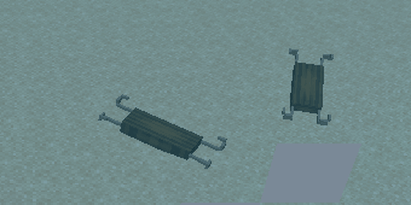

---
navigation:
  title: Bamboo shark
  icon: bettacraft:bamboo_shark_spawn_egg
  parent: big_tanks.md
  position: 60
item_ids:
  - bettacraft:bamboo_shark_spawn_egg
---

# Brownbanded bamboo shark

A small, slender shark of the reef floor: warm grey-brown with faint darker saddles (the young are boldly banded), a short
snout with two barbels, small eyes high on the head, two dorsal fins far back and a long, low tail. It grows to about 1 m.

**Origin:** reefs, lagoons and tide pools of the Indo-West Pacific.

## Profile

| | |
|---|---|
| Group | Sharks |
| Scientific name | *Chiloscyllium punctatum* |
| Size | about 1 m (2 blocks in the game) |
| Tank | at least 12 × 6 blocks, 3 high, 100 water blocks each |
| Temperature | 22–28 °C |
| Breeding temperature | 24–27 °C |
| Water | sea water, normal |
| Water chemistry | pH 7.8–8.6 |
| Shoal | alone or as a pair |
| Swims | on the bottom |
| Stocking | counts as 25 fish |
| Breeding | Lays egg cases, 1–2 young |
| Special | eats small fish and shrimp, swims wide curves, active at night |

## Keeping

* A big animal for the **sea water** tank: at least 12 × 6 blocks and 3 blocks of height, 100 water blocks of its own
  ([size rule](../big_tanks.md)). Like the pangasius it is one of the smallest big animals.
* A bottom shark: by day it lies on the ground, best under a ledge or in a rock cave; at night it hunts along the floor.
* It eats shrimp, crabs and small fish (up to 0.35 blocks), not bettas.

## Egg cases

The bamboo shark lays **egg cases** ("mermaid's purses"): a fit female with a male lays one or two at a time, under a
ledge or a cave of the decoration (else on the ground). Each leathery, dark brown case holds **one pup** that grows for
about **ten days** (four months in nature; `tankmates.clutchSpeed`). The other fish cannot eat it.

* A female only lays while the tank has room by the [size rule](../big_tanks.md) for the pups of all its cases.
* A ripe pup hatches only when there is **room for it**; until then it waits in its case (the tank log says so). Make room
  or move the case: the aquarium **net** takes it into an empty fish bag, and right-clicking another sea water tank with
  the bag puts it on that tank's floor.
* The tank menu (breeding tab) shows the cases, their days and the room left.

## Obtaining

* **[Large net](large_net.md)** in warm oceans (coral reefs): 1.1 % per swing (about 1 in 88 swings), into an empty transport tub (config `features.bigAnimals`).
* **[Steel leader](steel_leader.md)** (fishing) in warm oceans (coral reefs): 1.4 % per catch (about 1 in 70 catches), into an empty transport tub (config `features.bigAnimals`).
* **[Large net](large_net.md)** in lukewarm oceans: 1.3 % per swing (about 1 in 75 swings), into an empty transport tub (config `features.bigAnimals`).
* **[Steel leader](steel_leader.md)** (fishing) in lukewarm oceans: 1.7 % per catch (about 1 in 60 catches), into an empty transport tub (config `features.bigAnimals`).
* **Wild** in warm oceans (coral reefs), alone (spawn weight 2) (config `features.bigAnimals`).
* **Wild** in lukewarm oceans, alone (spawn weight 1) (config `features.bigAnimals`).
* **[Breeding](../big_tanks.md)**: Lays egg cases.

The biomes of biome mods count too ([biome tags](../settings.md)).
