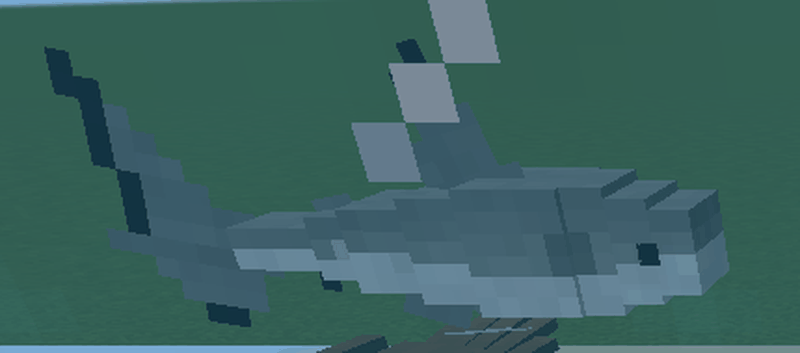

---
navigation:
  title: Blacktip reef shark
  icon: bettacraft:blacktip_reef_shark_spawn_egg
  parent: big_tanks.md
  position: 70
item_ids:
  - bettacraft:blacktip_reef_shark_spawn_egg
---

# Blacktip reef shark

The shark everyone knows from the reef: a light grey-brown torpedo with a white belly, a pale band along the flank, a tall
first dorsal fin and long pectorals, every fin with a jet black tip. It grows to 1.6 m (wild up to 1.8 m).

**Origin:** shallow coral reefs and lagoons of the Indian Ocean and the Pacific.

## Profile

| | |
|---|---|
| Group | Sharks |
| Scientific name | *Carcharhinus melanopterus* |
| Size | about 1.6 m (3.2 blocks in the game) |
| Tank | at least 20 × 10 blocks, 5 high, 410 water blocks each |
| Temperature | 24–30 °C |
| Water | sea water, normal |
| Water chemistry | pH 7.8–8.6 |
| Shoal | alone or as a pair |
| Swims | in the middle |
| Stocking | counts as 102.4 fish |
| Breeding | Does not breed in a tank |
| Special | eats small fish, bettas and shrimp, swims wide curves, must keep swimming to breathe |

## Keeping

* A big animal for a large **sea water** tank: at least 20 × 10 blocks and 5 blocks of height, 410 water blocks of its own
  ([size rule](../big_tanks.md)).
* It **has to keep swimming** to breathe (water flows over its gills only while it moves): it never rests and cruises the
  tank in wide curves day and night. Give it a long, free swimming lane.
* A predator: it eats every fish up to its own mouth size (all the small reef fish), bettas and shrimp. Keep it only with
  the other big animals.
* It bears live young in nature but practically never breeds in a tank.

## Obtaining

* **[Large net](large_net.md)** in warm oceans (coral reefs): 0.57 % per swing (about 1 in 175 swings), into an empty transport tub (config `features.bigAnimals`).
* **[Steel leader](steel_leader.md)** (fishing) in warm oceans (coral reefs): 0.71 % per catch (about 1 in 140 catches), into an empty transport tub (config `features.bigAnimals`).
* **Wild** in warm oceans (coral reefs), in groups of 1–1 (spawn weight 1) (config `features.bigAnimals`).

The biomes of biome mods count too ([biome tags](../settings.md)).
