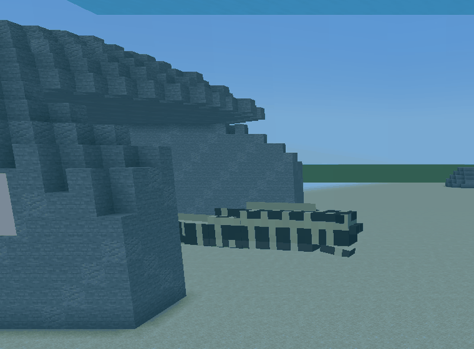

---
navigation:
  title: Honeycomb moray
  icon: bettacraft:honeycomb_moray_spawn_egg
  parent: big_tanks.md
  position: 95
item_ids:
  - bettacraft:honeycomb_moray_spawn_egg
---

# Honeycomb moray

A big moray eel: a long, muscular body without pectoral fins, close-set dark spots in a narrow pale yellow network, a tall
head with a deep mouth and one fin seam along the back that runs round the tail. 1.2 m in the game (wild up to 1.8 m).

**Origin:** reefs and rocky coasts of the Indo-Pacific.

## Profile

| | |
|---|---|
| Group | Moray eels |
| Scientific name | *Gymnothorax favagineus* |
| Size | about 1.2 m (2.4 blocks in the game) |
| Tank | at least 15 × 8 blocks, 4 high, 173 water blocks each |
| Temperature | 24–28 °C |
| Water | sea water, hardy |
| Water chemistry | pH 7.8–8.6 |
| Shoal | alone or as a pair |
| Swims | in the lower water |
| Stocking | counts as 43.2 fish |
| Breeding | Does not breed in a tank |
| Special | eats small fish, bettas and shrimp, lives in a lair under the decoration and comes out at night and for food, active at night |

## Keeping

* A big animal for the **sea water** tank: at least 15 × 8 blocks and 4 blocks of height, 173 water blocks of its own
  ([size rule](../big_tanks.md)).
* It lives in a **lair**: build it a rock cave or a ledge (decoration in the interior). It picks a sheltered spot there and
  lies in it most of the day, its body waving slowly and its mouth opening and closing - that is how it breathes, it is not
  threatening. Without decoration it takes a corner on the ground.
* At night it comes out and cruises the tank; when you feed by hand it comes out for the food.
* It swallows fish up to 0.8 blocks, bettas and shrimp: keep it with big animals only. It does not breed in a tank.

## Obtaining

* **[Large net](large_net.md)** in warm oceans (coral reefs): 1.1 % per swing (about 1 in 88 swings), into an empty transport tub (config `features.bigAnimals`).
* **[Steel leader](steel_leader.md)** (fishing) in warm oceans (coral reefs): 1.4 % per catch (about 1 in 70 catches), into an empty transport tub (config `features.bigAnimals`).
* **Wild** in warm oceans (coral reefs), alone (spawn weight 2) (config `features.bigAnimals`).

The biomes of biome mods count too ([biome tags](../settings.md)).
