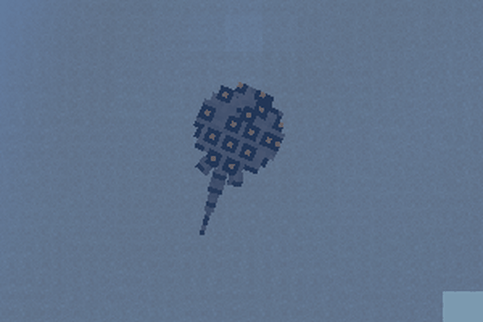

---
navigation:
  title: Motoro stingray
  icon: bettacraft:motoro_stingray_spawn_egg
  parent: big_tanks.md
  position: 50
item_ids:
  - bettacraft:motoro_stingray_spawn_egg
---

# Motoro stingray

A freshwater stingray: a round, flat disc, warm brown with orange eye spots ringed in black, small eyes on top and a thick
tail with a venomous spine. The disc grows to about 45 cm, 0.6 m with the tail.

**Origin:** the Amazon and the rivers of the Paraná basin.

## Profile

| | |
|---|---|
| Group | Rays |
| Scientific name | *Potamotrygon motoro* |
| Size | about 0.6 m (1.2 blocks in the game) |
| Tank | at least 8 × 4 blocks, 2 high, 22 water blocks each |
| Temperature | 24–30 °C |
| Breeding temperature | 26–29 °C |
| Water | fresh water, sensitive |
| Water chemistry | pH 5.5–7.5, TDS 0–300 ppm |
| Shoal | alone or as a pair |
| Swims | on the bottom |
| Stocking | counts as 5.4 fish |
| Breeding | Bears live young, 2–5 young |
| Betta tank | no (too big) |
| Special | eats small fish and shrimp, glides over the ground and lies on the substrate |

## Keeping

* A big animal: it needs a tank of at least 8 × 4 blocks and 2 blocks of height, and 22 water blocks of its own
  ([size rule](../big_tanks.md)). It needs **ground space** more than height.
* It glides low over the ground, a wave running back along the margins of its disc, and lies still on the substrate for
  long; give it fine sand and keep the middle of the floor free of decoration.
* Soft, warm and very clean water (24–30 °C): it is sensitive to waste.
* It eats worms, shrimp and small bottom fish.

## Breeding

The stingray is **livebearing**: a female carries her young about four times as long as the small livebearers and then
gives birth to **2–5 pups**. The pups are born fully formed and large, so they need room: a female only gets pregnant
while the tank has room for one more adult by the [size rule](../big_tanks.md), and only as many pups are born as there
is room for. They do not go into a breeding box, and the other fish do not eat them.

## Obtaining

* **[Large net](large_net.md)** in jungle water: 1.1 % per swing (about 1 in 88 swings), into an empty transport tub (config `features.bigAnimals`).
* **[Steel leader](steel_leader.md)** (fishing) in jungle water: 1.4 % per catch (about 1 in 70 catches), into an empty transport tub (config `features.bigAnimals`).
* **Wild** in jungle water, alone (spawn weight 2) (config `features.bigAnimals`).
* **[Breeding](../tankmates/breeding.md)**: Bears live young.

The biomes of biome mods count too ([biome tags](../settings.md)).
