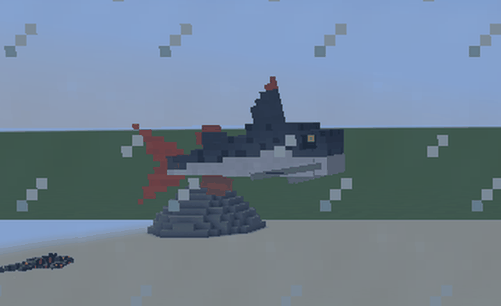

---
navigation:
  title: Redtail catfish
  icon: bettacraft:redtail_catfish_spawn_egg
  parent: big_tanks.md
  position: 20
item_ids:
  - bettacraft:redtail_catfish_spawn_egg
---

# Redtail catfish

A heavy catfish with a very broad, flat head, long barbels at the corners of its wide mouth, a dark grey back, a
cream-white band along the flank and a bright red tail. In big show tanks it grows to about 1.2 metres (in the wild up to
1.8 m).

**Origin:** the Amazon and the Orinoco.

## Profile

| | |
|---|---|
| Group | Catfish |
| Scientific name | *Phractocephalus hemioliopterus* |
| Size | about 1.2 m (2.4 blocks in the game) |
| Tank | at least 15 × 8 blocks, 4 high, 173 water blocks each |
| Temperature | 20–28 °C |
| Water | fresh water, hardy |
| Water chemistry | pH 5.5–7.8, TDS 0–500 ppm |
| Shoal | alone or as a pair |
| Swims | in the lower water |
| Stocking | counts as 43.2 fish |
| Breeding | Does not breed in a tank |
| Betta tank | no (eats them) |
| Special | eats small fish, bettas and shrimp, swims wide curves, active at night |

## Keeping

* A big animal: it needs a tank of at least 15 × 8 blocks and 4 blocks of height, and 173 water blocks of its own
  ([size rule](../big_tanks.md)).
* It rests on the ground a lot by day and hunts at dusk and at night; leave it a free stretch of ground.
* A predator that swallows everything that fits its mouth: small fish, bettas, shrimp. Keep it alone or with other giants.
* Soft to medium, warm water (20–28 °C). It does not breed in a tank.

## Obtaining

* **[Large net](large_net.md)** in jungle water: 1.1 % per swing (about 1 in 88 swings), into an empty transport tub (config `features.bigAnimals`).
* **[Steel leader](steel_leader.md)** (fishing) in jungle water: 1.4 % per catch (about 1 in 70 catches), into an empty transport tub (config `features.bigAnimals`).
* **Wild** in jungle water, alone (spawn weight 2) (config `features.bigAnimals`).

The biomes of biome mods count too ([biome tags](../settings.md)).
